# 06 · RAG (Retrieval-Augmented Generation)

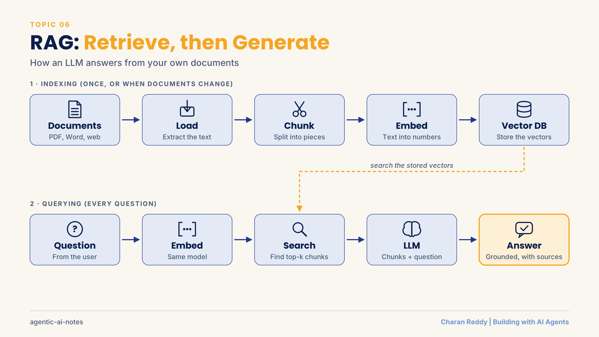

How to make an LLM answer from **your own documents**, by retrieving the right information first and generating the answer second.

> **Status:** 📘 Concepts learned, evaluation added, two demos in [`demos`](demos/README.md) · full project next.

[← Back to all topics](../README.md)

## Contents
1. [What RAG is](#1-what-rag-is)
2. [Loading documents](#2-loading-documents)
3. [Chunking](#3-chunking)
4. [Embeddings for RAG](#4-embeddings-for-rag)
5. [Vector databases](#5-vector-databases)
6. [Retrieval](#6-retrieval)
7. [Generation and grounding](#7-generation-and-grounding)
8. [RAG vs fine-tuning](#8-rag-vs-fine-tuning)
9. [Query vs prompt](#9-query-vs-prompt)
10. [Chaining with LCEL](#10-chaining-with-lcel)
11. [RAG patterns and debugging](#11-rag-patterns-and-debugging)
12. [Evaluating RAG: two scorecards](#12-evaluating-rag-two-scorecards)
13. [Retrieval metrics: Precision@k, Recall@k, MRR](#13-retrieval-metrics-precisionk-recallk-mrr)
14. [Answer metrics: faithfulness, relevancy, context precision and recall](#14-answer-metrics-faithfulness-relevancy-context-precision-and-recall)
15. [Evaluating with Ragas (and the wrong answer key trap)](#15-evaluating-with-ragas-and-the-wrong-answer-key-trap)
16. [Full pipeline in code](#16-full-pipeline-in-code)

---

## 1. What RAG is

**What it is**
A pattern where the system **searches your documents first**, then gives the most relevant pieces to the LLM to write the answer.

**How it works**
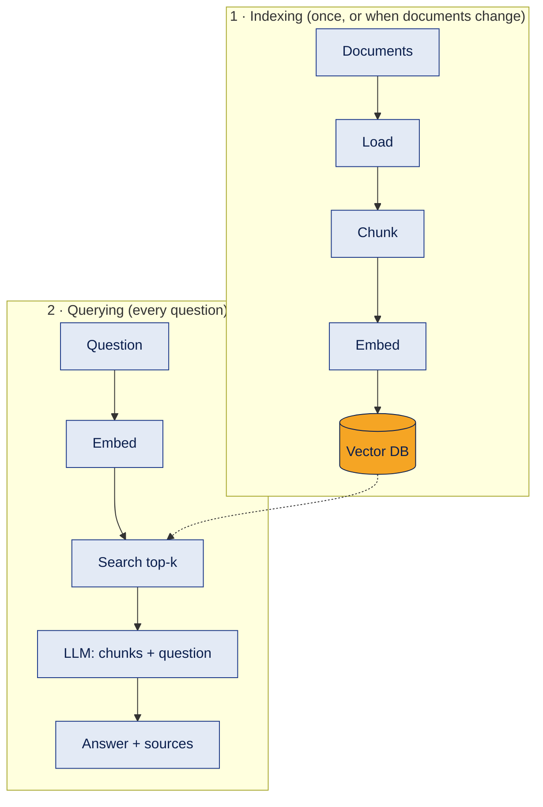

**An easy way to remember it: the open-book exam**

| Step | Plays the role of | What it does |
|---|---|---|
| **R**etrieval | The librarian | Runs to the shelves and brings back the 2 or 3 most related books. Does not answer anything. |
| **A**ugmentation | The photocopier | Copies the useful pages and staples them to your question. Nothing clever, but everything depends on it. |
| **G**eneration | The student in an open-book exam | Reads only the stapled pages and writes the answer from them. |

RAG does not make the AI smarter. It makes the AI **open-book instead of closed-book**.

**Example**
A customer asks "Can I return an opened serum?" → the system finds the return-policy section → the LLM answers using that text and cites it.

**Where it's used**
Company knowledge bots, customer support, HR/policy assistants, document Q&A, research tools.

**Common mistake**
Thinking RAG teaches the model permanently. It only supplies context for each answer; the model itself doesn't change.

**Interview questions**
1. **Q:** What is RAG? **A:** Retrieving relevant information from a knowledge source and adding it to the prompt so the LLM answers from it. (R = retrieve, A = augment the prompt, G = generate.)
2. **Q:** What problems does RAG solve? **A:** Missing private or up-to-date knowledge, and hallucination: answers become grounded in real sources.
3. **Q:** What are the two phases of RAG? **A:** Indexing (load, chunk, embed, store) and querying (embed question, retrieve, generate).
4. **Q:** Who finds the information and who writes the answer? **A:** The retriever finds it; the LLM writes the answer.
5. **Q:** Can RAG show sources? **A:** Yes. Chunks keep metadata (file, page), so answers can cite where they came from.

**In one line**
Retrieve first, generate second.

---

## 2. Loading documents

**What it is**
Extracting text (and metadata like file name and page number) from source files.

**How it works**
| Source | Example LangChain loader |
|---|---|
| PDF | `PyPDFLoader` |
| Word (.docx) | `Docx2txtLoader` |
| CSV | `CSVLoader` |
| Web page | `WebBaseLoader` |

**Example**
Loading a 40-page refund policy PDF gives 40 documents (one per page), each tagged with its page number.

**Where it's used**
The first step of every RAG pipeline. In no-code setups, tools like n8n can load files from Google Drive automatically.

**Common mistake**
Scanned PDFs are images: a normal loader returns empty text. They need OCR first. Tables also often come out messy.

**Interview questions**
1. **Q:** What does a document loader do? **A:** Reads a file and returns its text plus metadata.
2. **Q:** Why keep metadata like page numbers? **A:** For citations, filtering and debugging which source an answer came from.
3. **Q:** What's the problem with scanned PDFs? **A:** They contain images, not text, so they need OCR before loading.
4. **Q:** How would you keep a RAG system updated with new files? **A:** Re-index new or changed files on a schedule or when a file changes.
5. **Q:** Why can tables be tricky? **A:** Simple text extraction can break their structure, mixing up rows and columns.

**In one line**
Good answers start with clean text extracted from the right files.

---

## 3. Chunking

**What it is**
Splitting documents into smaller pieces before embedding them.

**How it works**
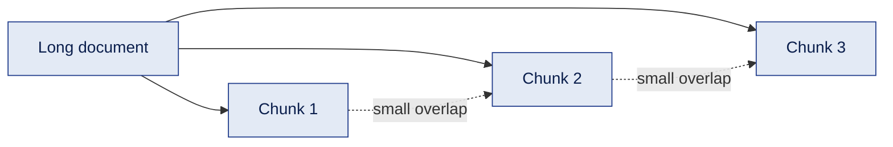
- A common starting point: about 500 to 1,000 characters per chunk, with 10 to 20% overlap.
- **Too big:** search becomes vague, and you send unnecessary text (cost).
- **Too small:** chunks lose meaning.
- Better: split on headings and paragraphs, not only a fixed character count.

**What overlap looks like** (chunk size 400 characters, overlap 100):
```text
Chunk 1: |------------------ 400 characters ------------------|
Chunk 2:                                    |------------------ 400 characters ------------------|
                                            |<-- 100 shared -->|
```
The last 100 characters of chunk 1 are repeated at the start of chunk 2, so a sentence on the border is never lost.

**Useful option:** `add_start_index=True` in LangChain's `RecursiveCharacterTextSplitter` saves where each chunk starts in the original text (in its metadata). That helps with citations and debugging.

**Example**
A refund policy split so "Returns within 7 days" and its conditions stay in the same chunk.

**Where it's used**
Every RAG system. Chunking quality often matters more than which LLM you use.

**Common mistake**
No overlap, so an important sentence gets cut in half across two chunks.

**Interview questions**
1. **Q:** Why chunk documents? **A:** Smaller pieces give more precise search and let you send only relevant text to the LLM.
2. **Q:** What is chunk overlap for? **A:** To keep context that would otherwise be split across chunk boundaries.
3. **Q:** What happens if chunks are too large? **A:** Less precise retrieval, more irrelevant text, higher cost.
4. **Q:** What happens if chunks are too small? **A:** Each chunk lacks enough context to be useful.
5. **Q:** What is structure-aware chunking? **A:** Splitting on natural boundaries like headings, sections and paragraphs.

**In one line**
Chunk size and boundaries decide what the retriever can find.

---

## 4. Embeddings for RAG

**What it is**
Converting each chunk (and later, each question) into a vector that represents its meaning.

**How it works**
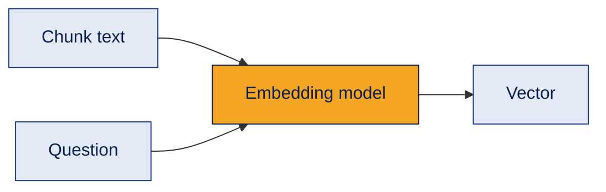
- **Tokens vs embeddings:** tokenization happens inside the model automatically; tokens matter for limits and cost. The embedding is the output: meaning as numbers.
- Use the **same embedding model** for chunks and questions.

**Example**
"Can I return it?" lands close to "Refund within 7 days" in vector space, even with no shared words.

**Where it's used**
Indexing every chunk and embedding every incoming question.

**Common mistake**
Changing the embedding model without re-indexing: old and new vectors can't be compared.

**Interview questions**
1. **Q:** Why embed both chunks and the question? **A:** So they're in the same vector space and can be compared by meaning.
2. **Q:** What happens if you switch embedding models? **A:** You must re-embed all documents; vectors from different models aren't comparable.
3. **Q:** Do you tokenize text yourself before embedding? **A:** No. The embedding model tokenizes internally.
4. **Q:** Name embedding model options. **A:** Hosted models (e.g. OpenAI embeddings) or open-source models from Hugging Face.
5. **Q:** What does embedding dimension mean? **A:** The length of the vector (e.g. hundreds to a few thousand numbers).

**In one line**
Same embedding model for documents and questions, always.

---

## 5. Vector databases

**What it is**
A database built to store vectors and quickly find the ones most similar to a query.

**How it works**
Each record stores three things:
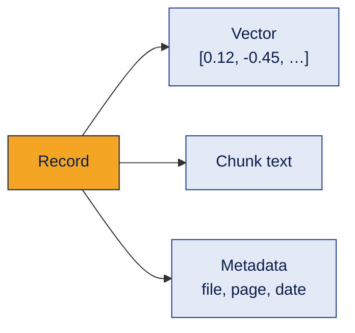

| Option | Good for |
|---|---|
| Chroma, FAISS | Learning and prototypes, run locally |
| Pinecone | Managed cloud service |
| Qdrant, Weaviate | Open-source, production |
| pgvector | Adding vectors to an existing PostgreSQL database |

**Example**
Storing 2,000 policy chunks in Chroma on a laptop for a prototype; moving to a managed service for production.

**Where it's used**
The memory/knowledge store of RAG systems and agents.

**Common mistake**
Re-creating the database on every run. Persist it and load it next time.

**Interview questions**
1. **Q:** What is a vector database? **A:** A database optimized to store embeddings and search them by similarity.
2. **Q:** What is stored alongside each vector? **A:** The original chunk text and metadata.
3. **Q:** Why not use a normal SQL database for semantic search? **A:** Standard SQL isn't built for fast similarity search over vectors (extensions like pgvector add it).
4. **Q:** Name a local and a managed vector DB. **A:** Local: Chroma or FAISS. Managed: Pinecone.
5. **Q:** How does metadata help? **A:** It enables filtering (e.g. only 2026 documents) and citations.

**In one line**
A vector DB stores meaning and finds the closest matches fast.

---

## 6. Retrieval

**What it is**
Finding the chunks most relevant to the question.

**How it works**
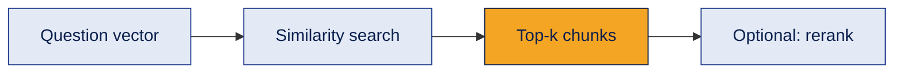

| Term | Meaning |
|---|---|
| Similarity | How close two vectors are (often cosine similarity) |
| Top-k | Number of chunks returned (often 3 to 5) |
| Metadata filter | Restrict search (e.g. one product line) |
| Hybrid search | Keyword + semantic search together |
| Reranking | Re-sorting results with a stronger model to put the best first |

**Example**
Question about "return window" → top 3 chunks: return policy, exceptions, how to request a return.

**Where it's used**
The core of RAG quality: if retrieval is wrong, the answer will be wrong.

**Common mistake**
Pure semantic search for exact terms like product codes ("SKU-4471"). Hybrid search handles exact matches better.

**Interview questions**
1. **Q:** What is top-k? **A:** The number of most-similar chunks retrieved for a query.
2. **Q:** What is cosine similarity? **A:** A measure of how similar two vectors' directions are, commonly used for comparing embeddings.
3. **Q:** What is hybrid search? **A:** Combining keyword search with semantic (vector) search.
4. **Q:** What does a reranker do? **A:** Re-scores retrieved chunks so the most relevant ones come first.
5. **Q:** What's the trade-off in choosing k? **A:** Too low may miss information; too high adds noise and cost.

**In one line**
Retrieval quality decides answer quality.

---

## 7. Generation and grounding

**What it is**
Sending the retrieved chunks and the question to the LLM, with instructions to answer **only** from that context.

**How it works**
```text
Answer the question using only the context below.
If the answer is not in the context, say "I don't know."
Cite the source for each fact.

Context:
<retrieved chunks>

Question: <user question>
```

**Example**
"Returns are accepted within 7 days if unopened (Refund Policy, page 2)."

**Where it's used**
The final step of RAG; also used by agents when they call a search tool.

**Common mistake**
No "I don't know" instruction: when retrieval misses, the model fills the gap with a made-up answer.

**Interview questions**
1. **Q:** What is grounding? **A:** Making the model base its answer on provided sources rather than its general memory.
2. **Q:** How do you reduce hallucinations in RAG? **A:** Instruct it to use only the context, allow "I don't know", cite sources, and improve retrieval.
3. **Q:** Why use low temperature for RAG answers? **A:** For consistent, factual answers.
4. **Q:** How do citations help? **A:** Users can verify answers, and developers can debug which chunk was used.
5. **Q:** What if the retrieved chunks contradict each other? **A:** Ask the model to flag the conflict and prefer the most recent/authoritative source (using metadata).

**In one line**
Answer only from the retrieved context, and say "I don't know" otherwise.

---

## 8. RAG vs fine-tuning

**What it is**
Two different ways to customize an LLM.

**How it works**
| | RAG | Fine-tuning |
|---|---|---|
| Changes | What the model **knows** for each answer | How the model **behaves** |
| Best for | Facts, policies, changing documents | Style, format, specialized task patterns |
| Updating | Easy: add or replace documents | Slower and costlier: retrain |
| Shows sources | Yes | No |

> Prompting = change instructions · RAG = supply knowledge · Fine-tuning = adapt behavior

Common fine-tuning terms: **SFT** (supervised fine-tuning), **PEFT** (training only a small part), **LoRA** (small adapter weights), **QLoRA** (LoRA on a compressed model).

**Example**
- Current refund policy → RAG.
- Always replying in the brand's exact tone and JSON format → fine-tuning (if prompting isn't enough).

**Where it's used**
Choosing the right approach before building. Most business assistants start with prompting + RAG.

**Common mistake**
Fine-tuning to add frequently changing facts: every update would need retraining.

**Interview questions**
1. **Q:** RAG vs fine-tuning: what's the key difference? **A:** RAG supplies external knowledge at query time; fine-tuning changes the model's behavior through training.
2. **Q:** Your company policies change monthly. Which approach? **A:** RAG, because you can update documents without retraining.
3. **Q:** When is fine-tuning a good choice? **A:** For consistent style/format or specialized task behavior that prompting can't achieve.
4. **Q:** What is LoRA? **A:** A fine-tuning method that trains small adapter weights instead of the full model, saving cost.
5. **Q:** Can RAG and fine-tuning be combined? **A:** Yes. Fine-tune for behavior, RAG for current knowledge.

**In one line**
RAG for knowledge, fine-tuning for behavior. Start with RAG.

---

## 9. Query vs prompt

**What it is**
Two different texts that are easy to mix up.
- **Query:** the short text sent to the **retriever** ("attendance rules"). It decides **what gets fetched**.
- **Prompt:** everything the **LLM** receives: instructions, the retrieved chunks and the original question. It decides **what the AI actually sees** when it answers.

**How it works**
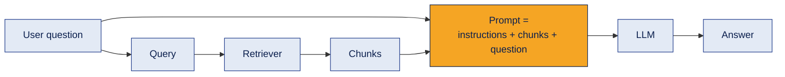
In basic RAG the query is usually the user's exact question. In agentic RAG the agent can **rewrite** the query or **split** it into several smaller queries (see [topic 08](../08-multi-agent-systems/README.md)).

**Example**
- User: "I joined last month. How many casual leaves do I get, and can I work from home?"
- Query 1 (rewritten): "casual leave per year". Query 2: "work from home policy".
- Prompt: "Answer only from the context..." + both sets of chunks + the original question.

**Where it's used**
Debugging RAG: first check the query (did it fetch the right chunks?), then the prompt (did the LLM get clear instructions?).

**Common mistake**
Sending a long, chatty user message straight to the retriever. Extra words can pull in irrelevant chunks. A short, focused query often retrieves better.

**Interview questions**
1. **Q:** What is the difference between a query and a prompt in RAG? **A:** The query goes to the retriever to fetch chunks; the prompt goes to the LLM and contains instructions, chunks and the question.
2. **Q:** Does the LLM see the query? **A:** Only as part of the prompt (usually as the user's question). The retriever is what uses the query directly.
3. **Q:** What is query rewriting? **A:** Turning the user's message into a clearer search query before retrieval.
4. **Q:** What is query decomposition? **A:** Splitting a multi-part question into smaller queries, one per part.
5. **Q:** Wrong answer: query problem or prompt problem? **A:** Check the retrieved chunks. Wrong chunks point to the query or retrieval; right chunks with a wrong answer point to the prompt or model.

**In one line**
The query decides what is fetched; the prompt decides what the LLM sees.

---

## 10. Chaining with LCEL

**What it is**
LCEL (LangChain Expression Language) connects steps with the `|` symbol, like a pipe: the output of one step becomes the input of the next.

**How it works**
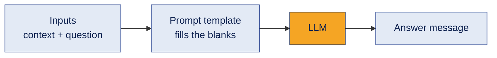
```python
from langchain_core.prompts import ChatPromptTemplate

prompt = ChatPromptTemplate.from_template(
    "Answer only from the context.\n\nContext:\n{context}\n\nQuestion: {question}"
)
chain = prompt | llm          # the filled prompt flows into the LLM
response = chain.invoke({"context": context, "question": "What is the minimum attendance?"})
print(response.content)
```

**Example**
`prompt | llm` for answering; later you can extend it, for example `prompt | llm | parser` to turn the answer into JSON.

**Where it's used**
Most LangChain RAG code, and many tutorials and course notebooks.

**Common mistake**
Forgetting that `{context}` and `{question}` in the template must match the keys you pass to `invoke`. A missing key raises an error.

**Interview questions**
1. **Q:** What does `|` mean in LangChain? **A:** It chains steps so each step's output feeds the next (LCEL).
2. **Q:** What does a prompt template do? **A:** Holds a prompt with blanks like `{question}` that are filled in at run time.
3. **Q:** What does `chain.invoke()` return for a chat model? **A:** A message object; the text is in `.content`.
4. **Q:** Why use templates instead of string concatenation? **A:** Reusable, cleaner, and easier to test and change.
5. **Q:** How would you add structured output to the chain? **A:** Add an output parser, or use the model's structured output feature.

**In one line**
LCEL pipes steps together: template, then model, then (optionally) parser.

---

## 11. RAG patterns and debugging

**What it is**
Variations of RAG for harder problems, and how to fix a RAG system that gives wrong answers.

**How it works**
| Pattern | Idea |
|---|---|
| Basic RAG | Retrieve top-k, generate |
| Hybrid RAG | Keyword + semantic retrieval |
| Agentic RAG | An agent decides when/where to search and which tool to use |
| Corrective RAG | Check retrieval quality; if weak, rewrite the query and search again |
| Graph RAG | Use entities and relationships (knowledge graphs) |
| Multimodal RAG | Retrieve across text, images, tables, audio |

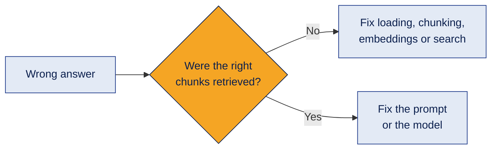

**Example**
An agentic RAG router: policy questions → PDF vector search; current pricing questions → web search.

**Where it's used**
Moving from a demo to a reliable system.

**Common mistake**
Blaming the LLM first. Print the retrieved chunks: most RAG failures are retrieval or ingestion problems.

**Interview questions**
1. **Q:** What is agentic RAG? **A:** RAG where an agent decides when to retrieve, from which source, and whether to retry.
2. **Q:** What is corrective RAG? **A:** A loop that evaluates retrieved results and re-searches (e.g. with a rewritten query) if they're weak.
3. **Q:** Your RAG gives wrong answers. How do you debug? **A:** Check retrieved chunks first; if wrong, fix ingestion/chunking/embeddings/search; if right, fix the prompt.
4. **Q:** How do you evaluate a RAG system? **A:** A test set of questions with known answers, measuring retrieval relevance and answer faithfulness.
5. **Q:** What is faithfulness? **A:** Whether the answer sticks to the retrieved sources without adding unsupported claims.

**In one line**
Debug retrieval before the model; upgrade the pattern only when basic RAG isn't enough.

---

## 12. Evaluating RAG: two scorecards

**What it is**
Measuring whether a RAG system works, with numbers instead of "it looks fine". A RAG system can fail in **two different places**, so it needs **two scorecards**.

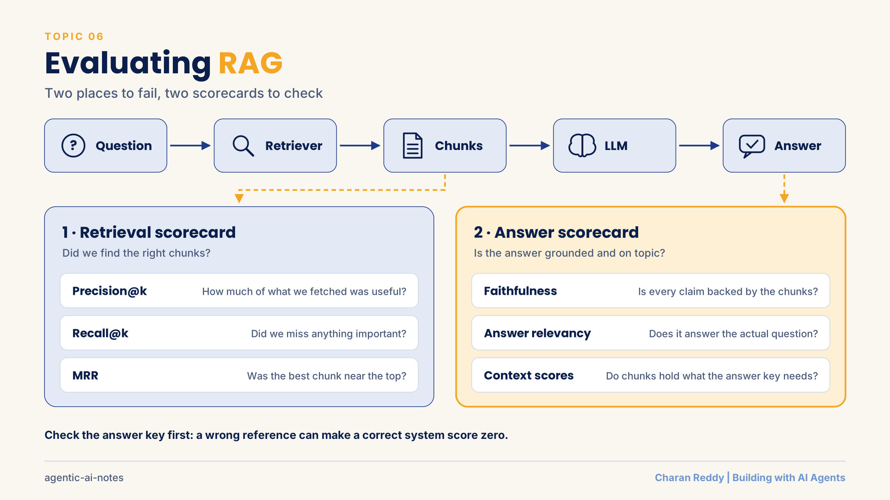

**How it works**
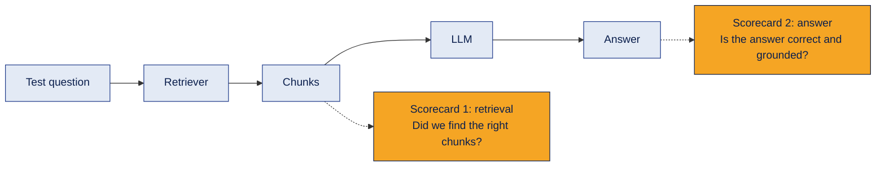

| Scorecard | Metrics | Catches |
|---|---|---|
| Retrieval | Precision@k, Recall@k, MRR | Missing or noisy chunks |
| Answer | Faithfulness, answer relevancy | Made-up claims, off-topic answers |
| Against an answer key | Context precision, context recall | Whether the chunks contained what the correct answer needed |

To evaluate you need a **test set**: questions, plus a correct answer written by a person (called the **reference** or **ground truth**).

**Example**
A college FAQ bot gives a wrong hostel fee. Scorecard 1 shows the hostel chunk was never retrieved, so the fix is in retrieval, not in the prompt.

**Where it's used**
Before launch, after every change (new chunk size, new model, new prompt) and regularly in production.

**Common mistake**
Only reading a few answers by eye. It feels fine until real users ask different questions. Use a fixed test set and compare scores over time.

**Interview questions**
1. **Q:** Why evaluate retrieval and generation separately? **A:** They fail differently; separate scores tell you which part to fix.
2. **Q:** What is a reference (ground truth) answer? **A:** A correct answer written by a person, used as the answer key.
3. **Q:** What goes into a RAG test set? **A:** Varied questions (easy, multi-part, tricky, unanswerable) with reference answers.
4. **Q:** When should you re-run the evaluation? **A:** After any change to chunking, embeddings, retrieval, prompt or model.
5. **Q:** Can a perfect retriever still give a bad answer? **A:** Yes. The LLM can ignore the chunks or add made-up details, which the answer scorecard catches.

**In one line**
Two places to fail, two scorecards to check.

---

## 13. Retrieval metrics: Precision@k, Recall@k, MRR

**What it is**
Three numbers that score the **librarian**: did it bring the right books, all of them, and the best one on top?

**How it works**
| Metric | Formula | Question it answers | Librarian version |
|---|---|---|---|
| Precision@k | relevant chunks in the top k ÷ k | How much of what we fetched was useful? | Of the books brought back, how many were useful? |
| Recall@k | relevant chunks in the top k ÷ all relevant chunks that exist | Did we miss anything important? | Did the librarian find every useful book in the library? |
| MRR | average of 1 ÷ (position of the first relevant chunk) | Was the best chunk near the top? | Was the most useful book on top of the pile? |

**Worked example** (k = 3)

| Question | Retrieved (in order) | Truly relevant | Precision@3 | Recall@3 | 1 ÷ rank |
|---|---|---|---|---|---|
| Application deadline? | admissions, scholarships, hostel | admissions | 1/3 = 0.33 | 1/1 = 1.00 | 1/1 = 1.00 |
| Scholarship and refund? | library, hostel, scholarships | scholarships, fee_refund | 1/3 = 0.33 | 1/2 = 0.50 | 1/3 = 0.33 |
| Library timings? | hostel, admissions, fee_refund | library | 0/3 = 0 | 0/1 = 0 | 0 |

**MRR** = (1.00 + 0.33 + 0) ÷ 3 = **0.44**

You can run this exact example: [`demos/retrieval_metrics.py`](demos/retrieval_metrics.py) (no API key needed).

**Example**
High recall but low precision: you found the answer but buried it among junk chunks, which costs tokens and can confuse the LLM. Try a smaller k or a reranker.

**Where it's used**
Tuning chunk size, top-k, embedding models, hybrid search and rerankers.

**Common mistake**
Looking only at precision. A retriever that returns one safe chunk can have high precision but miss half the answer (low recall).

**Interview questions**
1. **Q:** What is Precision@k? **A:** The share of the top k retrieved chunks that are relevant.
2. **Q:** What is Recall@k? **A:** The share of all relevant chunks that appear in the top k.
3. **Q:** What does MRR reward? **A:** Putting the first relevant chunk as high as possible in the results.
4. **Q:** You increase k from 3 to 10. What usually happens? **A:** Recall tends to go up, precision tends to go down.
5. **Q:** Why do these metrics need labelled data? **A:** You must know which chunks are truly relevant for each question.

**In one line**
Precision = no junk, recall = nothing missing, MRR = best result on top.

---

## 14. Answer metrics: faithfulness, relevancy, context precision and recall

**What it is**
Metrics that score the **answer** and check whether the retrieved chunks matched the **answer key**.

**How it works**
| Metric | What it checks | Needs a reference? | Low score means |
|---|---|---|---|
| Faithfulness | Every claim in the answer is supported by the retrieved chunks | No | The model made things up (hallucination) |
| Answer relevancy | The answer addresses the question that was asked | No | Off-topic or incomplete answer |
| Context precision | The chunks needed for the reference answer are ranked near the top | Yes | Useful chunks are buried or mixed with noise |
| Context recall | Everything in the reference answer can be found in the retrieved chunks | Yes | Retrieval missed needed information |

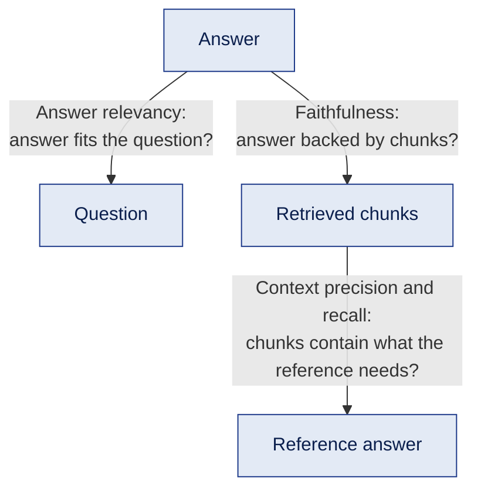

**Example**
The chunks say "library open 8 AM to 8 PM", but the answer says "open 24 hours". Faithfulness is low even though retrieval was perfect: the LLM added something that is not in the chunks.

**Where it's used**
Comparing prompts and models, catching hallucinations, and monitoring quality over time.

**Common mistake**
Treating faithfulness as correctness. An answer can be faithful to the chunks and still be wrong if the chunks themselves are outdated.

**Interview questions**
1. **Q:** What is faithfulness? **A:** The share of claims in the answer that the retrieved context supports.
2. **Q:** Faithfulness vs answer relevancy? **A:** Faithfulness checks the answer against the chunks; relevancy checks the answer against the question.
3. **Q:** Which metrics need a reference answer? **A:** Context precision and context recall (as used here).
4. **Q:** Low context recall tells you what? **A:** Retrieval did not bring back everything the correct answer needed.
5. **Q:** Can an answer be faithful but wrong? **A:** Yes, if the source documents are wrong or out of date.

**In one line**
Faithfulness = no made-up claims; relevancy = on-topic; context scores = the right evidence was found.

---

## 15. Evaluating with Ragas (and the wrong answer key trap)

**What it is**
**Ragas** is an open-source Python library that calculates RAG metrics. It uses an LLM as a **judge** to read questions, answers and chunks and give scores from 0 to 1.

**How it works**
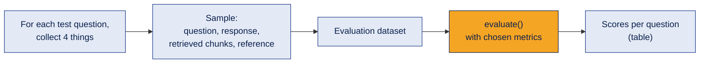
```python
from ragas import EvaluationDataset, evaluate
from ragas.dataset_schema import SingleTurnSample
from ragas.metrics import Faithfulness, AnswerRelevancy, ContextPrecision, ContextRecall

sample = SingleTurnSample(
    user_input="When do B.Tech applications close?",          # question
    response="Applications close on 30 June.",               # what our RAG answered
    retrieved_contexts=["Admissions: ... close on 30 June."],  # chunks it used
    reference="B.Tech applications close on 30 June.",        # human answer key
)
results = evaluate(dataset=EvaluationDataset(samples=[sample]),
                   metrics=[Faithfulness(), AnswerRelevancy(), ContextPrecision(), ContextRecall()],
                   llm=llm, embeddings=embeddings)
print(results.to_pandas())
```
"Single turn" means one question and one answer, evaluated as one interaction.

**The wrong answer key trap (an important lesson)**

A handbook says minimum attendance is **80%**. The RAG system correctly answers "80%". But the reference typed into the test set says **75%**.

| Metric | Score | Why |
|---|---|---|
| Faithfulness | 1.0 | The answer (80%) is fully supported by the chunks |
| Context precision | 0.0 | No chunk supports the reference (75%) |
| Context recall | 0.0 | The reference's claim cannot be found in any chunk |

The system was right; **the answer key was wrong**. If you trusted the scores blindly, you would "fix" a system that was working. Always verify reference answers against the source documents first.

**Example**
[`demos/rag_evaluation.py`](demos/rag_evaluation.py) builds a small RAG system on a college FAQ, evaluates three questions, and includes one deliberately wrong reference so you can see this trap yourself.

**Where it's used**
Automated RAG testing in development and in CI pipelines, comparing versions before release.

**Common mistake**
- Evaluating with **one** question. You need many varied questions to trust a score.
- Forgetting the judge is also an LLM. Scores can vary a little between runs, so check surprising scores by hand.
- Ignoring library changes. Ragas changes quickly (for example, newer versions warn that metrics are moving to `ragas.metrics.collections`), so pin versions and check the docs.

**Interview questions**
1. **Q:** What is Ragas? **A:** An open-source library for evaluating RAG systems with metrics like faithfulness and context recall.
2. **Q:** What four fields make a Ragas sample? **A:** The question (user_input), the system's response, the retrieved contexts and the reference answer.
3. **Q:** What is "LLM as a judge"? **A:** Using an LLM to score outputs against criteria, instead of a person scoring every answer.
4. **Q:** Faithfulness is 1.0 but context recall is 0.0. What could be wrong? **A:** Possibly the reference answer itself; verify it against the source before changing the system.
5. **Q:** Why pin library versions for evaluation code? **A:** Evaluation libraries change their APIs often; pinning keeps results reproducible.

**In one line**
Scores are only as trustworthy as the answer key and the size of the test set.

---

## 16. Full pipeline in code

A minimal RAG pipeline with LangChain and Chroma (an illustration, so check current docs before running):

```python
# pip install langchain-community langchain-openai langchain-chroma langchain-text-splitters pypdf
from langchain_community.document_loaders import PyPDFLoader
from langchain_text_splitters import RecursiveCharacterTextSplitter
from langchain_openai import OpenAIEmbeddings, ChatOpenAI
from langchain_chroma import Chroma

# 1. Load
docs = PyPDFLoader("refund_policy.pdf").load()

# 2. Chunk (sizes are characters here, not tokens)
splitter = RecursiveCharacterTextSplitter(chunk_size=1000, chunk_overlap=150)
chunks = splitter.split_documents(docs)

# 3 to 5. Embed + store (saved to disk so it isn't rebuilt every run)
db = Chroma.from_documents(chunks, OpenAIEmbeddings(model="text-embedding-3-small"),
                           persist_directory="./my_db")

# 6. Retrieve
question = "How many days do I have to ask for a refund?"
hits = db.similarity_search(question, k=3)
context = "\n\n".join(h.page_content for h in hits)

# 7. Generate (grounded)
llm = ChatOpenAI(model="gpt-4o-mini", temperature=0)
answer = llm.invoke(
    "Answer only from the context. If it's not there, say you don't know.\n\n"
    f"Context:\n{context}\n\nQuestion: {question}"
)
print(answer.content)
print([h.metadata for h in hits])   # sources: file + page
```

**API key:** stored in a `.env` file as `OPENAI_API_KEY`, never in the code or on GitHub.

**Demos:** runnable evaluation examples are in [`demos`](demos/README.md): retrieval metrics by hand (free) and a Ragas evaluation.

[← Back to all topics](../README.md)
