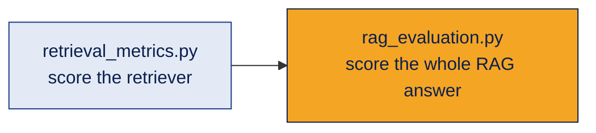

# Demos · Evaluating RAG

Two small demos for the evaluation sections of [topic 06](../README.md).

| File | What it shows | Needs an API key? |
|---|---|---|
| [`retrieval_metrics.py`](retrieval_metrics.py) | Precision@k, Recall@k and MRR calculated by hand on a tiny test set | No. Free, plain Python |
| [`rag_evaluation.py`](rag_evaluation.py) | Build a small RAG system, then score it with Ragas (faithfulness, answer relevancy, context precision, context recall) | Yes |



## How to run

1. Start with the free one:
   ```bash
   python retrieval_metrics.py
   ```
2. For the Ragas demo, install the libraries and add your key:
   ```bash
   pip install -r requirements.txt
   ```
   Copy `.env.example` to `.env` and put your own OpenAI API key in it. Then:
   ```bash
   python rag_evaluation.py
   ```

**Safety:** your key lives only in `.env`, which `.gitignore` keeps off GitHub.

## What to look for

**retrieval_metrics.py**
- Question 1: the right chunk is first, but precision is low because of extra chunks.
- Question 2: only half the relevant chunks were found, and late in the list.
- Question 3: nothing relevant was found. Every score is 0, so retrieval must be fixed before anything else.

**rag_evaluation.py**
- Ragas uses an LLM as a judge, so scores can change a little between runs.
- Question 3 has a **wrong reference answer on purpose** (85% instead of 90%). Watch the context scores drop even when the system's answer matches the FAQ. Lesson: check your answer key before trusting the scores.
- Three questions are only for learning. A real evaluation needs a larger, varied test set.

## Good to know
- Ragas changes quickly. `requirements.txt` pins versions that were checked to install and import together. If you upgrade, check the Ragas documentation, because import paths and metric names change.
- The control flow was tested with a fake model. Real scores depend on the judge model you use.
- The college FAQ is a made-up example.

[← Back to topic 06](../README.md)
