# 07 · AutoGen Deep Dive

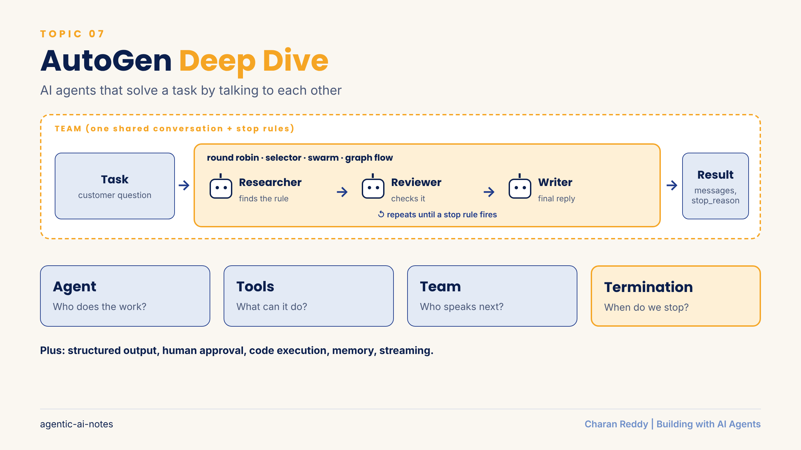

AutoGen builds **teams of AI agents that solve a task by talking to each other**: one agent drafts, another checks, a third finishes, and a set of rules decides who speaks next and when to stop.

> **Status:** 📘 Concepts learned. Checked against `autogen-agentchat` **0.7.5** (October 2026). AutoGen is now in **maintenance mode**: bug fixes and security patches only, no new features. For new projects Microsoft points to **Microsoft Agent Framework** (see [section 17](#17-autogen-vs-other-frameworks-and-moving-to-microsoft-agent-framework)). The patterns on this page carry over to any framework.

[← Back to Agent Frameworks](README.md) · [← All topics](../README.md)

## Contents
1. [The big picture: what AutoGen is and how it is built](#1-the-big-picture-what-autogen-is-and-how-it-is-built)
2. [Model client vs agent](#2-model-client-vs-agent)
3. [AssistantAgent and the run result](#3-assistantagent-and-the-run-result)
4. [Tools and the tool call loop](#4-tools-and-the-tool-call-loop)
5. [Structured output](#5-structured-output)
6. [Teams and RoundRobinGroupChat](#6-teams-and-roundrobingroupchat)
7. [Termination conditions](#7-termination-conditions)
8. [SelectorGroupChat: the LLM picks the next speaker](#8-selectorgroupchat-the-llm-picks-the-next-speaker)
9. [Swarm and handoffs](#9-swarm-and-handoffs)
10. [GraphFlow: workflows as a graph](#10-graphflow-workflows-as-a-graph)
11. [Human in the loop](#11-human-in-the-loop)
12. [Code execution](#12-code-execution)
13. [Memory, model context and saved state](#13-memory-model-context-and-saved-state)
14. [Streaming, token usage and cost](#14-streaming-token-usage-and-cost)
15. [Declarative config and AutoGen Studio](#15-declarative-config-and-autogen-studio)
16. [Failure patterns and a production checklist](#16-failure-patterns-and-a-production-checklist)
17. [AutoGen vs other frameworks, and moving to Microsoft Agent Framework](#17-autogen-vs-other-frameworks-and-moving-to-microsoft-agent-framework)

**Example used throughout:** a laptop store's warranty help desk. A **Researcher** finds the right policy, a **Reviewer** checks the answer, and a **Writer** turns it into a friendly reply for the customer.

---

## 1. The big picture: what AutoGen is and how it is built

**What it is**
An open source Python framework for multi-agent apps. Its main idea is **collaboration through conversation**: agents send messages into a shared chat, and the team's rules decide who speaks next and when the work is done.

**How it works**
AutoGen has three layers. Most work happens in **AgentChat**.

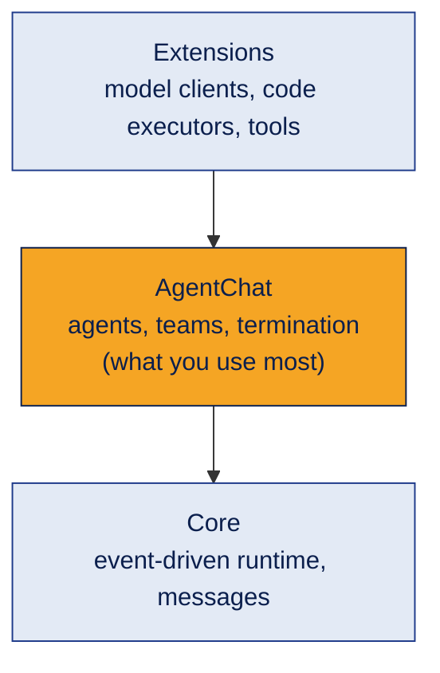

| Layer | Package | Holds |
|---|---|---|
| AgentChat | `autogen-agentchat` | `AssistantAgent`, teams, termination conditions |
| Core | `autogen-core` | The message runtime, memory and model context classes |
| Extensions | `autogen-ext` | Model clients (OpenAI and compatible), code executors |

```bash
pip install -U "autogen-agentchat" "autogen-ext[openai]"
```

Everything in AgentChat is **async**. In Jupyter you write `await agent.run(...)` directly. In a normal `.py` file you wrap it:

```python
import asyncio

async def main():
    result = await agent.run(task="Is a cracked screen covered?")
    print(result.messages[-1].content)

asyncio.run(main())
```

**Example**
One agent answering alone: Customer → LLM → reply. An AutoGen team: Customer → Researcher → Reviewer → Writer → reply, all inside one shared conversation.

**Where it's used**
Writer and critic loops, coder and tester loops, research teams, support triage, document review.

**Common mistake**
Treating AutoGen as the "intelligence". The LLM does the thinking; AutoGen only organises the agents, the messages and the rules.

**Interview questions**
1. **Q:** What is AutoGen's core idea? **A:** Multiple agents solve a task by exchanging messages in a shared conversation.
2. **Q:** Name AutoGen's three layers. **A:** AgentChat (high level), Core (runtime) and Extensions (model clients, executors).
3. **Q:** Why do you need `await` or `asyncio.run`? **A:** AgentChat methods are async coroutines.
4. **Q:** What is AutoGen's current status? **A:** Maintenance mode; Microsoft Agent Framework is the recommended successor.
5. **Q:** How is AutoGen's style different from CrewAI's? **A:** AutoGen is conversation based; CrewAI is role and task based.

**In one line**
AutoGen is a meeting room for agents: they talk, and the rules decide who speaks and when to stop.

---

## 2. Model client vs agent

**What it is**
A **model client** is the connection to an LLM: it sends messages and returns the reply. An **agent** wraps a model client with a name, instructions, tools and behaviour.

**How it works**
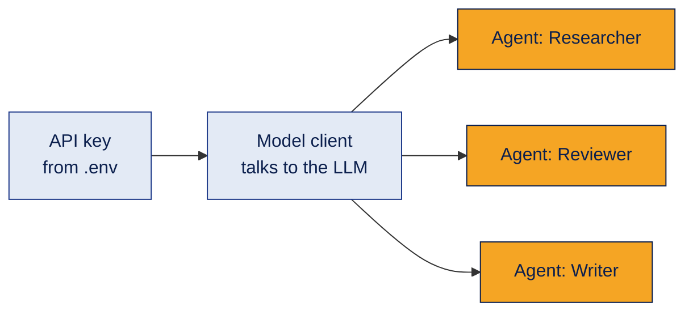
```python
import os
from dotenv import load_dotenv
from autogen_ext.models.openai import OpenAIChatCompletionClient
from autogen_core.models import UserMessage

load_dotenv()                                   # reads OPENAI_API_KEY from .env
model_client = OpenAIChatCompletionClient(model="gpt-4o-mini")

# Calling the model directly, with no agent
reply = await model_client.create([UserMessage(content="What is a warranty?", source="user")])
print(reply.content)

await model_client.close()                      # free the connection when finished
```

**Other providers:** any API that speaks the OpenAI format (Gemini, local Ollama and others) works with the same client by setting `base_url`. For model names AutoGen does not know, you must also pass `model_info`, which tells AutoGen what the model can do:

```python
model_client = OpenAIChatCompletionClient(
    model="your-model-name",
    base_url="https://provider-endpoint/v1/",
    api_key=os.environ["PROVIDER_API_KEY"],
    model_info={"vision": False, "function_calling": True, "json_output": True,
                "structured_output": True, "family": "unknown"},
)
```

**Example**
All three help desk agents share one model client. They behave differently only because their instructions differ.

**Where it's used**
Every AutoGen app. The client is the bridge; the agents are the workers.

**Common mistake**
Putting the API key in the notebook or reading it from a text file. Keep keys in `.env`, keep `.env` in `.gitignore`, and use a secret manager in production.

**Interview questions**
1. **Q:** Model client vs agent? **A:** The client only talks to the LLM; the agent adds a name, instructions, tools and behaviour on top.
2. **Q:** Do two agents need two different LLMs? **A:** No. Many agents can share one model client.
3. **Q:** How do you use a non OpenAI model? **A:** Set `base_url` to an OpenAI compatible endpoint and pass `model_info`.
4. **Q:** What does `model_info` describe? **A:** The model's abilities, like function calling and JSON output.
5. **Q:** Why call `close()`? **A:** To release the network connection cleanly.

**In one line**
The model client connects to the brain; the agent gives that brain a job.

---

## 3. AssistantAgent and the run result

**What it is**
`AssistantAgent` is AutoGen's ready-made LLM agent. You give it a task with `run()`, and it returns a **TaskResult**.

**How it works**
```python
from autogen_agentchat.agents import AssistantAgent

researcher = AssistantAgent(
    name="researcher",
    model_client=model_client,
    description="Finds the warranty rule that applies to a customer's question.",
    system_message="You are a warranty researcher. Quote the exact policy rule you rely on.",
)

result = await researcher.run(task="Is a cracked screen covered within 1 year?")

for msg in result.messages:                # the whole conversation
    print(msg.source, ":", msg.content)
print(result.stop_reason)                  # why it stopped (useful in teams)
```

| Field | Purpose |
|---|---|
| `name` | Unique id, shown as `source` on its messages |
| `description` | A short summary that **other parts of a team read** (for example, a selector choosing the next speaker) |
| `system_message` | Instructions the agent itself follows |
| `result.messages` | Every message: the task, tool events, replies |
| `result.stop_reason` | Why the run ended |

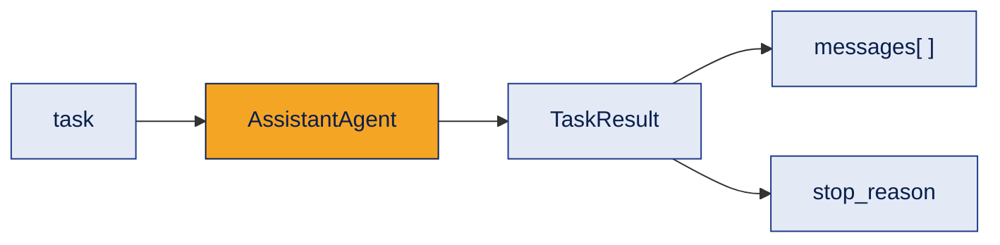

**Example**
`result.messages[0]` is the user task; `result.messages[-1].content` is the researcher's answer.

**Where it's used**
Every agent you build in AgentChat.

**Common mistake**
Mixing up `description` and `system_message`. The system message guides the agent; the description is how **others** see the agent.

**Interview questions**
1. **Q:** What does `run()` return? **A:** A `TaskResult` with `messages` and `stop_reason`.
2. **Q:** How do you get the final answer? **A:** `result.messages[-1].content`.
3. **Q:** `description` vs `system_message`? **A:** Description is for others choosing the agent; system message is the agent's own instructions.
4. **Q:** What does `source` on a message mean? **A:** The name of whoever sent it.
5. **Q:** Why print all messages, not just the last? **A:** To see tool calls and how the answer was reached.

**In one line**
Give the agent a task, read the messages, check why it stopped.

---

## 4. Tools and the tool call loop

**What it is**
A **tool** is a Python function the agent can use. The most important fact: **the LLM never runs the tool.** It only asks for it. Your Python program runs it and sends the result back.

**How it works**
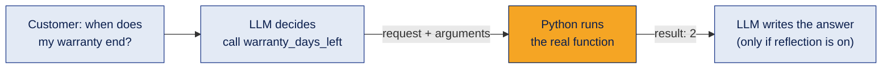
```python
def warranty_days_left(purchase_date: str, warranty_months: int = 12) -> int:
    """Return how many days of warranty are left for a purchase date (YYYY-MM-DD)."""
    ...                                       # real date maths, no guessing

agent = AssistantAgent(
    name="researcher",
    model_client=model_client,
    tools=[warranty_days_left],               # plain functions are wrapped automatically
    reflect_on_tool_use=True,                 # let the LLM write a sentence after the tool
    max_tool_iterations=3,                    # allow up to 3 rounds of tool calls
)
```
The type hints and the docstring become the tool's schema, so the LLM knows the arguments.

You can see both steps in `result.messages`:

| Message type | What it means |
|---|---|
| `ToolCallRequestEvent` | The LLM **decided** to call a tool, with arguments |
| `ToolCallExecutionEvent` | Python **ran** the tool and got a result |
| `ToolCallSummaryMessage` | The raw tool result returned as the answer (reflection off) |
| `TextMessage` | The LLM's written answer after the tool (reflection on) |

| Setting | Meaning | Default |
|---|---|---|
| `reflect_on_tool_use` | After the tool runs, call the LLM again to write a proper answer | Off |
| `max_tool_iterations` | How many tool rounds before the agent must stop | 1 |

**Agents as tools:** `AgentTool` (from `autogen_agentchat.tools`) wraps a whole agent so another agent can call it like a function. For example, a general help desk agent calls a "returns expert" agent only when needed.

**Example**
With reflection off, the customer gets the bare value `2`. With reflection on, they get "Your warranty ends in 2 days, so please book a repair soon."

**Where it's used**
Calculations, database lookups, API calls, search, anything that must be exact.

**Common mistake**
Writing "explain the result clearly" in the system message and forgetting that, with reflection off, the agent returns the raw tool output and never explains anything.

**Interview questions**
1. **Q:** Does the LLM run the tool? **A:** No. The LLM requests it; the application runs it and returns the result.
2. **Q:** How does the LLM know a tool's arguments? **A:** From the function's type hints and docstring, turned into a schema.
3. **Q:** What does `reflect_on_tool_use=True` do? **A:** Makes one more LLM call so the final answer is a written response, not the raw tool result.
4. **Q:** Why limit `max_tool_iterations`? **A:** To stop endless tool loops and control cost.
5. **Q:** What is `AgentTool`? **A:** A wrapper that lets one agent call another agent as a tool.

**In one line**
The LLM decides, Python runs, and reflection turns the result into an answer.

---

## 5. Structured output

**What it is**
Forcing an agent to reply in a fixed shape (a Pydantic model) instead of free text, so your code can read it safely.

**How it works**
```python
from pydantic import BaseModel

class Verdict(BaseModel):
    covered: bool
    rule: str
    confidence: str          # "high", "medium" or "low"

reviewer = AssistantAgent(
    name="reviewer",
    model_client=model_client,
    output_content_type=Verdict,
    system_message="Check the researcher's answer against the policy.",
)

result = await reviewer.run(task="Cracked screen, bought 8 months ago. Covered?")
verdict = result.messages[-1].content       # a Verdict object (StructuredMessage)
if not verdict.covered:
    ...                                     # plain Python decides what happens next
```
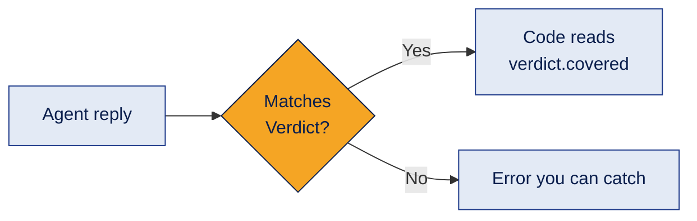
The model must support structured output (`"structured_output": True` in `model_info`).

**Example**
Instead of searching the reviewer's paragraph for a word like "approved", the code checks `verdict.covered`, which is either `True` or `False`.

**Where it's used**
Any handoff where code, not a person, reads the result: routing, approvals, scores, extracted fields.

**Common mistake**
Parsing free text with string checks. A check like `"PASS" in output` also matches `passed=False`, so a failure is read as a success.

**Interview questions**
1. **Q:** How do you get structured output from an AssistantAgent? **A:** Set `output_content_type` to a Pydantic model.
2. **Q:** What message type holds it? **A:** `StructuredMessage`, whose `content` is the model object.
3. **Q:** Why is it better than parsing text? **A:** Fields are typed and validated, so there is no guessing.
4. **Q:** What must the model support? **A:** Structured output (JSON schema).
5. **Q:** Where should structured output be mandatory? **A:** Wherever code makes a decision from an agent's reply.

**In one line**
If code reads it, give it a shape.

---

## 6. Teams and RoundRobinGroupChat

**What it is**
A **team** runs several agents in one shared conversation, so you don't pass outputs between them by hand. **RoundRobinGroupChat** is the simplest team: agents take turns in a **fixed order**.

**How it works**
Without a team, your code must copy one agent's output into the next agent's task. With a team, every agent sees the shared history.

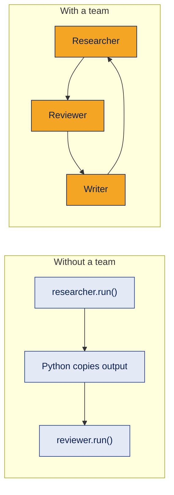
```python
from autogen_agentchat.teams import RoundRobinGroupChat
from autogen_agentchat.conditions import TextMentionTermination, MaxMessageTermination

team = RoundRobinGroupChat(
    [researcher, reviewer, writer],
    termination_condition=TextMentionTermination("APPROVED", sources=["reviewer"])
                          | MaxMessageTermination(12),
)
result = await team.run(task="Customer asks: is a cracked screen covered after 8 months?")
```

| Team behaviour | Detail |
|---|---|
| Shared history | Each agent sees what the others said |
| Order | Exactly the list order, repeating |
| Running again | `team.run(task=...)` again **continues the same conversation** |
| Fresh start | `await team.reset()` clears the history |
| Teams in teams | A team can be a participant of another team |

**Example**
Researcher finds the rule, Reviewer checks it, Writer drafts the reply, then the Researcher speaks again if the stop rule has not fired.

**Where it's used**
Simple pipelines where the order never changes: draft, check, polish.

**Common mistake**
Expecting every agent to speak. If a stop rule fires on turn 2, the agent on turn 3 never runs. Place the agent whose message should end the run **last**, or make the stop rule listen to the right agent.

**Interview questions**
1. **Q:** What does a team add over separate agents? **A:** A shared conversation and automatic turn taking.
2. **Q:** How does RoundRobinGroupChat pick the next speaker? **A:** Fixed list order, repeating.
3. **Q:** What happens if you call `run()` on the same team twice? **A:** It continues the same conversation; use `reset()` for a fresh start.
4. **Q:** Can a team contain another team? **A:** Yes, teams can be nested as participants.
5. **Q:** When is round robin a bad fit? **A:** When the next step depends on what just happened.

**In one line**
A team shares one conversation; round robin just takes turns.

---

## 7. Termination conditions

**What it is**
Rules that decide when a team stops. Without them, agents can talk forever and keep spending money.

**How it works**
The condition is checked **after every message**, including the very first task message.

| Condition | Stops when |
|---|---|
| `MaxMessageTermination(n)` | n messages exist (the task counts as one) |
| `TextMentionTermination("WORD", sources=[...])` | A message contains the word (optionally only from named agents) |
| `TokenUsageTermination(...)` | Token use passes a limit |
| `TimeoutTermination(seconds)` | Time runs out |
| `HandoffTermination(target)` | An agent hands off to the target (often the user) |
| `SourceMatchTermination([...])` | A named agent has replied |
| `TextMessageTermination` | An agent sends a plain text message |
| `StopMessageTermination` | An agent sends a stop message |
| `FunctionCallTermination(name)` | A specific tool has run |
| `ExternalTermination` | Your code stops it from outside (for example, a Stop button) |
| `FunctionalTermination` | Your own function returns True |

Combine them: `|` means **OR** (stop on either), `&` means **AND** (stop when both are true).

```python
stop = (
    TextMentionTermination("APPROVED", sources=["reviewer"])   # success
    | MaxMessageTermination(12)                                 # safety net
    | TimeoutTermination(120)                                   # time limit
)
team = RoundRobinGroupChat([researcher, reviewer, writer], termination_condition=stop)
result = await team.run(task="...")
print(result.stop_reason)       # which rule fired
```
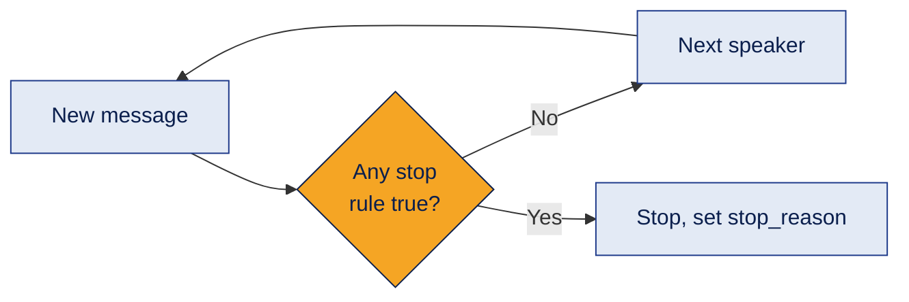
`max_turns` on the team is a separate, simpler limit on agent turns.

**Example**
Success rule: the Reviewer says APPROVED. Safety rules: 12 messages or 2 minutes, whichever comes first.

**Where it's used**
Every team, without exception.

**Common mistakes**
- **The stop word appears in the task.** If the task says "reply APPROVED when done", the team stops before any agent speaks, because the task message is checked too.
- **Any agent can trigger it.** A writer quoting "APPROVED" ends the run. Use `sources=["reviewer"]`.
- **Only a success rule.** If APPROVED never comes, nothing stops the loop. Always add a limit.
- **Only a limit.** Agents finish the work early, then fill the remaining turns with polite "thank you" messages that cost tokens.

**Interview questions**
1. **Q:** Why add `MaxMessageTermination` if you already have a text condition? **A:** As a safety net in case the success word never appears.
2. **Q:** What do `|` and `&` mean? **A:** OR and AND between conditions.
3. **Q:** How do you find out which rule stopped a run? **A:** `result.stop_reason`.
4. **Q:** Why use `sources` on `TextMentionTermination`? **A:** So only the right agent can end the run.
5. **Q:** Name a hidden trap with stop words. **A:** If the word is in the task, the run stops immediately.

**In one line**
One rule for success, one rule for safety, and know which one fired.

---

## 8. SelectorGroupChat: the LLM picks the next speaker

**What it is**
A team where, after each message, **a model chooses which agent should speak next**, based on the conversation and each agent's `description`.

**How it works**
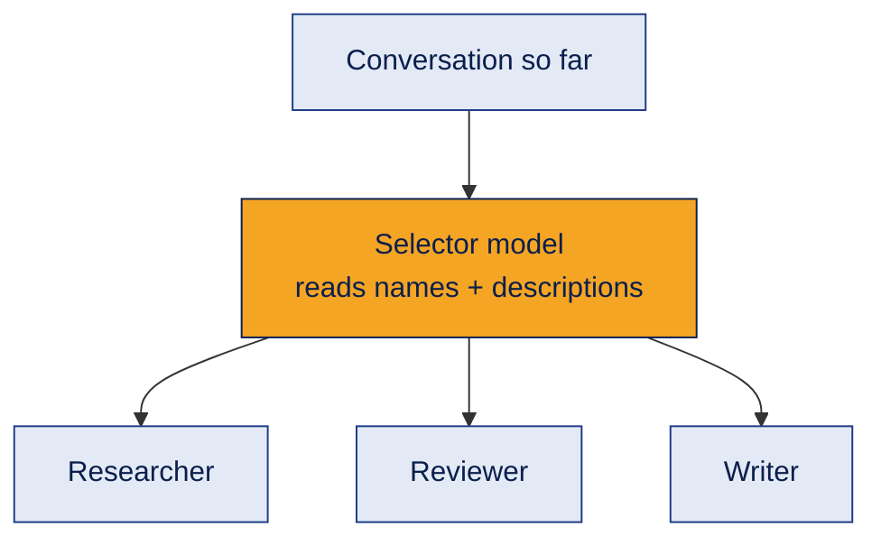
```python
from autogen_agentchat.teams import SelectorGroupChat

def pick_next(messages):
    # Rule-based override: after the writer, the reviewer always checks.
    if messages[-1].source == "writer":
        return "reviewer"
    return None            # None = let the model decide

team = SelectorGroupChat(
    [researcher, reviewer, writer],
    model_client=model_client,
    selector_func=pick_next,
    allow_repeated_speaker=False,         # default: same agent cannot speak twice in a row
    termination_condition=stop,
)
```

| Setting | Meaning |
|---|---|
| `selector_prompt` | The prompt the selector model uses (you can customise it) |
| `selector_func` | Your function returns an agent name, or `None` to let the model choose |
| `candidate_func` | Your function narrows the list the model may choose from |
| `allow_repeated_speaker` | Can the same agent speak twice in a row? Default False |

**Example**
A simple question goes Researcher → Writer. A risky refund question goes Researcher → Reviewer → Researcher → Writer. The order changes with the situation.

**Where it's used**
Open-ended work where the next step depends on what happened.

**Common mistakes**
- Vague `description`s. The selector chooses by description, so unclear descriptions mean wrong choices.
- Assuming every agent will take part. The model may skip one.
- Forgetting the cost: every selection is an extra LLM call.

**Interview questions**
1. **Q:** RoundRobin vs Selector? **A:** Fixed order vs a model choosing the next speaker each turn.
2. **Q:** What does the selector read? **A:** The conversation plus each agent's name and description.
3. **Q:** How do you force a rule into the selection? **A:** `selector_func`; return a name, or `None` to fall back to the model.
4. **Q:** What does `candidate_func` do? **A:** Limits which agents the model may pick.
5. **Q:** Main downside? **A:** Less predictable and more expensive.

**In one line**
Selector trades a fixed order for flexibility, so guide it with clear descriptions and rules.

---

## 9. Swarm and handoffs

**What it is**
In a **Swarm**, there is no central chooser. The agent that is speaking decides who goes next by **handing off** the conversation, using a special tool call.

**How it works**
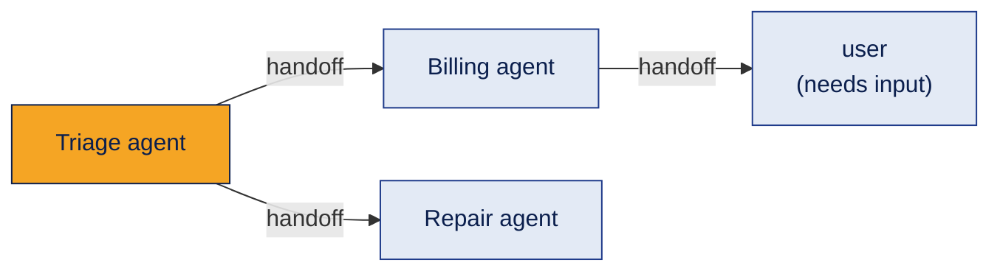
```python
from autogen_agentchat.teams import Swarm
from autogen_agentchat.conditions import HandoffTermination

triage = AssistantAgent("triage", model_client=model_client,
                        handoffs=["billing", "repair", "user"],
                        system_message="Send billing questions to billing and repairs to repair.")
billing = AssistantAgent("billing", model_client=model_client, handoffs=["triage", "user"])
repair = AssistantAgent("repair", model_client=model_client, handoffs=["triage", "user"])

team = Swarm([triage, billing, repair],
             termination_condition=HandoffTermination(target="user") | MaxMessageTermination(15))
```
Each name in `handoffs` becomes a tool the agent can call. The first participant speaks first. Handing off to `"user"` with `HandoffTermination` pauses the team so a person can answer; then you call `run()` again with their reply.

**Example**
"My refund hasn't arrived and the hinge is broken": triage hands off to billing; billing finishes and hands back to triage, which hands off to repair.

**Where it's used**
Customer support routing, triage flows, any "pass it to the right department" pattern.

**Common mistake**
Handoff loops: A hands to B and B hands back to A again and again. Always add a message limit, and keep handoff options minimal.

**Interview questions**
1. **Q:** How is Swarm different from Selector? **A:** In Swarm the current agent picks the next one through a handoff; in Selector a separate model chooses.
2. **Q:** How is a handoff implemented? **A:** As a tool call that produces a `HandoffMessage`.
3. **Q:** Who speaks first in a Swarm? **A:** The first participant in the list.
4. **Q:** How do you pause for a human? **A:** Hand off to "user" and stop with `HandoffTermination`.
5. **Q:** What model ability does Swarm need? **A:** Tool calling, because handoffs are tools.

**In one line**
In a swarm, each agent passes the baton to the next.

---

## 10. GraphFlow: workflows as a graph

**What it is**
A team where **you draw the route** as a directed graph: who goes after whom, which branch to take, and where loops are allowed. The most controlled team type in AutoGen.

**How it works**
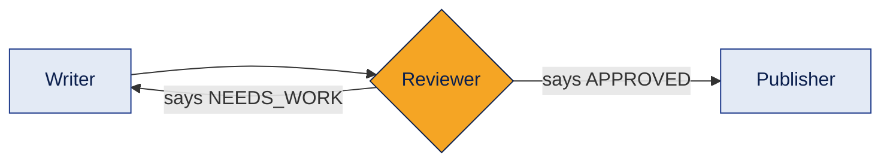
```python
from autogen_agentchat.teams import DiGraphBuilder, GraphFlow

builder = DiGraphBuilder()
builder.add_node(writer).add_node(reviewer).add_node(publisher)
builder.add_edge(writer, reviewer)
builder.add_edge(reviewer, publisher, condition="APPROVED")    # text match
builder.add_edge(reviewer, writer, condition="NEEDS_WORK")     # loop back
builder.set_entry_point(writer)

flow = GraphFlow(builder.get_participants(), graph=builder.build(),
                 termination_condition=MaxMessageTermination(12))
result = await flow.run(task="Reply to the cracked screen customer.")
```

| Building block | Meaning |
|---|---|
| `add_node(agent)` | Add an agent to the graph |
| `add_edge(a, b)` | b runs after a |
| `condition=` | A word to find in a's message, or a function on the message |
| Several edges out of one node | Parallel branches (fan out) |
| `activation_group`, `activation_condition` | Should the next node wait for **all** or **any** incoming branches |
| `set_entry_point(agent)` | Where the flow starts |

**Example**
The reviewer says NEEDS_WORK, the flow goes back to the writer, the second draft is APPROVED, and the publisher sends it. Every path is something you designed.

**Where it's used**
Business processes with clear steps and branches: approvals, document pipelines, review loops.

**Common mistake**
A loop with no exit. If the reviewer never says APPROVED, the writer and reviewer loop until a limit stops them, so always keep a message limit on a graph with cycles.

**Interview questions**
1. **Q:** When choose GraphFlow over Selector? **A:** When the steps and branches are known and must be predictable.
2. **Q:** How do you add a branch? **A:** `add_edge` with a `condition`.
3. **Q:** Can a graph loop? **A:** Yes, an edge can point back to an earlier node; keep a limit on it.
4. **Q:** How do you run steps in parallel? **A:** Several edges out of one node; the joining node waits for all or any.
5. **Q:** What is the similar idea in LangGraph? **A:** Nodes, edges and conditional edges in a state graph.

**In one line**
GraphFlow is the route map: you decide every turn and branch.

---

## 11. Human in the loop

**What it is**
Bringing a person into the workflow to give input, feedback or **approval** before risky actions. In a real app, approval is a control **your code enforces**, not a polite request in a prompt.

**How it works**
Three ways in AutoGen:

| Way | How | Good for |
|---|---|---|
| `UserProxyAgent` | A team member whose "reply" comes from a person through `input_func` | Feedback during a run |
| Stop, ask, run again | The team stops (for example, a handoff to "user"), your app collects the answer, then calls `run()` again | Web apps, chat UIs |
| Approval in code | Code checks a structured verdict and asks a person before acting | Payments, refunds, sending emails |

```python
from autogen_agentchat.agents import UserProxyAgent

manager = UserProxyAgent("store_manager", input_func=input)   # in a web app, read from the UI instead
team = RoundRobinGroupChat([researcher, writer, manager],
                           termination_condition=TextMentionTermination("APPROVE", sources=["store_manager"])
                                                 | MaxMessageTermination(10))
```
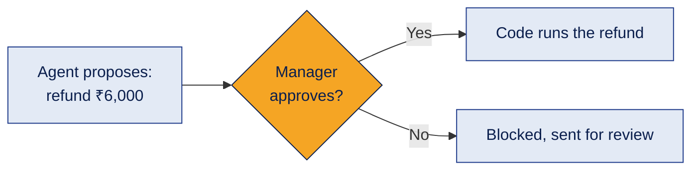

**Example**
The agents decide a laptop needs a full refund. The refund only happens if the store manager types "approve". The decision comes from the agent's structured verdict, not a hardcoded value.

**Where it's used**
Refunds, payments, deletions, sending messages to customers, anything costly or hard to undo.

**Common mistakes**
- A `UserProxyAgent` blocks the whole team while waiting. In a web app, prefer "stop, ask, run again".
- Approval code that is not connected to the agent's actual output, so it approves something other than what the agent decided.

**Interview questions**
1. **Q:** What is `UserProxyAgent`? **A:** An agent that stands in for a person; its reply comes from `input_func`.
2. **Q:** Why is approval an application control? **A:** Because a prompt can be ignored; code that refuses to act without approval cannot.
3. **Q:** What is the downside of `UserProxyAgent`? **A:** It blocks the team until the person replies.
4. **Q:** How do you pause and resume instead? **A:** Stop the team (for example with a handoff to "user"), then call `run()` again with the reply.
5. **Q:** Which actions need human approval? **A:** Anything costly, external or irreversible.

**In one line**
Agents propose, people approve, code enforces.

---

## 12. Code execution

**What it is**
Letting an agent's generated code actually run. One agent writes code; a **CodeExecutorAgent** runs it and reports the output.

**How it works**
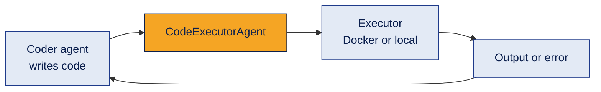
The Docker executor needs an extra package and Docker running on the machine:
```bash
pip install -U "autogen-ext[docker]"
```
```python
from autogen_agentchat.agents import CodeExecutorAgent
from autogen_ext.code_executors.docker import DockerCommandLineCodeExecutor

executor = DockerCommandLineCodeExecutor(work_dir="coding")   # runs inside a container
await executor.start()

runner = CodeExecutorAgent("runner", code_executor=executor)
team = RoundRobinGroupChat([coder, runner], termination_condition=MaxMessageTermination(6))
result = await team.run(task="Count how many returns in returns.csv were screen damage.")

await executor.stop()
```

| Executor | Where code runs | Safety |
|---|---|---|
| `DockerCommandLineCodeExecutor` | In a container | Isolated. The safer choice |
| `LocalCommandLineCodeExecutor` | On your own machine | Not isolated. AutoGen itself warns about this |

`CodeExecutorAgent` also accepts an `approval_func` so a person or a rule approves each piece of code before it runs.

**Example**
The coder writes code to count screen damage returns; the runner executes it in Docker and replies with the number; the coder uses it in the answer.

**Where it's used**
Data analysis, code generation with tests, automated fixes.

**Common mistake**
Running generated code with `exec()` or the local executor on a real machine. Generated code is untrusted; run it in a sandbox with time, memory, file and network limits.

**Interview questions**
1. **Q:** Agent vs code executor? **A:** The agent decides what code to write; the executor actually runs it.
2. **Q:** Why prefer Docker execution? **A:** It isolates untrusted code from your machine.
3. **Q:** Does a timeout make `exec()` safe? **A:** No. The execution environment itself must be isolated.
4. **Q:** How do you approve code before it runs? **A:** `approval_func` on `CodeExecutorAgent`.
5. **Q:** What limits should a sandbox have? **A:** CPU, memory, time, file access and network.

**In one line**
Let agents write code, but run it only in a sandbox.

---

## 13. Memory, model context and saved state

**What it is**
Three different things that are easy to mix up.

| Concept | Purpose | Example |
|---|---|---|
| **Model context** | How much of **this conversation** the agent sends to the LLM | Only the last 10 messages |
| **Memory** | Extra facts added to the agent's context **from a store** | "This customer prefers repair over replacement" |
| **Saved state** | A snapshot of agents or teams you can save and **load later** | Resume a support chat tomorrow |

**How it works**
```python
from autogen_core.model_context import BufferedChatCompletionContext
from autogen_core.memory import ListMemory, MemoryContent, MemoryMimeType

prefs = ListMemory()
await prefs.add(MemoryContent(content="Customer prefers repair over replacement.",
                              mime_type=MemoryMimeType.TEXT))

agent = AssistantAgent(
    "writer", model_client=model_client,
    model_context=BufferedChatCompletionContext(buffer_size=10),   # last 10 messages only
    memory=[prefs],                                                # facts added before each reply
)

state = await team.save_state()     # a plain dict: store it as JSON in a database
await team.load_state(state)        # later, continue from the same point
```
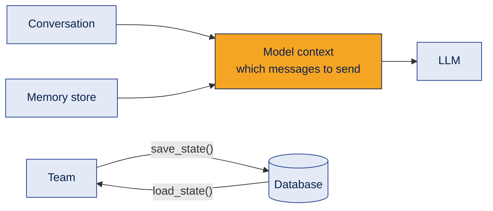
Other context options: `TokenLimitedChatCompletionContext` (limit by tokens) and `HeadAndTailChatCompletionContext` (keep the first and the last messages). By default the context is unbounded.

**Example**
A long chat keeps only recent messages to save tokens, memory reminds the writer about the customer's preference, and the saved state lets the chat resume after a server restart.

**Where it's used**
Long conversations, personalisation, apps that must survive restarts.

**Common mistake**
Thinking memory and state are the same. State resumes **one** conversation; memory supplies facts **across** conversations.

**Interview questions**
1. **Q:** Model context vs memory? **A:** Context controls which conversation messages go to the LLM; memory injects extra facts from a store.
2. **Q:** Why limit the model context? **A:** To control token cost and stay within the model's limit.
3. **Q:** How do you resume a team later? **A:** `save_state()`, store the dict, then `load_state()`.
4. **Q:** What is the default model context? **A:** Unbounded: the whole history is sent.
5. **Q:** What is `ListMemory`? **A:** A simple memory store that adds its items to the agent's context.

**In one line**
Context is what the agent sees now, memory is what it remembers, state is how you resume.

---

## 14. Streaming, token usage and cost

**What it is**
Seeing a run **as it happens** instead of waiting for the end, and measuring how many tokens each step used.

**How it works**
```python
from autogen_agentchat.ui import Console

# See every message live in the terminal
await Console(team.run_stream(task="Cracked screen, 8 months old. Covered?"))

# Or handle messages yourself, for example in a web UI
async for item in team.run_stream(task="..."):
    print(type(item).__name__)               # the last item is the TaskResult
```
Token usage is on each message that came from the LLM:
```python
total_in = total_out = 0
for msg in result.messages:
    if msg.models_usage:                      # None for user messages and tool results
        total_in += msg.models_usage.prompt_tokens
        total_out += msg.models_usage.completion_tokens
print("Input tokens:", total_in, "Output tokens:", total_out)
# cost = tokens × your provider's current price per token
```
Set `model_client_stream=True` on an agent to stream the reply word by word.

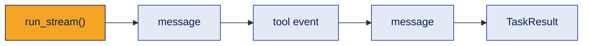

**Example**
The help desk UI shows "Researcher is checking the policy…" while the team works, and the logs record about how many tokens each answer cost.

**Where it's used**
Chat UIs, debugging, cost dashboards.

**Common mistake**
Reporting cost as zero because nobody added up `models_usage`. Also note that the selector's own LLM calls in SelectorGroupChat cost tokens too.

**Interview questions**
1. **Q:** `run()` vs `run_stream()`? **A:** `run()` returns at the end; `run_stream()` yields each message as it happens, then the TaskResult.
2. **Q:** What does `Console` do? **A:** Prints a streamed run neatly in the terminal.
3. **Q:** Where are token counts? **A:** `models_usage` on messages produced by the LLM.
4. **Q:** How do you estimate cost? **A:** Add up prompt and completion tokens and multiply by the provider's current prices.
5. **Q:** Why stream in a UI? **A:** Users see progress instead of a frozen screen.

**In one line**
Watch it live, count every token.

---

## 15. Declarative config and AutoGen Studio

**What it is**
**Declarative config** means describing agents and teams as data (JSON or YAML) instead of only Python code. **AutoGen Studio** is a no-code web UI for building and testing teams.

**How it works**
```python
config = team.dump_component()              # the team as data
print(config.model_dump_json(indent=2))     # save this to a file or database

from autogen_agentchat.teams import RoundRobinGroupChat
same_team = RoundRobinGroupChat.load_component(config)   # rebuild it from the data
```
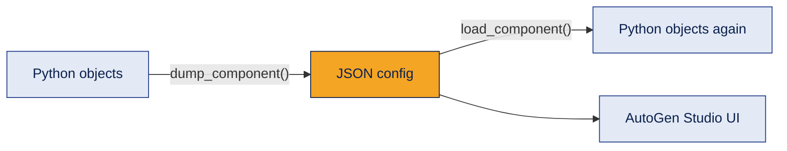
```bash
pip install -U autogenstudio
autogenstudio ui --port 8080
```

**Example**
The help desk team is saved as JSON, so a teammate can open it in Studio, change the reviewer's instructions and test it without editing code.

**Where it's used**
Sharing team setups, versioning them, quick prototypes and demos.

**Common mistake**
Treating AutoGen Studio as a production app. Its own docs describe it as a prototyping tool; real apps need their own authentication, security and deployment.

**Interview questions**
1. **Q:** Imperative vs declarative setup? **A:** Imperative builds objects step by step in code; declarative describes what should exist as data.
2. **Q:** How do you export a team? **A:** `dump_component()`.
3. **Q:** How do you rebuild it? **A:** `load_component(config)` on the class.
4. **Q:** What is AutoGen Studio for? **A:** Building and testing teams in a browser without code.
5. **Q:** Is Studio production ready? **A:** No, it is meant for prototyping.

**In one line**
Describe the team as data so it can be saved, shared and edited.

---

## 16. Failure patterns and a production checklist

**What it is**
The ways multi-agent teams go wrong in practice, and what to add before real users depend on one.

**How it works**

| Failure pattern | What it looks like | Fix |
|---|---|---|
| Early stop | A later agent never speaks because the stop word came earlier | Put the final agent last, use `sources` |
| Polite chatter | Work is done, but agents keep saying "thank you" until the limit | A clear success condition plus a limit |
| Drift between runs | Same input, different counts or severities each time | Structured output, fixed criteria, evals |
| Raw tool output | The customer receives "50.0" | `reflect_on_tool_use=True` |
| Text parsing bugs | `"PASS" in text` matches `passed=False` | Read typed fields, not strings |
| Infinite loops | Handoffs or graph cycles never end | Message, token and time limits |
| Unsafe code | Generated code runs on the host | Docker executor or a sandbox |
| Fake approval | Approval not linked to the agent's actual decision | Approve the structured verdict itself |
| Unknown cost | No one adds up tokens | Sum `models_usage` per run |

**Production checklist**
- **Control flow in plain code:** retries, timeouts, limits and approvals are deterministic code. Use agents only where judgement is needed.
- **Failure handling:** classify failures first. Retry with backoff for rate limits and timeouts, send real bugs to a fixer agent, and stop on security problems.
- **Validation:** structured output and checks between agents, not only at the end.
- **Observability:** one run id per task, logged on every step with agent, status, latency and tokens.
- **Security:** least-privilege tools, sandboxed execution, keys in a secret manager.
- **Human approval:** for every costly or irreversible action.
- **Evals:** run the same test set after every change and compare quality, cost and time.

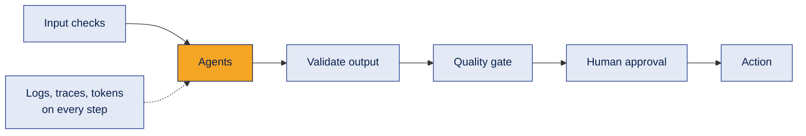

**Example**
A help desk team that "worked" in testing gave different coverage verdicts for the same question on different runs. Structured output plus an eval set made the problem visible and measurable.

**Where it's used**
Before any agent system reaches real users.

**Common mistake**
Treating "it ran without errors" as "it works". A finished run can still give a wrong or inconsistent answer.

**Interview questions**
1. **Q:** Why keep control flow in plain code? **A:** It is predictable, testable and cheap; LLMs are not.
2. **Q:** Retry vs recovery? **A:** Retry repeats the same call for temporary problems; recovery changes something, like asking a fixer agent.
3. **Q:** Which failures should never be retried? **A:** Security and guardrail violations; stop and escalate.
4. **Q:** Why does the same input give different results? **A:** LLM randomness and free text handoffs; fix with structure, fixed criteria and evals.
5. **Q:** What should every log line include? **A:** Run id, agent, action, status, latency and tokens.

**In one line**
Agents for judgement, code for control, and measure everything.

---

## 17. AutoGen vs other frameworks, and moving to Microsoft Agent Framework

**What it is**
Where AutoGen fits next to LangGraph and CrewAI, and what replaces it going forward.

**How it works**

**AutoGen vs LangGraph vs CrewAI**

| | AutoGen | LangGraph | CrewAI |
|---|---|---|---|
| Thinking style | Agents in a conversation | A flowchart of steps | A team of roles |
| Coordination | Round robin, selector, swarm, graph | Nodes and conditional edges | Sequential or hierarchical process |
| Control | Medium (high with GraphFlow) | Highest | Lower |
| Watch out for | Endless chats, maintenance mode | More code to write | Extra LLM calls |

**AutoGen to Microsoft Agent Framework** (from Microsoft's migration guide, checked October 2026)

| AutoGen | Microsoft Agent Framework |
|---|---|
| `AssistantAgent` | `Agent` (keeps calling tools until it has a final answer) |
| `FunctionTool` | `@tool` decorator |
| `AgentTool` | `agent.as_tool()` |
| `RoundRobinGroupChat` | `SequentialBuilder` |
| `GraphFlow` | `WorkflowBuilder` (typed data flow; an evolution, not a copy) |
| `MagenticOneGroupChat` | `MagenticBuilder` |
| Conversation history | `AgentSession` |
| `SelectorGroupChat`, `Swarm` | Not mapped yet in the guide (listed as future patterns) |

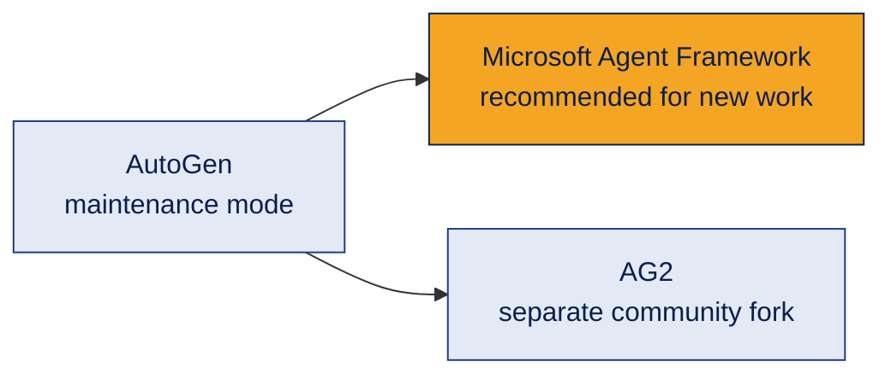

**Example**
An existing AutoGen help desk can stay as it is. A new one in a company using Microsoft tools would start on Microsoft Agent Framework, reusing the same ideas: agents, tools, sessions and workflows.

**Where it's used**
Choosing a framework, and migration planning.

**Common mistake**
Thinking AutoGen knowledge is wasted. The concepts (agents, tools, teams, stop rules, handoffs, graphs, human approval) are the same in every framework; only class names change.

**Interview questions**
1. **Q:** Should a new project start on AutoGen today? **A:** Usually not; it is in maintenance mode and Microsoft recommends Agent Framework for new work.
2. **Q:** What replaces `AssistantAgent`? **A:** `Agent` in Microsoft Agent Framework.
3. **Q:** What replaces GraphFlow? **A:** Workflows built with `WorkflowBuilder`.
4. **Q:** What is AG2? **A:** A separate community fork of AutoGen.
5. **Q:** What carries over between frameworks? **A:** The patterns: agents, tools, coordination, termination, state and human approval.

**In one line**
Learn the patterns once; the framework is just the current syntax.

**Practice design:** design a three-agent AutoGen team for a college hostel complaint desk (room repairs, mess food, fee questions). Choose the team type, write each agent's description, define one success rule and two safety stop rules, decide which steps need structured output, and mark which action needs a warden's approval.

[← CrewAI deep dive](crewai.md) · [Back to Agent Frameworks](README.md)
