# 07 · CrewAI Deep Dive

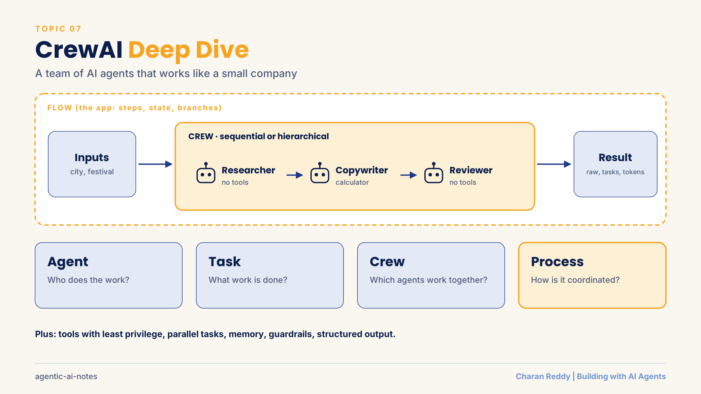

CrewAI builds **teams of AI agents that work like a small company**: each agent has a job title, a goal and tools, and the team completes tasks together.

> **Status:** 📘 Concepts learned · runnable demo in [`demos/crewai_team.py`](demos/crewai_team.py). Checked against CrewAI 1.15 docs. CrewAI changes often (memory and project files changed recently), so check the docs when you code.

[← Back to Agent Frameworks](README.md) · [← All topics](../README.md)

## Contents
1. [The big picture: Flows and Crews](#1-the-big-picture-flows-and-crews)
2. [Agent](#2-agent)
3. [Task](#3-task)
4. [Crew, kickoff and the result](#4-crew-kickoff-and-the-result)
5. [Process: sequential vs hierarchical](#5-process-sequential-vs-hierarchical)
6. [Tools and permissions](#6-tools-and-permissions)
7. [Parallel tasks](#7-parallel-tasks)
8. [Task context vs memory vs knowledge](#8-task-context-vs-memory-vs-knowledge)
9. [Guardrails and structured output](#9-guardrails-and-structured-output)
10. [Flows](#10-flows)
11. [Evaluating a crew and failure modes](#11-evaluating-a-crew-and-failure-modes)
12. [Production checklist, and CrewAI vs LangGraph](#12-production-checklist-and-crewai-vs-langgraph)

**Example used throughout:** a home bakery's Diwali offer post, made by a Researcher, a Copywriter and a Reviewer.

---

## 1. The big picture: Flows and Crews

**What it is**
CrewAI has two main building blocks. A **Flow** controls the whole app. A **Crew** is a team of agents that handles one complex job.

**How it works**
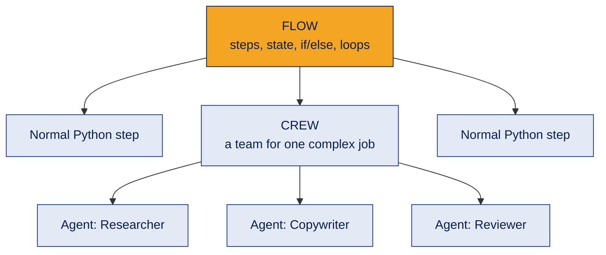
The four core ideas of a crew:

| Concept | Question it answers |
|---|---|
| **Agent** | Who does the work? |
| **Task** | What work is done? |
| **Crew** | Which agents work together? |
| **Process** | How is the work coordinated? |

> Agent + Task → Crew → Process → Result

**Example**
One agent doing everything: User → LLM → answer. A crew: User → Researcher → Copywriter → Reviewer → answer. The key idea is **specialisation**.

**Where it's used**
Content pipelines, research reports, market analysis, any work that maps to a team of specialists.

**Common mistake**
Making everything a crew. CrewAI's docs recommend starting with a Flow and using a Crew only for steps that need a team.

**Interview questions**
1. **Q:** Flow vs Crew? **A:** A Flow controls the app's steps and state; a Crew is an autonomous team for one complex step.
2. **Q:** Name CrewAI's four core concepts. **A:** Agent, Task, Crew and Process.
3. **Q:** What is the main idea behind CrewAI? **A:** Splitting work among specialised agents.
4. **Q:** When is one agent better than a crew? **A:** For simple tasks one agent can do reliably.
5. **Q:** Where does a Crew sit in a Flow? **A:** Inside a Flow step that needs teamwork.

**In one line**
Flows give control; crews give teamwork.

---

## 2. Agent

**What it is**
An AI team member defined like a job description: **role**, **goal** and **backstory**, plus an LLM and tools.

**How it works**
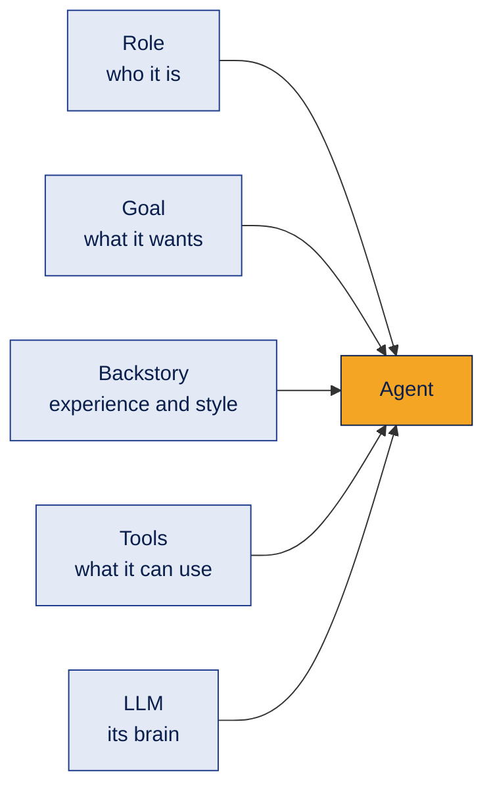
```python
from crewai import Agent

copywriter = Agent(
    role="Instagram Copywriter",
    goal="Write a short, warm festival offer post that makes people order",
    backstory="You write simple, friendly captions for home businesses.",
    tools=[price_calculator],
    llm="openai/gpt-4o-mini",     # "provider/model"
    max_iter=5,
)
```

| Setting | Meaning | Default |
|---|---|---|
| `role`, `goal`, `backstory` | Who the agent is | Required |
| `tools` | Tools it may use | Empty |
| `llm` | Which model | From settings |
| `allow_delegation` | Can it hand work to others? | False |
| `max_iter` | Max thinking rounds before it must answer | 20 |
| `max_execution_time` | Time limit | None |
| `verbose` | Print its steps | False |

**Example**
The Copywriter has a calculator; the Researcher and Reviewer do not.

**Where it's used**
Every crew.

**Common mistake**
Vague goals like "be helpful". Write specific, measurable goals.

**Interview questions**
1. **Q:** What three fields define an agent? **A:** Role, goal and backstory.
2. **Q:** What does `allow_delegation` do? **A:** Lets the agent pass work to other agents. Off by default.
3. **Q:** Why set `max_iter`? **A:** To stop an agent thinking in circles.
4. **Q:** Can agents use different models? **A:** Yes, each agent can have its own `llm`.
5. **Q:** What does the backstory change? **A:** The agent's style and expertise in its answers.

**In one line**
An agent is a team member with a job title, a goal and tools.

---

## 3. Task

**What it is**
One piece of work with a clear **description**, an **expected output** and an **agent**.

**How it works**
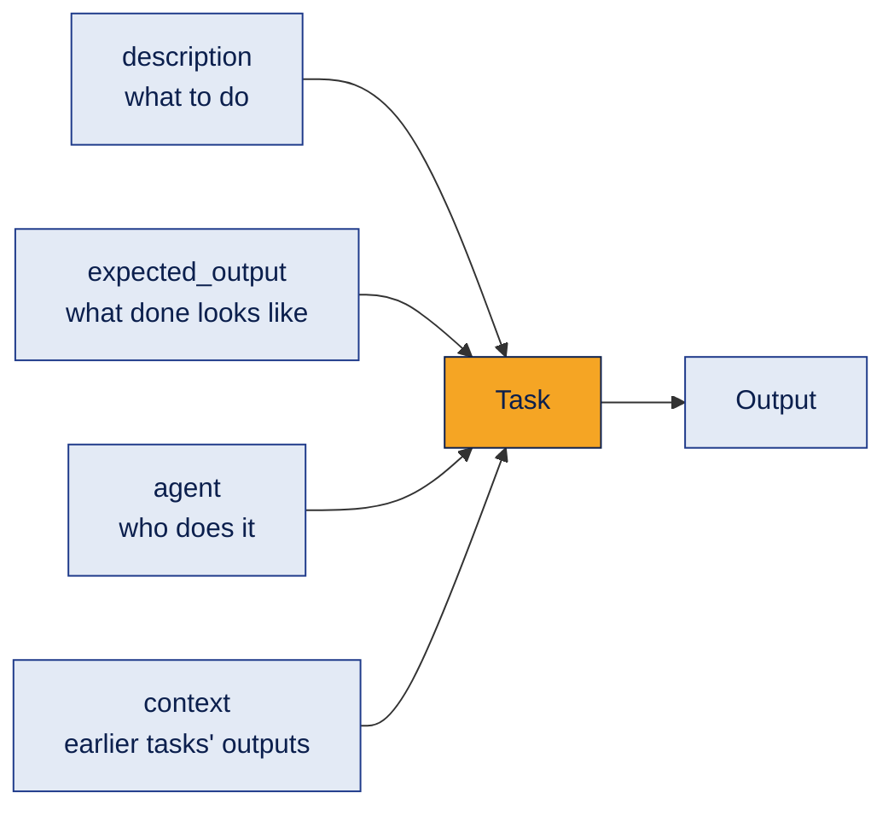
```python
from crewai import Task

research = Task(
    description="List what customers in {city} care about when buying festival cakes for {festival}.",
    expected_output="5 short bullet points.",
    agent=researcher,
)
write = Task(
    description="Write an Instagram caption for the {festival} offer...",
    expected_output="A caption under 150 words with the offer price in ₹.",
    agent=copywriter,
    context=[research],          # gets the research output
)
```

| Setting | Meaning |
|---|---|
| `context` | Earlier tasks whose output this task needs |
| `tools` | Tools for this task only |
| `async_execution` | Run without waiting (default False) |
| `output_pydantic` / `output_json` | Force structured output |
| `output_file` | Save the result to a file |
| `human_input` | A person reviews the answer (default False) |
| `guardrail` | Check the output before it moves on |

**Example**
The writing task uses `context=[research]`, so the Copywriter sees the Researcher's points.

**Where it's used**
Breaking a job into clear steps.

**Common mistake**
Skipping `expected_output`. Without it, the agent guesses what "done" means.

**Interview questions**
1. **Q:** Agent vs Task? **A:** The agent is who does the work; the task is what work is done.
2. **Q:** What does `context` do? **A:** Passes earlier tasks' outputs into this task.
3. **Q:** How do `{placeholders}` get filled? **A:** From `inputs` in `kickoff(inputs={...})`.
4. **Q:** How do you add human review? **A:** `human_input=True`.
5. **Q:** Why write `expected_output`? **A:** It defines the finish line for the agent.

**In one line**
A task is one clear job with a defined finish line.

---

## 4. Crew, kickoff and the result

**What it is**
A **Crew** groups agents and tasks with a process. `kickoff()` runs it and returns a **CrewOutput**.

**How it works**
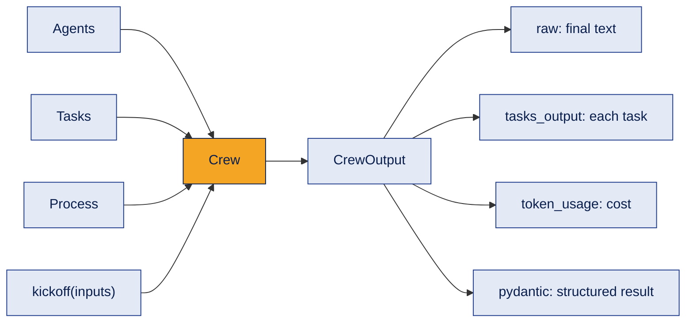
```python
from crewai import Crew, Process

crew = Crew(agents=[researcher, copywriter, reviewer],
            tasks=[research, write, review],
            process=Process.sequential)
result = crew.kickoff(inputs={"city": "Warangal", "festival": "Diwali", "price": "650"})

print(result.raw)                                   # final answer
for t in result.tasks_output:                       # every task's output
    print(t.agent, len(t.raw))
print(result.token_usage.total_tokens)              # cost check
```
In a notebook you may see `await crew.kickoff_async()`, the async version of the same thing.

**Example**
Three tasks give three task outputs. Token usage shows how many LLM requests the crew made.

**Where it's used**
Running and inspecting every crew.

**Common mistake**
Reading only `result.raw`. Check `tasks_output` to see where quality dropped, and `token_usage` to see the cost.

**Interview questions**
1. **Q:** What does a Crew contain? **A:** Agents, tasks and a process.
2. **Q:** How do you run it? **A:** `crew.kickoff(inputs={...})` (or `kickoff_async`).
3. **Q:** Where is the final text? **A:** `result.raw`.
4. **Q:** How do you see each task's work? **A:** `result.tasks_output`.
5. **Q:** How do you track cost? **A:** `result.token_usage`.

**In one line**
A crew runs with kickoff; the result holds the answer, every step and the cost.

---

## 5. Process: sequential vs hierarchical

**What it is**
How the crew coordinates work. There are exactly **two** process types.

**How it works**
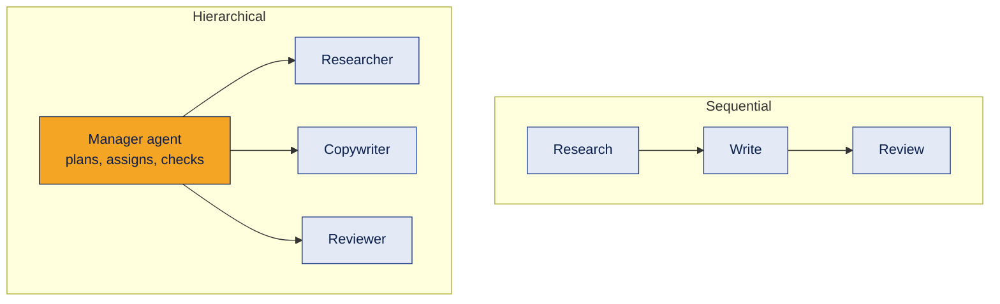
```python
crew = Crew(agents=[researcher, copywriter, reviewer], tasks=tasks,
            process=Process.hierarchical, manager_agent=manager)   # or manager_llm=...
```

| | Sequential | Hierarchical |
|---|---|---|
| Order | Tasks run in the listed order | A manager decides who does what |
| Assignment | You assign each task's agent | Tasks are not pre-assigned |
| Needs | Nothing extra | `manager_agent` or `manager_llm` |
| Cost | Lower | Higher (manager calls) |
| Good for | Dependent steps | Work that needs judgment and delegation |

**Example**
Bakery post → sequential (research must come before writing). An open-ended product plan → hierarchical.

**Common mistake**
Judging a process by output length. A longer answer is not automatically better; compare quality, cost and time on the same task.

**Interview questions**
1. **Q:** Name the two process types. **A:** Sequential and hierarchical.
2. **Q:** What does hierarchical need? **A:** A manager agent or a manager LLM.
3. **Q:** In hierarchical mode, who assigns tasks? **A:** The manager.
4. **Q:** Which is cheaper and easier to trace? **A:** Sequential.
5. **Q:** How should you compare them? **A:** Same task, same criteria: quality, cost, latency.

**In one line**
Sequential is a line; hierarchical is a manager with a team.

---

## 6. Tools and permissions

**What it is**
Tools let agents act: calculate, search, read files, call APIs. Give each agent **only the tools its role needs** (least privilege).

**How it works**
```python
from crewai.tools import tool

@tool("Price Calculator")
def price_calculator(expression: str) -> str:
    """Calculate prices and discounts, for example '40 * 450 * 0.85'."""
    return calculate(expression)          # safe parser, never eval()

print(price_calculator.run("650 * 0.85"))   # test the tool on its own
```
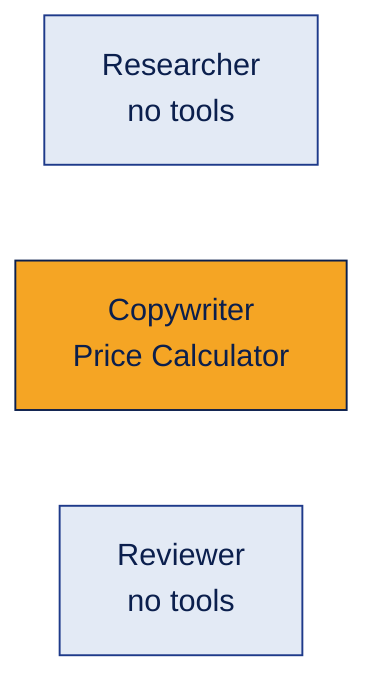
Tell the agent in its backstory or task to **use the tool instead of doing maths in its head**.

**Example**
The Copywriter calls the calculator for 650 × 0.85 = ₹552.5 instead of guessing.

**Common mistake**
Giving every agent every tool. More tools mean more confusion and more security risk.

**Interview questions**
1. **Q:** How do you make a custom CrewAI tool? **A:** With the `@tool("Name")` decorator from `crewai.tools`.
2. **Q:** How do you test a tool alone? **A:** `tool.run(...)`.
3. **Q:** What is least privilege? **A:** Each agent gets only the tools its role needs.
4. **Q:** Why tell an agent to use the calculator? **A:** LLMs make arithmetic mistakes; tools are exact.
5. **Q:** How do you check tools worked? **A:** Look at the logs and `has_tool_failures` on the result.

**In one line**
Right tool, right agent, nothing more.

---

## 7. Parallel tasks

**What it is**
Independent tasks can run at the same time with `async_execution=True`. A later task waits for them through `context`.

**How it works**
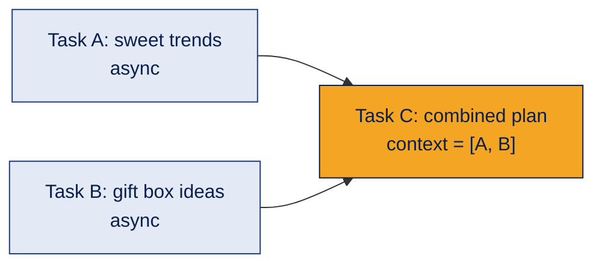
```python
sweets = Task(description="3 Diwali sweet trends", expected_output="3 bullets",
              agent=researcher, async_execution=True)
gifting = Task(description="3 gift box ideas", expected_output="3 bullets",
               agent=copywriter, async_execution=True)
summary = Task(description="Combine both lists", expected_output="A short plan",
               agent=reviewer, context=[sweets, gifting])   # waits for both
```

**Example**
Trends and gift ideas don't depend on each other, so they run together. The summary waits for both.

**Common mistake**
Assuming tasks ran in parallel just because the crew finished. Check the logs or measure time to confirm.

**Interview questions**
1. **Q:** How do you run a task in parallel? **A:** `async_execution=True`.
2. **Q:** How does a later task wait for parallel ones? **A:** By listing them in its `context`.
3. **Q:** When can tasks run in parallel? **A:** When neither needs the other's output.
4. **Q:** Main benefit? **A:** Less total waiting time.
5. **Q:** What must you still handle? **A:** Combining results and failures in any branch.

**In one line**
Independent work runs together; dependent work waits.

---

## 8. Task context vs memory vs knowledge

**What it is**
Three different ways agents get information. They are easy to mix up.

**How it works**
| Concept | Purpose | Example |
|---|---|---|
| **Task context** | Pass outputs between tasks **in this run** | The Copywriter receives the Researcher's points |
| **Memory** | Store and recall information **across runs** | Remembering a customer's preferred cake flavour |
| **Knowledge** | Give agents **reference material** | The bakery's menu or price list as a source |

**Memory (current version):** CrewAI now uses **one unified `Memory` system** that replaced the older separate types (short-term, long-term, entity). Turn it on with `Crew(memory=True)`. Agents can get a **scoped** part of memory for private context. It is stored locally by default.

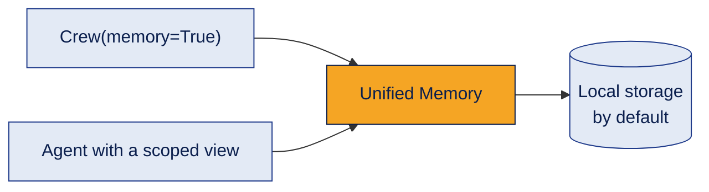

**Example**
Context gives this run's research to the writer. Memory remembers that a customer prefers eggless cakes for next time.

**Common mistake**
- Expecting memory to remember **everything**. What is stored and recalled depends on its setup.
- Following old tutorials that use the separate memory types.

**Interview questions**
1. **Q:** Task context vs memory? **A:** Context passes outputs within one run; memory persists across runs.
2. **Q:** What is knowledge in CrewAI? **A:** Reference sources like documents that agents can use.
3. **Q:** How do you enable memory? **A:** `memory=True` on the crew.
4. **Q:** What changed in CrewAI memory? **A:** One unified `Memory` class replaced separate types.
5. **Q:** Should every agent share all memory? **A:** Not always. Scoped memory limits what each agent sees.

**In one line**
Context is for this run, memory is for later, knowledge is for reference.

---

## 9. Guardrails and structured output

**What it is**
A **guardrail** checks a task's output before it moves on. **Structured output** forces a fixed shape.

**How it works**
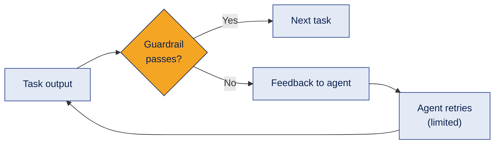
```python
from crewai import TaskOutput
from pydantic import BaseModel

def caption_guardrail(output: TaskOutput) -> tuple[bool, str]:
    if "₹" not in output.raw:
        return False, "Include the offer price with the ₹ sign."
    return True, output.raw

class OfferPost(BaseModel):
    headline: str
    body: str
    offer_price: str
    hashtags: list[str]

write = Task(..., guardrail=caption_guardrail, guardrail_max_retries=2)
review = Task(..., output_pydantic=OfferPost)    # result.pydantic is an OfferPost
```
Guardrails can also be written in plain words and checked by an LLM, and several can run in order.

**Example**
A caption without a price is sent back to the Copywriter with the feedback "Include the offer price".

**Common mistake**
Passing unchecked free text between agents. One bad output spoils every later step.

**Interview questions**
1. **Q:** What is a task guardrail? **A:** A check that validates output before the next task.
2. **Q:** What does a function guardrail return? **A:** `(True, output)` to pass or `(False, feedback)` to fail.
3. **Q:** What happens on failure? **A:** Feedback goes to the agent, which retries up to a limit.
4. **Q:** How do you force structured output? **A:** `output_pydantic=MyModel`.
5. **Q:** Where is the structured result? **A:** `result.pydantic`.

**In one line**
Check every handoff, and force a shape when code needs to read it.

---

## 10. Flows

**What it is**
An event-driven workflow that controls the app: steps, shared state, branches and loops. Crews can run inside its steps.

**How it works**
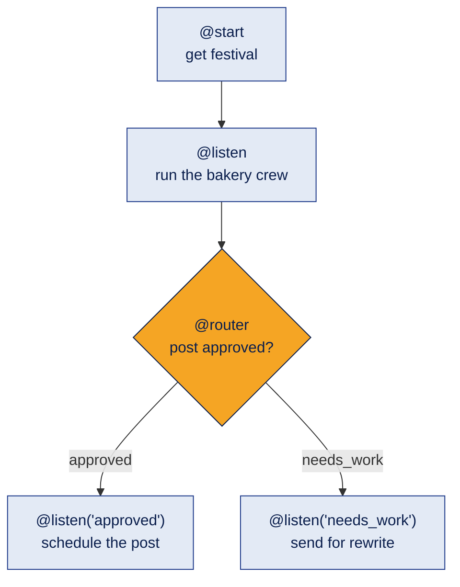

| Piece | Meaning |
|---|---|
| `@start()` | Where the flow begins |
| `@listen(step)` | Runs after a step and receives its output |
| `@router(step)` | Returns a label that picks the next path |
| `or_` / `and_` | Run when any / all listed steps finish |
| State | Shared data: a dict, or a Pydantic model |
| `@persist` | Saves state so a run can resume |

```python
from crewai.flow.flow import Flow, start, listen

class OfferFlow(Flow):
    @start()
    def pick_festival(self):
        self.state["festival"] = "Diwali"

    @listen(pick_festival)
    def make_post(self):
        result = bakery_crew.kickoff(inputs={"festival": self.state["festival"], ...})
        self.state["post"] = result.raw
```

**Common mistake**
Making every step a crew. Simple steps should be plain Python in a Flow: cheaper and predictable.

**Interview questions**
1. **Q:** What does `@router` do? **A:** Returns a label that decides the next path.
2. **Q:** What is flow state? **A:** Data shared across steps.
3. **Q:** How do you resume a flow? **A:** Use `@persist` and kick off with the saved state id.
4. **Q:** Can a flow call a crew? **A:** Yes, inside a step.
5. **Q:** Why start with a Flow? **A:** It gives predictable control; crews add autonomy only where needed.

**In one line**
A Flow is the plan; crews do the teamwork inside it.

---

## 11. Evaluating a crew and failure modes

**What it is**
A crew can **run successfully and still give a poor answer**. Evaluation checks the result, not just whether it finished.

**How it works**
| Check | Question |
|---|---|
| Task completion | Did every task produce an output? |
| Tool reliability | Did any required tool fail? |
| Quality | Are the claims relevant, accurate and supported? |
| Latency | How long did it take (measure real time)? |
| Cost | How many tokens and requests? |
| Fallbacks | What happens on a timeout, bad output or missing tool? |

| Failure mode | Fix |
|---|---|
| Vague agent goals | Specific, measurable goals |
| Irrelevant research | Restrict sources and check relevance |
| Wrong analysis | Cross-check evidence and assumptions |
| Unsupported claims | Require evidence or say "uncertain" |
| Tool failure or timeout | Retries, fallbacks, escalation |
| Too many LLM calls | Remove unnecessary agents and handoffs |
| Leaking sensitive data | Least privilege, protect credentials |
| Wrong memory recalled | Validate retrieved memory, limit access |

**Example**
The bakery crew finished with no tool failures, but the post claimed "best cakes in India". The Reviewer agent or a guardrail should catch claims like that.

**Common mistake**
Treating "it ran" as "it works". Successful execution is not successful problem solving.

**Interview questions**
1. **Q:** Name three metrics for a multi-agent workflow. **A:** Quality (accuracy), latency and cost (also tool failure rate).
2. **Q:** Why isn't "no errors" enough? **A:** The output can still be wrong or unsupported.
3. **Q:** What should happen when evidence is missing? **A:** Say so clearly, or send it to a human, instead of guessing.
4. **Q:** How do you reduce cost in a crew? **A:** Fewer agents and handoffs, smaller models for simple steps.
5. **Q:** Why compare processes on the same task? **A:** Different setups need the same criteria for a fair comparison.

**In one line**
Measure quality, cost and time, not just whether the crew finished.

---

## 12. Production checklist, and CrewAI vs LangGraph

**What it is**
What to add before a crew goes to real users, and how CrewAI compares with LangGraph.

**How it works**

**Production checklist**
- **Reliability:** retries, timeouts, a plan for when an agent fails
- **Cost and latency:** count LLM calls; run independent tasks in parallel
- **Security:** least-privilege tools; keys in environment variables or a secret manager, never in code or notebooks
- **Observability:** log task status, failures, duration and tokens, without logging secrets
- **Guardrails and evaluation:** validate outputs between tasks
- **Human approval:** before any important outside action (payments, posting, emails)

**CrewAI vs LangGraph**

| | CrewAI | LangGraph |
|---|---|---|
| Thinking style | A team of roles | A flowchart of steps |
| You define | Agents, tasks, a process | State, nodes, edges, routes |
| Control | Less (agents decide more) | Full (you design every path) |
| Strengths | Fast to build role-based teams | Approvals, retries, loops, long-running state |
| Watch out for | Extra LLM calls, less predictable | More code to write |

**Example**
A weekly content team → CrewAI. A refund system that must pause for a manager → LangGraph.

**Common mistake**
Picking a framework by popularity. Pick by how much control the problem needs.

**Interview questions**
1. **Q:** Name three things to add before production. **A:** Guardrails, observability and human approval for risky actions.
2. **Q:** Where should API keys live? **A:** In environment variables or a secret manager.
3. **Q:** CrewAI vs LangGraph in one line? **A:** CrewAI organises a team of roles; LangGraph gives precise control of every step.
4. **Q:** When choose LangGraph over CrewAI? **A:** When you need exact routing, pauses for approval, retries and saved state.
5. **Q:** When choose CrewAI? **A:** For quick, role-based collaboration like content or research teams.

**In one line**
CrewAI for teams of roles, LangGraph for precise control, and a checklist before any production use.

**Practice design:** design a three-agent crew for a college library helpdesk (book search, renewal rules, complaint routing). Define each agent's role and goal, the tasks and expected outputs, the tools and permissions, the process, and a human review step for anything the agents can't answer.

[← LangGraph deep dive](langgraph.md) · [Next: AutoGen deep dive →](autogen.md) · [Back to Agent Frameworks](README.md)
