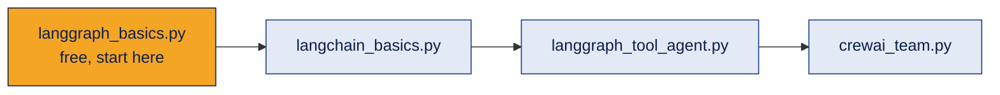

# Demos · Agent Frameworks

Runnable examples for the deep dives in [topic 07](../README.md).

| File | Shows | API key? |
|---|---|---|
| [`langgraph_basics.py`](langgraph_basics.py) | 8 small graphs: linear, conditional, cycle, parallel + reducer, checkpoint, human in the loop, retry, subgraph | **No.** Free |
| [`langchain_basics.py`](langchain_basics.py) | Messages, prompt template, LCEL chain, structured output, batch, tools, tool calling, agent with memory | Yes |
| [`langgraph_tool_agent.py`](langgraph_tool_agent.py) | The agent loop built by hand: LLM node, tool node, router, cycle, loop limit | Yes |
| [`crewai_team.py`](crewai_team.py) | A three-agent CrewAI team: sequential, hierarchical and parallel, with a tool, guardrail and structured output | Yes |
| [`safe_calculator.py`](safe_calculator.py) | Shared helper: a calculator tool that never uses `eval()` | No |



## How to run

1. Open a terminal in this `demos` folder.
2. Start with the free one:
   ```bash
   pip install -r requirements.txt
   python langgraph_basics.py
   ```
3. For the others, copy `.env.example` to `.env` and add your own OpenAI API key, then:
   ```bash
   python langchain_basics.py
   python langgraph_tool_agent.py
   ```
4. CrewAI installs many packages, so it has its own file. A separate virtual environment is a good idea:
   ```bash
   pip install -r requirements-crewai.txt
   python crewai_team.py          # Part 1 only
   python crewai_team.py all      # all three parts (more API calls)
   ```

**Safety:** keys live only in `.env`, which `.gitignore` keeps off GitHub. Never paste a key into code or a notebook cell.

## What to look for
- **langgraph_basics.py:** in part 7, `ConnectionError` is retried but `RuntimeError` is not. LangGraph's default retry policy only retries errors that look temporary (connection errors, HTTP 5xx).
- **langchain_basics.py:** the second question remembers Ravi because it uses the same `thread_id`. A new thread starts empty.
- **langgraph_tool_agent.py:** `pretty_print` shows Human → AI (tool calls) → Tool results → AI answer.
- **crewai_team.py:** only the Copywriter has the calculator tool. The guardrail rejects captions without a ₹ price or over 150 words.

## Good to know
- The control flow was tested with fake models, and `langgraph_basics.py` was run for real. Live LLM answers vary between runs.
- These frameworks change quickly. If an import fails, check the official docs for the current name.
- Shop, help desk and bakery data are made up for learning.

[← Back to topic 07](../README.md)
