# 07 · LangChain Deep Dive

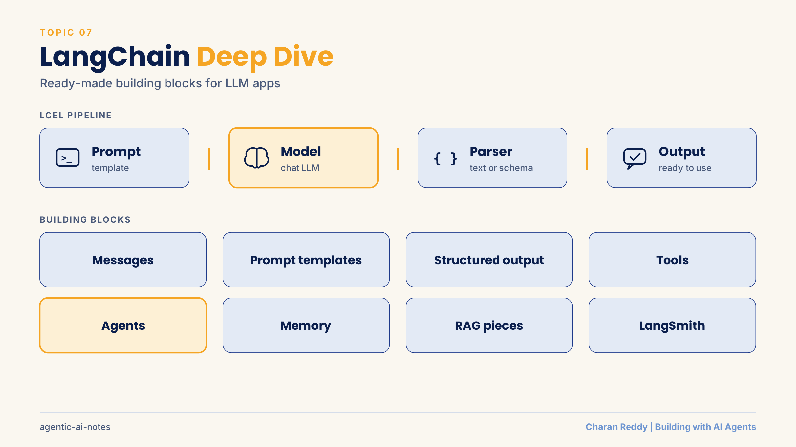

LangChain is a Python toolkit that gives you **ready-made building blocks** for LLM apps: models, messages, prompts, chains, structured output, tools, agents, memory and RAG pieces.

> **Status:** 📘 Concepts learned · runnable demo in [`demos/langchain_basics.py`](demos/langchain_basics.py). LangChain changes often, so check the official docs for the current API.

[← Back to Agent Frameworks](README.md) · [← All topics](../README.md)

## Contents
1. [Why LangChain?](#1-why-langchain)
2. [Chat models and AIMessage](#2-chat-models-and-aimessage)
3. [Messages](#3-messages)
4. [Prompt templates](#4-prompt-templates)
5. [LCEL and Runnables](#5-lcel-and-runnables)
6. [Output parsers and structured output](#6-output-parsers-and-structured-output)
7. [Tools](#7-tools)
8. [Tool calling vs agents](#8-tool-calling-vs-agents)
9. [Agents with create_agent](#9-agents-with-create_agent)
10. [Agent memory: checkpointer and thread_id](#10-agent-memory-checkpointer-and-thread_id)
11. [RAG building blocks in LangChain](#11-rag-building-blocks-in-langchain)
12. [Observability with LangSmith](#12-observability-with-langsmith)
13. [LangChain vs LangGraph vs LangSmith](#13-langchain-vs-langgraph-vs-langsmith)

**Example used throughout:** a small online stationery shop assistant.

---

## 1. Why LangChain?

**What it is**
You *can* call an LLM API directly. LangChain helps when your app grows: it gives one consistent way to work with many models, prompts, tools, memory and data.

**How it works**
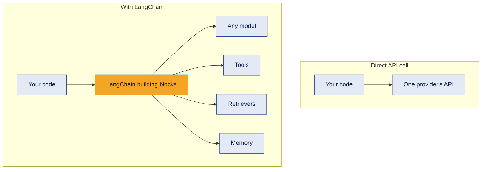

What LangChain offers: model integrations, prompt management, structured output, tools, agents, retrieval, memory and state, middleware, and links to observability tools.

**Example**
Switching the shop assistant from one model provider to another means changing one line, not rewriting every call.

**Where it's used**
Chatbots, RAG apps, tool-using agents, document processing.

**Common mistake**
Using LangChain for a single, simple LLM call. A direct API call is fine for that.

**Interview questions**
1. **Q:** Why use LangChain instead of calling an LLM API directly? **A:** Consistent building blocks for models, prompts, tools, memory and retrieval, which makes larger apps easier to build and change.
2. **Q:** Name four things LangChain provides. **A:** Model integrations, prompt templates, tools and agents, retrieval components.
3. **Q:** Is LangChain tied to one model provider? **A:** No. It integrates many providers through a common interface.
4. **Q:** When is LangChain unnecessary? **A:** For a single simple LLM call with no tools, data or memory.
5. **Q:** What is a downside of LangChain? **A:** Its API changes often, and extra abstraction can make debugging harder.

**In one line**
LangChain = standard building blocks so LLM apps are faster to build and easier to change.

---

## 2. Chat models and AIMessage

**What it is**
A chat model object wraps an LLM. Calling it returns an **AIMessage**, not just text.

**How it works**
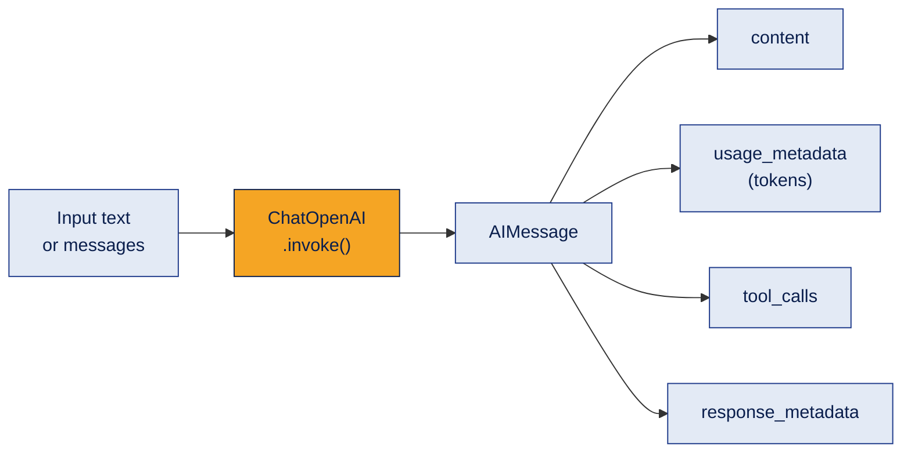
```python
from langchain_openai import ChatOpenAI

llm = ChatOpenAI(model="gpt-4o-mini", temperature=0)
reply = llm.invoke("What is a gel pen?")
print(reply.content)          # the text
print(reply.usage_metadata)   # token counts
```

**Example**
`print(reply)` shows the whole message object; `print(reply.content)` shows only the answer text.

**Where it's used**
Every LangChain app starts with a chat model.

**Common mistake**
Printing the whole response and thinking the extra fields are part of the answer. Use `.content`.

**Interview questions**
1. **Q:** What does `llm.invoke()` return? **A:** An AIMessage.
2. **Q:** Where is the answer text? **A:** In `.content`.
3. **Q:** How do you see token usage? **A:** `usage_metadata` on the AIMessage.
4. **Q:** Why set `temperature=0`? **A:** More consistent, predictable answers.
5. **Q:** What does `tool_calls` hold? **A:** The tools the model wants to call, with arguments (empty if none).

**In one line**
A chat model returns a message object; the text is in `.content`.

---

## 3. Messages

**What it is**
Conversations are lists of typed messages, each with a role.

**How it works**
| Message | Who | Example |
|---|---|---|
| `SystemMessage` | Your rules and role for the model | "You are a shop assistant." |
| `HumanMessage` | The user | "What is a gel pen?" |
| `AIMessage` | The model's reply (text or tool calls) | "A gel pen uses..." |
| `ToolMessage` | A tool's result, linked by `tool_call_id` | "pen: ₹15" |

```python
from langchain_core.messages import SystemMessage, HumanMessage

reply = llm.invoke([
    SystemMessage("You answer in one sentence."),
    HumanMessage("What is a gel pen?"),
])
```

**Example**
The system message keeps every answer short, whatever the user asks.

**Where it's used**
Chat apps, agents (the whole agent state is a list of messages).

**Common mistake**
Putting rules inside the human message. Rules belong in the system message.

**Interview questions**
1. **Q:** Name the four main message types. **A:** System, Human, AI and Tool messages.
2. **Q:** What is a system message for? **A:** Setting the model's role and rules.
3. **Q:** What links a ToolMessage to a request? **A:** Its `tool_call_id`.
4. **Q:** Why send a list of messages? **A:** To give the model the conversation history and roles.
5. **Q:** Is an LLM stateful? **A:** No. It only knows the messages you send in each call.

**In one line**
Messages carry roles: system sets rules, human asks, AI answers, tool reports.

---

## 4. Prompt templates

**What it is**
A reusable prompt with blanks like `{item}` that are filled at run time.

**How it works**
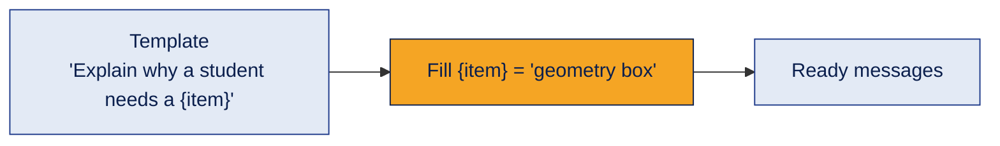
```python
from langchain_core.prompts import ChatPromptTemplate

prompt = ChatPromptTemplate.from_messages([
    ("system", "You are a friendly shop assistant."),
    ("human", "Explain why a student needs a {item}."),
])
messages = prompt.invoke({"item": "geometry box"})
```

**Example**
Without a template, you rebuild the prompt string by hand every time (`f"..."`). With one, the prompt lives in one place and is reused.

**Where it's used**
Every repeated prompt: classification, RAG answers, summaries.

**Common mistake**
Mismatched names: the template says `{item}` but you pass `{"product": ...}`. That raises an error.

**Interview questions**
1. **Q:** What is a prompt template? **A:** A prompt with placeholders filled at run time.
2. **Q:** Why not just use f-strings? **A:** Templates are reusable, support message roles and plug into chains.
3. **Q:** What does `prompt.invoke()` return? **A:** The filled prompt (messages), ready for a model.
4. **Q:** What happens if a key is missing? **A:** An error, because the template cannot be filled.
5. **Q:** Can a template contain a system and a human message? **A:** Yes, with `from_messages`.

**In one line**
Write the prompt once, fill the blanks every time.

---

## 5. LCEL and Runnables

**What it is**
**LCEL (LangChain Expression Language)** joins steps with `|`. Each step is a **Runnable**: it has the same methods, and its output becomes the next step's input.

**How it works**
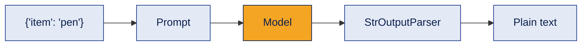
```python
from langchain_core.output_parsers import StrOutputParser

chain = prompt | llm | StrOutputParser()

chain.invoke({"item": "pen"})                          # one input
chain.batch([{"item": "pen"}, {"item": "notebook"}])   # many inputs
for piece in chain.stream({"item": "pen"}):            # text arrives piece by piece
    print(piece, end="")
```

| Method | Use it for |
|---|---|
| `invoke` | One input, one output |
| `batch` | Many inputs at once |
| `stream` | Show the answer as it is generated |

A **chain** is a fixed sequence of steps, for example: topic → explanation → quiz.

**Example**
The shop explains three products at once with `batch`, and shows a long answer live with `stream`.

**Where it's used**
Most LangChain code, including RAG chains.

**Common mistake**
Using `batch` when you meant `stream`. They do different things.

**Interview questions**
1. **Q:** What does `|` do in LangChain? **A:** Pipes one Runnable's output into the next (LCEL).
2. **Q:** What is a Runnable? **A:** Any LangChain component with standard methods like `invoke`, `batch` and `stream`.
3. **Q:** What does `StrOutputParser` do? **A:** Turns the AIMessage into plain text.
4. **Q:** `batch` vs `stream`? **A:** `batch` runs many inputs; `stream` returns one answer in pieces.
5. **Q:** What is a chain? **A:** A fixed sequence of steps where each output feeds the next.

**In one line**
LCEL pipes prompt → model → parser, and every step speaks the same Runnable language.

---

## 6. Output parsers and structured output

**What it is**
Ways to get **usable data** back instead of free text.

**How it works**
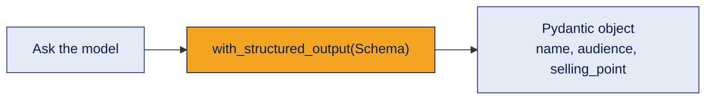
```python
from pydantic import BaseModel, Field

class ProductIdea(BaseModel):
    name: str = Field(description="Short product name")
    audience: str
    selling_point: str

structured_llm = llm.with_structured_output(ProductIdea)
idea = structured_llm.invoke("Suggest a stationery product for engineering students.")
print(idea.name)
```

**Example**
The shop's code reads `idea.name` directly and saves it to a database, without parsing any text.

**Where it's used**
Classification, extraction, passing data between agents, saving to databases.

**Common mistake**
Using a variable like `structured_llm` before creating it with `with_structured_output`. Define it first.

**Interview questions**
1. **Q:** Why use structured output? **A:** So code can rely on exact fields instead of parsing text.
2. **Q:** How do you get a Pydantic object from a model? **A:** `llm.with_structured_output(MyModel)`.
3. **Q:** What does `Field(description=...)` help with? **A:** It tells the model what each field should contain.
4. **Q:** Output parser vs structured output? **A:** Parsers convert text after generation; structured output asks the model to follow a schema directly.
5. **Q:** Name a use case. **A:** Extracting name, email and issue from a support message.

**In one line**
Ask for a schema, get an object your code can trust.

---

## 7. Tools

**What it is**
A tool is a Python function the model can ask to use. An LLM can write text, but it cannot act in the world on its own.

**How it works**
`@tool` turns a function into a tool with four parts:

| Part | Comes from |
|---|---|
| Name | The function name |
| Description | The docstring |
| Input schema | The type hints |
| Function | The code that runs |

```python
from langchain_core.tools import tool

@tool
def get_price(item: str) -> str:
    """Get the price in rupees of one stationery item, for example 'pen'."""
    return PRICES.get(item, "Not found")

get_price.invoke({"item": "pen"})   # tools can be tested directly
print(get_price.name, get_price.description)
```

**Example**
The model cannot know today's prices, so the shop gives it a `get_price` tool.

**Where it's used**
Every agent: search, database lookups, calculators, sending emails.

**Common mistake**
Using `eval()` inside a calculator tool. Text from a model or user could run any code. Parse the expression safely instead (see [`safe_calculator.py`](demos/safe_calculator.py)).

**Interview questions**
1. **Q:** What does `@tool` do? **A:** Turns a Python function into a tool the model can request.
2. **Q:** Where does a tool's description come from? **A:** Its docstring.
3. **Q:** Why do type hints matter? **A:** They define the tool's input schema.
4. **Q:** How do you test a tool without a model? **A:** Call `tool.invoke({...})` directly.
5. **Q:** Why avoid `eval()` in tools? **A:** It can execute arbitrary code from untrusted input.

**In one line**
Tools are an agent's hands; the docstring is how the model knows when to use them.

---

## 8. Tool calling vs agents

**What it is**
**Tool calling** lets the model *ask* for a tool. An **agent** adds the *loop* that runs the tool, sends the result back, and repeats until done.

**How it works**
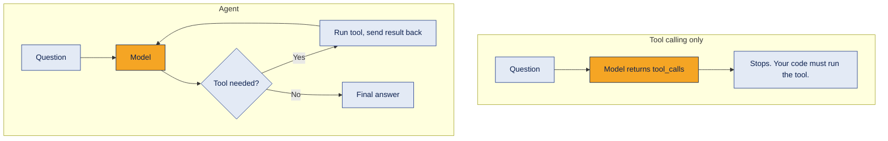
```python
llm_with_tools = llm.bind_tools([get_price])
response = llm_with_tools.invoke("What is the price of a pen?")
print(response.tool_calls)
# [{'name': 'get_price', 'args': {'item': 'pen'}, 'id': 'call_...'}]
```

**Example**
With `bind_tools` only, you get the request `get_price(item='pen')` but no answer. With an agent, you get "A pen costs ₹15".

**Where it's used**
Understanding this difference is key to debugging agents.

**Common mistake**
Thinking `bind_tools` runs the tool. It doesn't; the model only asks.

**Interview questions**
1. **Q:** What does `bind_tools` do? **A:** Tells the model which tools exist so it can request them.
2. **Q:** Does the model run the tool? **A:** No. The application runs it.
3. **Q:** Tool calling vs agent? **A:** Tool calling is one request; an agent adds the loop that runs tools and continues.
4. **Q:** Where are the requested tools? **A:** In `response.tool_calls`.
5. **Q:** What ends an agent loop? **A:** A model reply with no tool calls (or a step limit).

**In one line**
Tool calling asks; the agent loop acts.

---

## 9. Agents with create_agent

**What it is**
`create_agent` builds a ready agent: model + tools + system prompt, running the full tool loop for you. It is built on LangGraph.

**How it works**
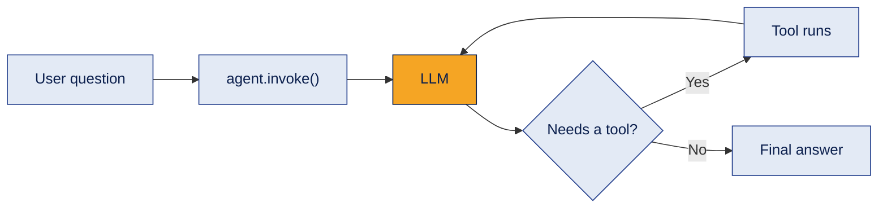
```python
from langchain.agents import create_agent

agent = create_agent(
    model=llm,
    tools=[get_price, calculator],
    system_prompt="Use get_price for prices and calculator for maths. Never guess prices.",
)
result = agent.invoke({"messages": [{"role": "user", "content": "Price of 3 notebooks and 2 pens?"}]})
print(result["messages"][-1].content)
```
`result["messages"]` holds the **whole run**: the question, tool requests, tool results and final answer. Print them all to see what the agent did.

**Example**
The agent calls `get_price` twice, then `calculator`, then answers "₹210".

**Where it's used**
Most single-agent apps: assistants, support bots, research helpers.

**Common mistake**
A vague system prompt. Tell the agent which tool to use for what, and what never to do (like guessing prices).

**Interview questions**
1. **Q:** What does `create_agent` need? **A:** A model, tools and usually a system prompt.
2. **Q:** Where is the final answer? **A:** The last message in `result["messages"]`.
3. **Q:** How do you see the agent's steps? **A:** Loop through `result["messages"]` and print each type and content.
4. **Q:** What is `create_agent` built on? **A:** LangGraph.
5. **Q:** Why mention tools in the system prompt? **A:** It guides when the agent should use each tool.

**In one line**
`create_agent` = model + tools + prompt, with the loop handled for you.

---

## 10. Agent memory: checkpointer and thread_id

**What it is**
An LLM forgets everything between calls. An agent remembers a conversation when its **state is saved** by a **checkpointer** and grouped by a **thread_id**.

**How it works**
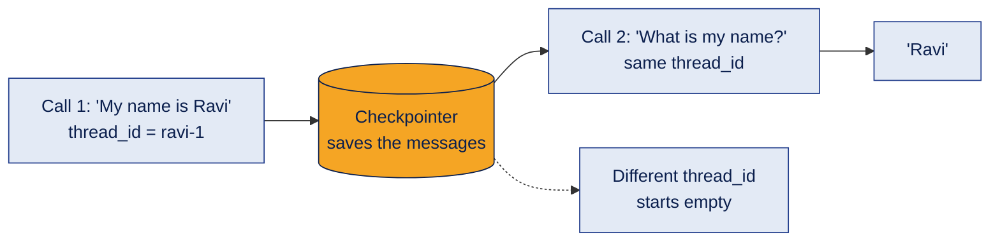
```python
from langgraph.checkpoint.memory import InMemorySaver

agent = create_agent(model=llm, tools=tools, checkpointer=InMemorySaver())
config = {"configurable": {"thread_id": "ravi-1"}}   # 'config' says HOW to run, not WHAT
agent.invoke({"messages": [{"role": "user", "content": "My name is Ravi."}]}, config=config)
agent.invoke({"messages": [{"role": "user", "content": "What is my name?"}]}, config=config)
```

| | Short-term memory | Long-term memory |
|---|---|---|
| Scope | One conversation (thread) | Across many conversations |
| How | Checkpointer + thread_id | A separate store you design |

**Example**
Each customer gets their own `thread_id`, so conversations never mix.

**Where it's used**
Any multi-turn chat or agent.

**Common mistake**
- Using `InMemorySaver` in production. It is lost when the program stops. Use a database-backed checkpointer.
- Changing the `thread_id` and expecting the agent to remember.

**Interview questions**
1. **Q:** Why does an agent forget without a checkpointer? **A:** LLMs are stateless; nothing saves the previous messages.
2. **Q:** What is `thread_id`? **A:** An ID that groups saved state into one conversation.
3. **Q:** What does `config` control? **A:** How to run the call (for example which thread), not what to run.
4. **Q:** Is `InMemorySaver` good for production? **A:** No. Its data disappears when the process ends.
5. **Q:** Short-term vs long-term memory? **A:** Short-term is one thread's history; long-term persists across conversations.

**In one line**
Checkpointer saves, thread_id separates: that is conversation memory.

---

## 11. RAG building blocks in LangChain

**What it is**
LangChain provides each piece of a RAG pipeline. (Full RAG theory: [topic 06](../06-rag/README.md).)

**How it works**
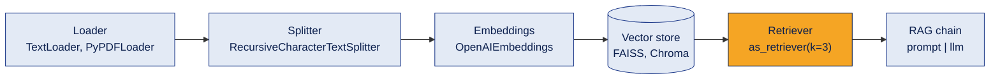
- A loaded **Document** has `page_content` (text) and `metadata` (source, page).
- When splitting, think about chunk size, overlap, natural boundaries and metadata.
- **Conversational RAG** first rewrites a follow-up ("what about its price?") into a full question using the chat history, then retrieves.

**Example**
The shop loads its product catalogue, splits it, embeds it and answers "Which pens are waterproof?" from the catalogue.

**Where it's used**
Document Q&A and knowledge assistants.

**Common mistake**
Importing old paths from tutorials. Many integrations have moved to separate packages, so check the docs when an import shows a warning.

**Interview questions**
1. **Q:** Two fields of a LangChain Document? **A:** `page_content` and `metadata`.
2. **Q:** What does a retriever do? **A:** Returns the most relevant chunks for a query.
3. **Q:** What sets how many chunks come back? **A:** `k` in `search_kwargs`.
4. **Q:** What is conversational RAG? **A:** RAG that uses chat history to turn follow-up questions into standalone queries.
5. **Q:** Which splitter is common? **A:** `RecursiveCharacterTextSplitter`.

**In one line**
Loader → splitter → embeddings → vector store → retriever → chain.

---

## 12. Observability with LangSmith

**What it is**
**LangSmith** is the LangChain team's tool for tracing, debugging and evaluating LLM apps.

**How it works**
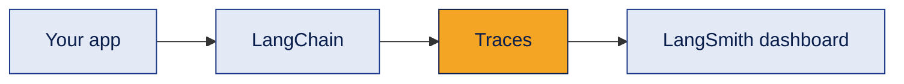
It shows each run's steps, inputs and outputs, **latency**, **token usage**, errors and intermediate tool calls. It is usually switched on with environment variables (like `LANGSMITH_TRACING` and `LANGSMITH_API_KEY`), kept in `.env`.

**Example**
A slow answer is traced: the search tool took 6 seconds, the LLM only 1. You fix the tool, not the prompt.

**Where it's used**
Debugging, cost tracking and quality monitoring ([topic 12](../README.md)).

**Common mistake**
Logging secrets or private user data in traces. Mask sensitive fields.

**Interview questions**
1. **Q:** What is LangSmith? **A:** A platform for tracing, debugging and evaluating LLM apps.
2. **Q:** Name three things a trace shows. **A:** Steps, latency and token usage (also errors and tool calls).
3. **Q:** How is tracing usually enabled? **A:** With environment variables and an API key.
4. **Q:** Why is tracing useful for agents? **A:** You can see every tool call and decision, not just the final answer.
5. **Q:** What should you avoid logging? **A:** API keys and sensitive personal data.

**In one line**
LangSmith shows what happened inside your app, step by step.

---

## 13. LangChain vs LangGraph vs LangSmith

**What it is**
Three tools from the same team, each with a different job.

**How it works**
| | LangChain | LangGraph | LangSmith |
|---|---|---|---|
| Job | Building blocks | Orchestration | Observability |
| Contains | Models, prompts, tools, retrievers, messages, agent API | State, nodes, edges, branching, cycles, persistence, interrupts, subgraphs | Traces, debugging, latency, tokens, evaluation, monitoring |
| Think of it as | The parts | The flowchart that controls the parts | The dashboard |

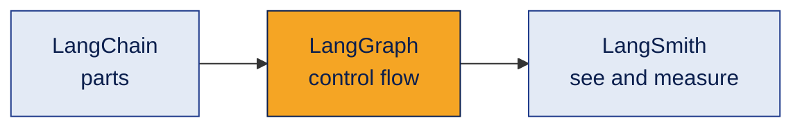

**Example**
LangChain tools and models live inside LangGraph nodes, and LangSmith traces the whole run.

**Where it's used**
Choosing the right tool and explaining your stack in interviews.

**Common mistake**
Thinking LangGraph replaces LangChain. They work together; `create_agent` itself runs on LangGraph.

**Interview questions**
1. **Q:** One line each: LangChain, LangGraph, LangSmith? **A:** Components; orchestration; observability.
2. **Q:** Does LangGraph replace LangChain? **A:** No, they complement each other.
3. **Q:** Which one handles loops and human approval? **A:** LangGraph.
4. **Q:** Which one shows token usage per step? **A:** LangSmith.
5. **Q:** What is `create_agent` built on? **A:** LangGraph.

**In one line**
LangChain builds, LangGraph controls, LangSmith watches.

[← Back to Agent Frameworks](README.md) · [Next: LangGraph deep dive →](langgraph.md)
