# 07 · LangGraph Deep Dive

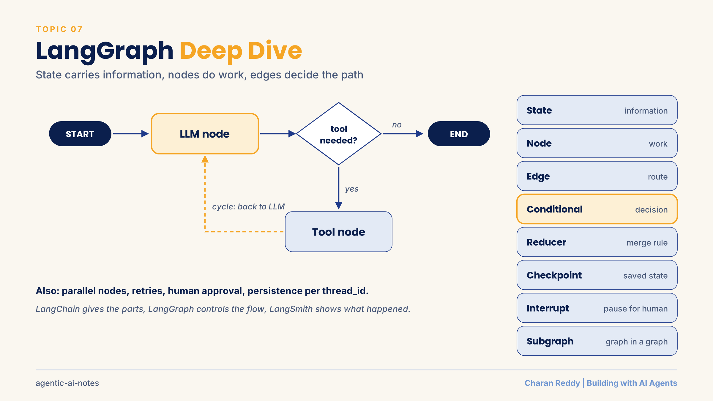

LangGraph builds AI workflows as a **graph**: **state** carries the information, **nodes** do the work, **edges** decide what runs next. It adds loops, branching, memory, human approval and retries on top of plain LLM calls.

> **Status:** 📘 Concepts learned · runnable demos: [`demos/langgraph_basics.py`](demos/langgraph_basics.py) (no API key needed) and [`demos/langgraph_tool_agent.py`](demos/langgraph_tool_agent.py).

[← Back to Agent Frameworks](README.md) · [← All topics](../README.md)

## Contents
1. [When one LLM call is not enough](#1-when-one-llm-call-is-not-enough)
2. [What LangGraph is: state, nodes, edges](#2-what-langgraph-is-state-nodes-edges)
3. [Your first graph in 6 steps](#3-your-first-graph-in-6-steps)
4. [Conditional edges](#4-conditional-edges)
5. [Reducers and parallel nodes](#5-reducers-and-parallel-nodes)
6. [Cycles (loops)](#6-cycles-loops)
7. [The tool-calling agent as a graph](#7-the-tool-calling-agent-as-a-graph)
8. [Persistence: checkpointer and thread_id](#8-persistence-checkpointer-and-thread_id)
9. [Human in the loop: interrupt and resume](#9-human-in-the-loop-interrupt-and-resume)
10. [Retries vs loops](#10-retries-vs-loops)
11. [Guardrails and validation nodes](#11-guardrails-and-validation-nodes)
12. [Streaming and visualising a graph](#12-streaming-and-visualising-a-graph)
13. [Subgraphs and multi-agent systems](#13-subgraphs-and-multi-agent-systems)
14. [Context engineering, and LangGraph vs A2A](#14-context-engineering-and-langgraph-vs-a2a)
15. [Common errors and cheat sheet](#15-common-errors-and-cheat-sheet)

**Examples used:** a refund desk, an order help desk and a small research team.

---

## 1. When one LLM call is not enough

**What it is**
Many tasks need only **User → Prompt → LLM → Answer**. Agents are needed when the app must **decide, act and check**.

**How it works**
| One LLM call is enough | An agent workflow is needed |
|---|---|
| Answer from the prompt, summarise, translate, classify, write text | Choose and use tools, fetch outside data, make decisions, validate results, repeat until done |

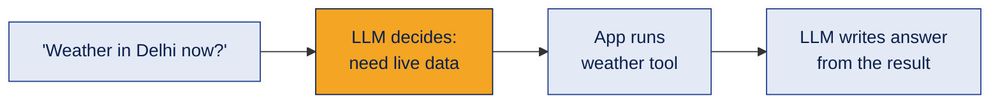

**Example**
"Summarise this paragraph" → one call. "What is the weather in Delhi now?" → the model needs a tool, so it's an agent workflow.

**Where it's used**
Deciding whether you need an agent at all, which is the first design decision.

**Common mistake**
Building an agent for a task one LLM call can do. It adds cost, delay and failure points.

**Interview questions**
1. **Q:** When is a single LLM call enough? **A:** When the prompt contains everything needed, like summarising or translating.
2. **Q:** When do you need an agent? **A:** When the task needs tools, outside data, decisions, validation or repeated steps.
3. **Q:** Who runs a tool, the LLM or the app? **A:** The app. The LLM only requests it.
4. **Q:** What makes a workflow "agentic"? **A:** It decides what to do next based on results, not just generating text.
5. **Q:** Downside of unnecessary agents? **A:** More cost, latency and things that can break.

**In one line**
Use an agent only when the task needs decisions and actions.

---

## 2. What LangGraph is: state, nodes, edges

**What it is**
A framework for **stateful, multi-step AI workflows**, drawn as a graph.

**How it works**
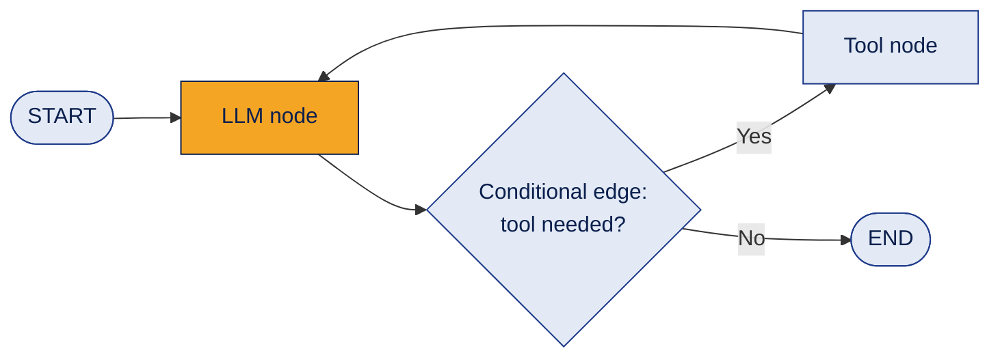

| Concept | Meaning | In the weather example |
|---|---|---|
| **State** | Shared information that nodes read and update | The question and the tool result |
| **Node** | A step that does work (a Python function) | LLM node, weather tool node |
| **Edge** | Connection to the next step | LLM → tool |
| **Conditional edge** | Picks the next step from the state | Tool if needed, else END |
| **Cycle** | A path back to an earlier node | Tool → back to LLM |
| **Persistence** | Saving state to resume later | Continue after a crash or pause |

Node types by job (not all are built-in classes): LLM node, tool node, validation node, human approval node, database node.

**Example**
State carries the question; the LLM node decides; the tool node fetches; the conditional edge picks the next step.

**Where it's used**
Agents that need control: support desks, approval flows, research assistants.

**Common mistake**
Treating LangGraph as a replacement for LangChain. LangChain components often run *inside* LangGraph nodes.

**Interview questions**
1. **Q:** What are LangGraph's three core parts? **A:** State, nodes and edges.
2. **Q:** What is a node? **A:** A function that reads the state and returns updates.
3. **Q:** What is a conditional edge? **A:** An edge that picks the next node based on the state.
4. **Q:** Why are cycles useful? **A:** For retrying, refining and repeated tool use.
5. **Q:** LangChain vs LangGraph? **A:** LangChain gives components; LangGraph controls the workflow.

**In one line**
State carries information, nodes do work, edges decide where to go.

---

## 3. Your first graph in 6 steps

**What it is**
The fixed recipe for every LangGraph program.

**How it works**
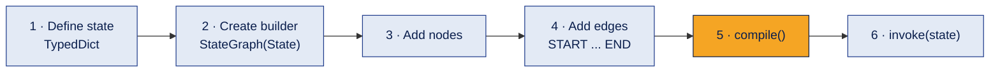
```python
from typing import TypedDict
from langgraph.graph import StateGraph, START, END

class OrderState(TypedDict):          # 1. the shape of the state
    item: str
    message: str

def confirm(state: OrderState):       # a node returns ONLY the keys it updates
    return {"message": f"Order received for {state['item']}."}

builder = StateGraph(OrderState)      # 2.
builder.add_node("confirm", confirm)  # 3.
builder.add_edge(START, "confirm")    # 4.
builder.add_edge("confirm", END)
graph = builder.compile()             # 5.
print(graph.invoke({"item": "blue notebook", "message": ""}))   # 6.
```

**Example**
Output: `{'item': 'blue notebook', 'message': 'Order received for blue notebook.'}`

**Where it's used**
Every graph, from 1 node to 50.

**Common mistake**
Adding nodes or edges **after** `compile()`. The compiled graph doesn't change; LangGraph warns you. Build first, then compile.

**Interview questions**
1. **Q:** What does `TypedDict` define? **A:** The expected keys and types of the state.
2. **Q:** What are `START` and `END`? **A:** The entry point and finish point of the graph.
3. **Q:** Must a node return the whole state? **A:** No, only the keys it wants to update.
4. **Q:** What does `compile()` do? **A:** Prepares the graph for running.
5. **Q:** Does `TypedDict` check values at run time? **A:** No. It documents the shape; it doesn't validate.

**In one line**
State → builder → nodes → edges → compile → invoke.

---

## 4. Conditional edges

**What it is**
An edge that **chooses** the next node by calling a routing function on the state.

**How it works**
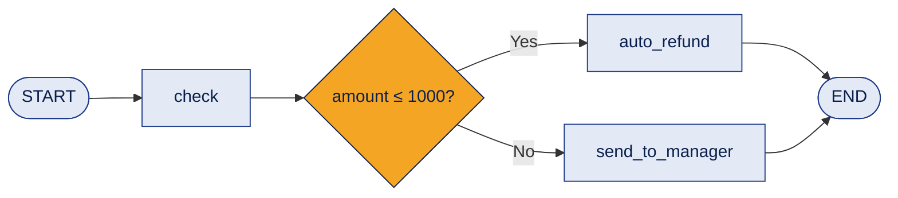
```python
from typing import Literal

def route_refund(state) -> Literal["auto_refund", "send_to_manager"]:
    return "auto_refund" if state["amount"] <= 1000 else "send_to_manager"

builder.add_conditional_edges("check", route_refund)
```
The returned label must match a node name (or use a mapping like `{"done": END}`). `Literal[...]` documents the allowed labels.

**Example**
₹500 refund → refunded automatically. ₹5000 → sent to a manager.

**Where it's used**
Every agent decision: need a tool? need clarification? need another agent? retry? human approval? done?

**Common mistake**
Returning a label that isn't connected to any node. The graph fails at run time.

**Interview questions**
1. **Q:** What does a routing function return? **A:** A label naming the next node.
2. **Q:** Normal edge vs conditional edge? **A:** A normal edge is fixed; a conditional edge chooses from the state.
3. **Q:** Why use `Literal` in the return type? **A:** It documents the allowed labels and helps the graph drawing.
4. **Q:** Name three agent decisions that become routes. **A:** Use a tool, ask a human, finish.
5. **Q:** What turns a fixed workflow into an adaptive one? **A:** Conditional edges.

**In one line**
Conditional edges let the state decide the path.

---

## 5. Reducers and parallel nodes

**What it is**
A **reducer** is the rule for combining updates to the same state key. It matters most when **parallel** nodes write to one key.

**How it works**
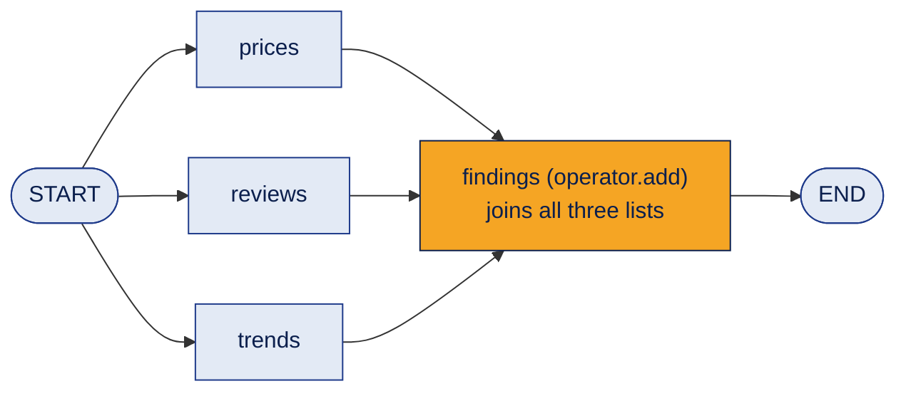
```python
import operator
from typing import Annotated, TypedDict

class ResearchState(TypedDict):
    findings: Annotated[list[str], operator.add]   # reducer: add lists together

# Three nodes all start from START and each returns {"findings": [...]}
# Result: {'findings': ['Competitor prices', 'Customer reviews', 'Market trends']}
```

**Example**
Three research agents work at the same time; the reducer merges their findings into one list.

**Where it's used**
Parallel research, chat history (`add_messages`), collecting results from many agents.

**Common mistake**
No reducer on a key that parallel nodes update. LangGraph doesn't know how to combine them and raises an error.

**Interview questions**
1. **Q:** What is a reducer? **A:** A rule for combining updates to one state key.
2. **Q:** What happens without a reducer when parallel nodes update the same key? **A:** An error, because the updates conflict.
3. **Q:** What does `operator.add` do for lists? **A:** Joins them together.
4. **Q:** How do you run nodes in parallel? **A:** Add edges from the same node (for example START) to each of them.
5. **Q:** Which reducer is used for chat messages? **A:** `add_messages`.

**In one line**
Parallel nodes do the work; the reducer merges their results.

---

## 6. Cycles (loops)

**What it is**
A route back to an earlier node, so the graph repeats until a condition is met.

**How it works**
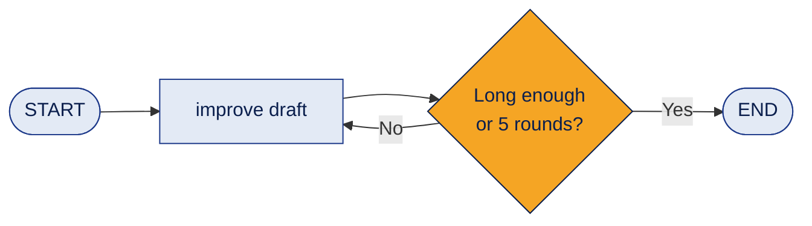
```python
def good_enough(state) -> Literal["improve", "__end__"]:
    if len(state["draft"]) >= 60 or state["rounds"] >= 5:   # goal OR safety limit
        return END
    return "improve"

builder.add_conditional_edges("improve", good_enough)
```

**Example**
A draft is improved again and again until it's long enough, with a 5-round safety limit.

**Where it's used**
Retry, refine, validate and repeat, and tool use (tool → back to LLM).

**Common mistake**
A loop with no safety limit. If the goal is never reached, it runs forever. (LangGraph also has a built-in recursion limit, but don't rely on it as your only stop.)

**Interview questions**
1. **Q:** What is a cycle in LangGraph? **A:** A path that returns to an earlier node.
2. **Q:** Name three uses of cycles. **A:** Refinement, validation and tool calling.
3. **Q:** Why add a round limit? **A:** So the loop always ends even if the goal is never met.
4. **Q:** Chain vs cyclic graph? **A:** A chain only moves forward; a cyclic graph can go back.
5. **Q:** In a tool agent, where is the cycle? **A:** Tool node → back to the LLM node.

**In one line**
Loop until done, but always with a limit.

---

## 7. The tool-calling agent as a graph

**What it is**
The full agent loop built by hand: an **LLM node**, a **tool node** and a **router**, sharing a **message state**.

**How it works**
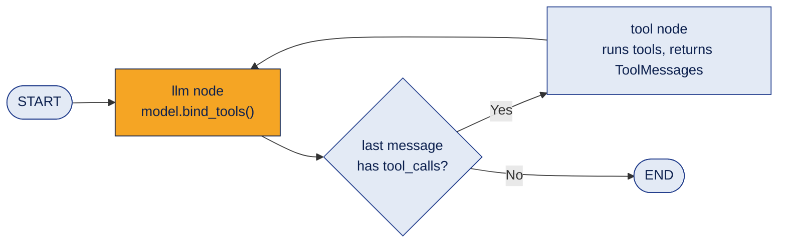
```python
from typing import Annotated, TypedDict
from langchain_core.messages import AnyMessage, ToolMessage
from langgraph.graph.message import add_messages

class AgentState(TypedDict):
    messages: Annotated[list[AnyMessage], add_messages]   # appends, handles message IDs

def llm_node(state):
    return {"messages": [llm_with_tools.invoke(state["messages"])]}

def tool_node(state):
    results = []
    for call in state["messages"][-1].tool_calls:          # name, args, id
        output = tools_by_name[call["name"]].invoke(call["args"])
        results.append(ToolMessage(content=str(output), tool_call_id=call["id"]))
    return {"messages": results}

def route(state):
    return "tools" if state["messages"][-1].tool_calls else END
```
The message history then reads: **Human → AI (tool call) → Tool (result) → AI (final answer)**.

**Example**
"Where is order A102, and what is 450 × 2 − 100?" → two tool calls → "A102 is packed; the answer is 800."

**Where it's used**
Any custom agent where you need control that `create_agent` hides: extra checks, logging, limits.

**Common mistake**
Not replying to every tool call. Each request needs a `ToolMessage` with the matching `tool_call_id`, even when the tool fails.

**Interview questions**
1. **Q:** What does `add_messages` do? **A:** Appends new messages to the history and handles message IDs.
2. **Q:** What three fields does a tool call have? **A:** `name`, `args` and `id`.
3. **Q:** How does the router know to end? **A:** The last AI message has no tool calls.
4. **Q:** Why build the loop by hand instead of `create_agent`? **A:** For extra control: checks, limits, logging, custom routing.
5. **Q:** What links a tool result to its request? **A:** `tool_call_id`.

**In one line**
LLM node asks, tool node acts, router decides, and the cycle repeats.

---

## 8. Persistence: checkpointer and thread_id

**What it is**
A **checkpointer** saves the state after each step, so a graph can **resume** instead of restarting, and remember a conversation.

**How it works**
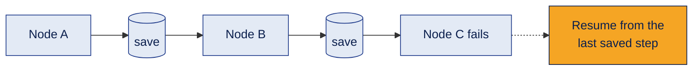
```python
from langgraph.checkpoint.memory import InMemorySaver

graph = builder.compile(checkpointer=InMemorySaver())
config = {"configurable": {"thread_id": "user-1"}}
graph.invoke({"count": 0}, config=config)

snapshot = graph.get_state(config)
print(snapshot.values, snapshot.next)   # saved values, and which nodes run next
```
| Term | Meaning |
|---|---|
| State | The information during one run |
| Persistence | Saving state between runs |
| Memory | How *your app* decides what to keep (a design choice) |

**Example**
Each customer has a different `thread_id`, so each has separate saved state.

**Where it's used**
Chat memory, long-running workflows, human approval (it needs persistence).

**Common mistake**
Using `InMemorySaver` for production. It disappears when the program stops; use a database checkpointer.

**Interview questions**
1. **Q:** What does a checkpointer do? **A:** Saves the graph's state at each step.
2. **Q:** What is a `thread_id`? **A:** An ID that groups saved state; a new ID means a new, separate workflow.
3. **Q:** How do you read saved state? **A:** `graph.get_state(config)`.
4. **Q:** Is state the same as long-term memory? **A:** No. State is the current run; memory is a design choice on top of persistence.
5. **Q:** Why is `InMemorySaver` only for demos? **A:** Its data is lost when the process ends.

**In one line**
Checkpoint every step, separate by thread, resume instead of restarting.

---

## 9. Human in the loop: interrupt and resume

**What it is**
The graph **pauses** for a person to approve, reject or edit, then **continues** from the same point.

**How it works**
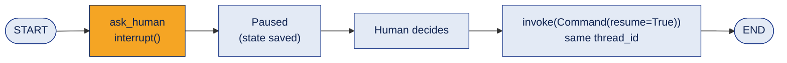
```python
from langgraph.types import interrupt, Command

def ask_human(state):
    decision = interrupt({"question": "Approve this refund?", "amount": state["amount"]})
    return {"approved": bool(decision)}

graph = builder.compile(checkpointer=InMemorySaver())     # REQUIRED for interrupt
config = {"configurable": {"thread_id": "refund-A"}}
paused = graph.invoke({"amount": 4000, "approved": False}, config=config)
print(paused["__interrupt__"])                           # what the human is asked
graph.invoke(Command(resume=True), config=config)        # approve and continue
```
The **edit pattern** works the same way: `interrupt()` shows a draft, and `Command(resume="edited text")` sends back the human's version.

**Example**
Refunds over ₹1000 pause for a manager. The manager approves, and the graph continues.

**Where it's used**
Payments, sending emails to customers, deleting data, publishing content: anything costly or hard to undo.

**Common mistake**
- Resuming on a **finished** thread. If the thread already completed (for example you approved it), resuming again with "reject" changes nothing. Start a **new thread** for a new request.
- Using `interrupt()` without a checkpointer, so the graph cannot resume.
- Resuming with a different `thread_id`, which is a different workflow.

**Interview questions**
1. **Q:** What does `interrupt()` do? **A:** Pauses the graph and shows information for a human decision.
2. **Q:** How do you continue? **A:** `graph.invoke(Command(resume=value), config)` with the same thread_id.
3. **Q:** Why is a checkpointer required? **A:** The paused state must be saved so the graph can resume.
4. **Q:** Where does the human's answer go? **A:** It becomes the return value of `interrupt()` in the node.
5. **Q:** Name two actions that should need approval. **A:** Payments and sending messages to customers.

**In one line**
Pause with interrupt, decide, resume with Command, on the same thread.

---

## 10. Retries vs loops

**What it is**
Two different ways to "do it again":
- **Retry policy:** run the **same node again** because it **crashed** (for example a network error).
- **Graph loop:** the **workflow decides** to do another step (for example the answer was weak).

**How it works**
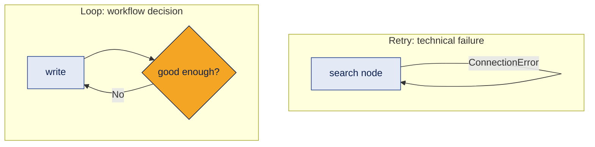
```python
from langgraph.types import RetryPolicy

builder.add_node("search", search_node, retry_policy=RetryPolicy(max_attempts=3))
```

**Important detail:** by default, LangGraph only retries errors that look **temporary**, such as `ConnectionError` and HTTP 5xx server errors. It does **not** retry `ValueError`, `RuntimeError`, `TypeError` and similar, because those usually mean a bug. If a node raises `RuntimeError`, it stops after the first attempt even with `max_attempts=3`. You can change this with the `retry_on` setting. (Checked in the library source and shown in [`demos/langgraph_basics.py`](demos/langgraph_basics.py).)

**Example**
A web search fails twice with a connection error and succeeds on the third try.

**Where it's used**
Calls to APIs, databases and search services.

**Common mistake**
Expecting every exception to be retried. Check which errors your retry policy covers.

**Interview questions**
1. **Q:** Retry vs graph loop? **A:** A retry repeats a node after a technical failure; a loop is a workflow decision to do another step.
2. **Q:** How do you add a retry? **A:** Pass `retry_policy=RetryPolicy(max_attempts=...)` to `add_node`.
3. **Q:** Does the default policy retry `ValueError`? **A:** No. It retries errors like connection failures and 5xx responses.
4. **Q:** Why not retry every error? **A:** Bugs won't fix themselves; retrying wastes time and money.
5. **Q:** How can you change which errors are retried? **A:** With the `retry_on` setting.

**In one line**
Retries fix temporary crashes; loops are decisions.

---

## 11. Guardrails and validation nodes

**What it is**
A **guardrail** checks whether something is acceptable **before** the workflow continues. In LangGraph, it is usually a node plus a conditional edge.

**How it works**
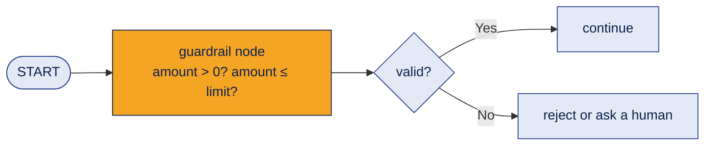
```python
def guardrail(state):
    if state["amount"] <= 0:
        return {"valid": False, "reason": "Amount must be positive"}
    if state["amount"] > 10000:
        return {"valid": False, "reason": "Over the auto-approve limit"}
    return {"valid": True, "reason": ""}
```
Keep the jobs separate: a **validate** function checks, a **route** function decides where to go next.

**Example**
A refund of −₹50 is rejected before it reaches the payment tool.

**Where it's used**
Before payments, before sending content, before passing data to another agent.

**Common mistake**
A validation node whose routes all go to the same place (for example both "done" and "improve" lead to END). The check runs, but nothing changes. Make sure "improve" really loops back.

**Interview questions**
1. **Q:** What is a guardrail in LangGraph? **A:** A check, usually a node plus a conditional edge, that decides if the workflow may continue.
2. **Q:** Why separate validate and route functions? **A:** Each has one job, which makes testing and changes easier.
3. **Q:** Raise an error or return a flag? **A:** Returning a flag lets the graph handle it (reject, retry, ask a human) instead of crashing.
4. **Q:** Name a guardrail for payments. **A:** The amount must be positive and under a limit.
5. **Q:** Where do guardrails go? **A:** Before risky actions and between agents.

**In one line**
Check first, then let the router decide what happens next.

---

## 12. Streaming and visualising a graph

**What it is**
**Streaming** shows progress while the graph runs. **Visualising** draws the graph so you can check its structure.

**How it works**
```python
# See each node's update as it happens
for chunk in graph.stream(input_data, stream_mode="updates"):
    print(chunk)

# Draw the graph (in a notebook)
from IPython.display import Image, display
display(Image(graph.get_graph().draw_mermaid_png()))
```
| Stream mode | Shows |
|---|---|
| `"updates"` | What each node changed |
| `"values"` | The full state after each step |
| `"messages"` | LLM text as it is generated |

**Example**
A user sees "Searching... Writing answer..." instead of waiting silently.

**Where it's used**
Chat UIs, debugging, documentation, and the diagram for your project README.

**Common mistake**
Debugging only from the final output. Stream updates to see which node went wrong.

**Interview questions**
1. **Q:** Why stream a graph? **A:** To show progress and debug each step.
2. **Q:** `updates` vs `values`? **A:** `updates` shows what changed; `values` shows the whole state.
3. **Q:** How do you draw a graph? **A:** `graph.get_graph().draw_mermaid_png()`.
4. **Q:** Why visualise a graph? **A:** To check the edges and routes match your design.
5. **Q:** Which mode shows tokens as they are generated? **A:** `"messages"`.

**In one line**
Stream to watch it run, draw it to check the design.

---

## 13. Subgraphs and multi-agent systems

**What it is**
A **subgraph** is a whole graph used as **one node** inside another graph. Each specialist agent can be a node or its own subgraph.

**How it works**
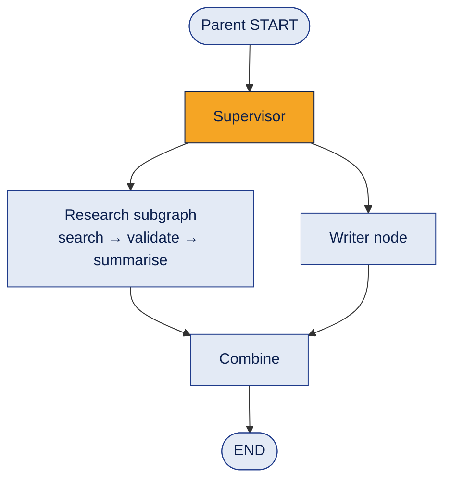
```python
research_graph = research_builder.compile()

parent = StateGraph(ParentState)
parent.add_node("research", research_graph)   # a compiled graph used as a node
```
If the parent and child states have **different keys**, wrap the subgraph in a normal node function that converts the state in and out.

**Example**
An insurance claim graph: the state holds the claim ID, documents, verification status, fraud score, policy result, risk and decision. A separate fraud-check subgraph plugs in as one node.

**Where it's used**
Multi-agent systems, reusable workflows, and teams building different parts independently.

**Common mistake**
Making one giant graph. Split it into subgraphs that can be tested on their own.

**Interview questions**
1. **Q:** What is a subgraph? **A:** A graph used as a node inside another graph.
2. **Q:** Why use subgraphs? **A:** Modularity, reuse and independent development and testing.
3. **Q:** Can an agent be a subgraph? **A:** Yes. A specialist agent can be its own graph.
4. **Q:** What if parent and child states differ? **A:** Wrap the subgraph in a node that maps the states.
5. **Q:** How does this help multi-agent systems? **A:** Each specialist is a self-contained unit the supervisor can call.

**In one line**
Graphs inside graphs: build big systems from small, testable parts.

---

## 14. Context engineering, and LangGraph vs A2A

**What it is**
- **Context engineering:** give each node or agent **only the state it needs**, not everything.
- **LangGraph vs A2A:** LangGraph **orchestrates** steps inside your system. **A2A (Agent2Agent)** is a protocol for **separately built agents to talk to each other**.

**How it works**
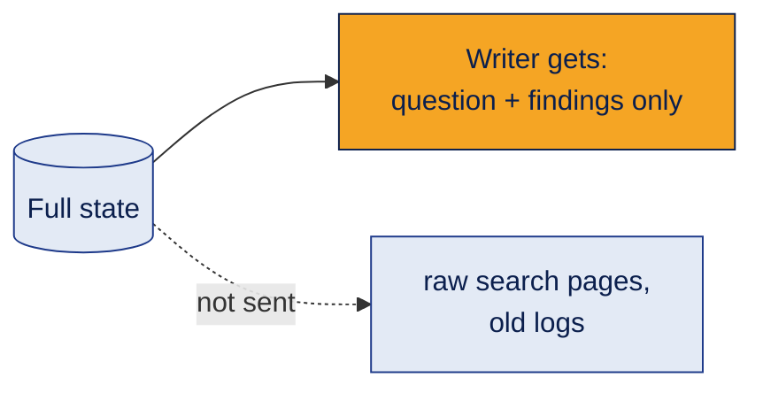
Benefits: fewer tokens (lower cost), lower latency, less irrelevant context, less confusion.

| | LangGraph | A2A |
|---|---|---|
| Main job | Orchestration | Interoperability |
| Decides | Who runs next, what state is passed, what happens on failure, where to loop | How independent agents (maybe from different teams or vendors) exchange messages |

**Example**
The writer agent receives the question and the summarised findings, not 20 raw web pages.

**Where it's used**
Every multi-agent system (context), and systems connecting agents across organisations (A2A).

**Common mistake**
Passing the whole state to every agent "just in case". It costs more and often makes answers worse.

**Interview questions**
1. **Q:** What is context engineering? **A:** Choosing exactly what information each step or agent receives.
2. **Q:** Name two benefits. **A:** Lower cost and lower latency (also less confusion).
3. **Q:** LangGraph vs A2A? **A:** LangGraph orchestrates within a system; A2A lets independent agents communicate.
4. **Q:** Could you use both? **A:** Yes. A LangGraph agent can talk to an outside agent over A2A.
5. **Q:** Why not pass the full state to every agent? **A:** Irrelevant context wastes tokens and can distract the model.

**In one line**
Send each agent only what it needs; use A2A when agents live in different systems.

---

## 15. Common errors and cheat sheet

**Common errors**

| Error | Fix |
|---|---|
| Missing API key | Set it in `.env` (never in a notebook cell or code) |
| Wrong model name | Use a model your account actually has |
| Tool name mismatch | Print `message.tool_calls` and compare names |
| Wrong tool arguments | Inspect the arguments the model generated |
| Missing reducer | Add one for keys updated by parallel nodes |
| Interrupt without checkpointer | Compile with a checkpointer |
| Different thread IDs | Pause and resume on the **same** thread |
| Edges added after compile | Build everything, then compile |
| `eval()` in a calculator tool | Use a safe parser ([`safe_calculator.py`](demos/safe_calculator.py)) |

**Cheat sheet**
```text
State       → information
Node        → work
Edge        → route
Conditional → decision
Reducer     → rule for merging updates
Cycle       → repeat
Checkpoint  → saved state
Interrupt   → pause for a human
Thread ID   → which saved workflow
Subgraph    → graph inside a graph
RetryPolicy → repeat a node after a temporary crash
```

**CrewAI vs LangGraph**

| | CrewAI | LangGraph |
|---|---|---|
| Thinking style | A team of roles | A flowchart of steps |
| Control | Less (agents decide more) | Full (you design every route) |
| Best for | Role-based collaboration, quick prototypes | Precise control, approvals, retries, long-running state |

**Practice task:** build a research graph for "How can a small bookshop use AI to recommend books to customers?" with three parallel research nodes, a reducer, a synthesis node, a validation loop, a checkpointer with `thread_id`, and a retry on a flaky node. Every piece you need is in [`demos/langgraph_basics.py`](demos/langgraph_basics.py).

**In one line**
LangGraph models the whole agent as a graph: state, work, routes, loops, saves, pauses and teams.

[← LangChain deep dive](langchain.md) · [Next: CrewAI deep dive →](crewai.md)
