# 08 · Multi-Agent Systems (Part I)

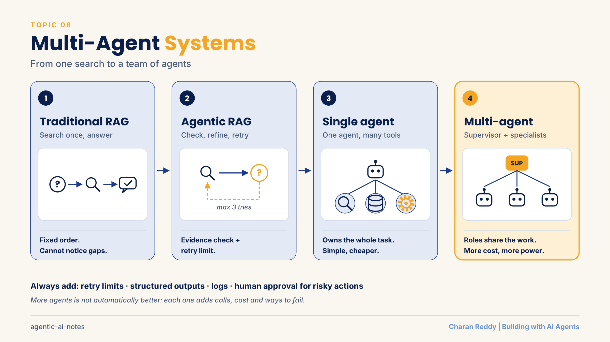

How a system grows from **one search and one answer** into **agents that decide, retry and work as a team**: traditional RAG → agentic RAG → single agent → autonomous agent → multi-agent system.

> **Status:** 📘 Part I: concepts and three runnable demos · Part II coming next.

[← Back to all topics](../README.md)

## Contents
1. [Traditional RAG in one minute](#1-traditional-rag-in-one-minute)
2. [Where traditional RAG falls short](#2-where-traditional-rag-falls-short)
3. [Agentic RAG](#3-agentic-rag)
4. [Building blocks of an agent](#4-building-blocks-of-an-agent)
5. [The decision loop: evidence check and retry limit](#5-the-decision-loop-evidence-check-and-retry-limit)
6. [Two ways to build agentic RAG: controller vs tool calling](#6-two-ways-to-build-agentic-rag-controller-vs-tool-calling)
7. [The agent harness](#7-the-agent-harness)
8. [Single-agent systems](#8-single-agent-systems)
9. [Autonomous agents (AutoGPT style) and bounded autonomy](#9-autonomous-agents-autogpt-style-and-bounded-autonomy)
10. [Multi-agent systems](#10-multi-agent-systems)
11. [Single agent or multi-agent?](#11-single-agent-or-multi-agent)
12. [Lead agent and subagents (research pattern)](#12-lead-agent-and-subagents-research-pattern)
13. [Research frameworks: CAMEL, AgentVerse, MetaGPT](#13-research-frameworks-camel-agentverse-metagpt)
14. [Designing agent contracts](#14-designing-agent-contracts)
15. [Practice: design a multi-agent product team](#15-practice-design-a-multi-agent-product-team)
16. [Good engineering habits for agent code](#16-good-engineering-habits-for-agent-code)
17. [Demos](#17-demos)

---

## 1. Traditional RAG in one minute

**What it is**
Search your documents first, then let the LLM answer from what was found. (Full details in [topic 06](../06-rag/README.md).)

**How it works**
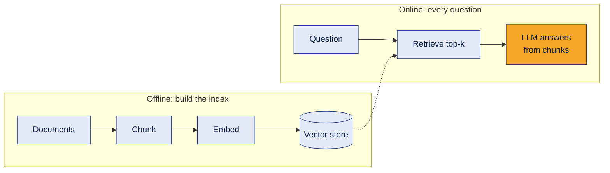

**Example**
A student asks "When do B.Tech applications close?" The system finds the admissions entry and the LLM answers "30 June", citing it.

**Where it's used**
FAQ bots, policy assistants, document search, support tools.

**Common mistake**
Thinking more retrieved chunks always help. Irrelevant chunks add noise and cost.

**Interview questions**
1. **Q:** What are the two phases of RAG? **A:** Offline indexing (load, chunk, embed, store) and online querying (retrieve, then generate).
2. **Q:** What does RAG do well? **A:** Grounds answers in your own, current documents and lets you show sources.
3. **Q:** Do you need to retrain the model when documents change? **A:** No. You re-index the changed documents.
4. **Q:** What is "top-k"? **A:** The number of most similar chunks returned by a search.
5. **Q:** What is grounding? **A:** Making the answer depend on retrieved evidence instead of the model's memory.

**In one line**
Retrieve, then generate: one pass, in a fixed order.

---

## 2. Where traditional RAG falls short

**What it is**
Basic RAG is a straight line: **Question → Retrieve → Generate**, exactly once. It never stops to ask "did I find enough?"

**How it works**
| Situation | Why one search is not enough |
|---|---|
| Incomplete retrieval | The first chunks miss part of the answer |
| Multi-part question | The answer sits in two or more documents |
| Unclear question | It needs rephrasing or clarification |
| Needs a live tool | The answer is in a database or API, not a document |
| Needs checking | Nobody verifies the answer matches the evidence |
| Needs a decision or action | It can quote a rule, but it cannot check a case, decide or escalate |

**Example**
"How do I apply for B.Tech, and can I get a scholarship?" One search returns the admissions entry but not the scholarship entry. Basic RAG answers half the question, or fills the gap by guessing.

**Where it's used**
Knowing these gaps is how you decide when to upgrade a RAG system.

**Common mistake**
Expecting an LLM to "naturally" retry or verify. A basic pipeline only does that if you **design** it to.

**Interview questions**
1. **Q:** What is the main limitation of basic RAG? **A:** It retrieves once in a fixed order and never decides to search again, use a tool or verify.
2. **Q:** Why do multi-part questions fail? **A:** One search often returns chunks for only one part.
3. **Q:** What happens when retrieval misses information? **A:** The answer is incomplete, or the model fills the gap with a guess.
4. **Q:** Can basic RAG fetch live data? **A:** Not by itself. It only searches the indexed documents.
5. **Q:** Does a better LLM fix bad retrieval? **A:** No. If the right chunks are not retrieved, the model cannot use them.

**In one line**
Basic RAG cannot notice its own gaps.

---

## 3. Agentic RAG

**What it is**
RAG with a **decision loop**: after each search, the system checks the result and decides what to do next.

**How it works**
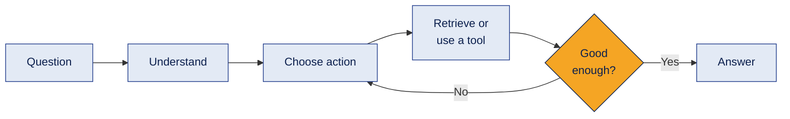
Possible actions: search, rewrite the query, search again, call a tool, answer, or ask the user to clarify.

**An easy picture:** basic RAG is a student in an open-book exam who may visit the library **once**. Agentic RAG is a **personal assistant**: it can go back to the library many times, keep notes, use a calculator or make a call, and decide what to do next based on what it finds.

**How retrieval itself changes**

| Traditional RAG | Agentic RAG |
|---|---|
| Retrieves exactly once per question | Can retrieve many times as its plan changes |
| Searches the user's exact words | Can **rewrite** the query, or **split** it into sub-queries the user never typed |
| Top chunks go straight into one answer | Chunks are one input among memory and tool results |
| No feedback: the LLM cannot ask for more | The agent can say "I need more" and fetch it, or use a different tool |
| Answers a question | Can complete a task (check, decide, act) |

**Example**
For the B.Tech question, the agent sees the scholarship part is missing, searches "merit scholarship", finds it, then answers both parts.

**Where it's used**
Support assistants, research tools, internal knowledge bots where answers span several sources.

**Common mistake**
Thinking agentic RAG needs many agents. **One agent** running a loop is already agentic RAG.

**Interview questions**
1. **Q:** What is agentic RAG? **A:** RAG where an agent evaluates retrieval results and decides whether to search again, use a tool or answer.
2. **Q:** Does agentic RAG require multiple agents? **A:** No. A single agent can control the loop.
3. **Q:** Is agentic RAG always more accurate? **A:** Not guaranteed. It must be proven with evaluation, and it adds cost and latency.
4. **Q:** Name three actions an agentic RAG system can take. **A:** Rewrite the query, retrieve more evidence, call a tool (also: answer or ask for clarification).
5. **Q:** Agentic RAG vs corrective RAG? **A:** Corrective RAG is one agentic pattern: grade the retrieval, and re-search if it is weak.

**In one line**
Agentic RAG adds "check and decide" between retrieving and answering.

---

## 4. Building blocks of an agent

**What it is**
Four parts every agent needs, plus one golden rule about who is in control.

**How it works**
| Part | Job | Example |
|---|---|---|
| Goal | What to achieve, and the rules | "Answer from the college FAQ. Never invent fees or dates." |
| LLM | Reads the situation and **proposes** the next step | "Search for scholarship rules next" |
| Retriever | Finds information in a knowledge source | Vector store search |
| Tools | Act outside the LLM | Database query, calculator, web search, send email |

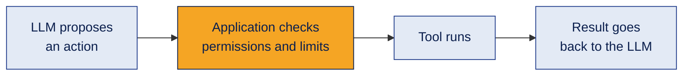

**Example**
The LLM asks to call `refund_payment(order_id)`. Your code first checks that the user owns the order and the amount is under the auto-approve limit. Only then does it run.

**Where it's used**
Every agent, in every framework.

**Common mistake**
Letting the LLM run tools directly. **The LLM proposes; your application executes and controls.**

**Interview questions**
1. **Q:** What are the core parts of an agent? **A:** A goal, an LLM, a retriever or knowledge source, and tools.
2. **Q:** Who should execute tool calls? **A:** The application code, after validating the request and checking permissions.
3. **Q:** Why write rules into the goal? **A:** They define what the agent may do and when the task is finished.
4. **Q:** What makes a good tool? **A:** A clear name, defined inputs and outputs, and a limited scope.
5. **Q:** Does having access to a tool mean the agent should always use it? **A:** No. It should use a tool only when the task needs it.

**In one line**
The LLM suggests; the code decides and acts.

---

## 5. The decision loop: evidence check and retry limit

**What it is**
The heart of agentic RAG: search, **check the evidence**, refine the query and repeat, with a **hard limit** on attempts.

**How it works**
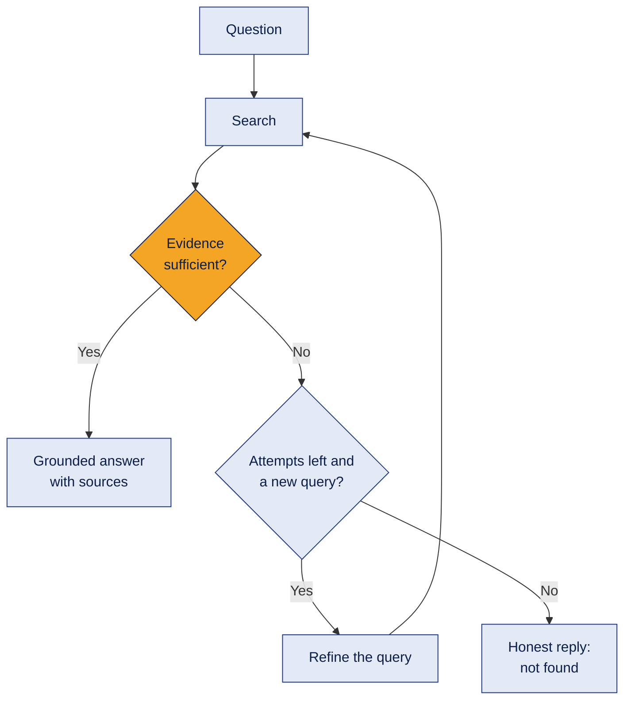

The loop keeps **state** so every decision can be traced:

| State | Purpose |
|---|---|
| `question` | The original question (never changes) |
| `queries` | Every query tried, to avoid repeats |
| `evidence` | Chunks collected so far, without duplicates |
| `attempts` | Counts searches against the limit |
| `decision` | SUFFICIENT or INSUFFICIENT |
| `trace` | A log of each step, for debugging |

**Example**
"What is the average placement salary?" The FAQ has no placement data. The agent tries three queries, never finds evidence, and replies "I could not find this in the FAQ. Please contact the college office." It does **not** invent a number. That is a success, not a failure.

**Where it's used**
Any agent that retries: search agents, coding agents that re-run tests, data agents that re-query.

**Common mistake**
No retry limit. Without one, a confused agent can loop forever and burn money. Also: trusting the evidence check blindly. It is an LLM judgment, so test it on real questions.

**Interview questions**
1. **Q:** Why does an agentic loop need a retry limit? **A:** To prevent endless loops and to control cost and latency.
2. **Q:** What is an evidence check? **A:** A step that judges whether the retrieved information answers every part of the question.
3. **Q:** Why ask the evidence check for structured output (like JSON)? **A:** So code can read the decision reliably and act on it.
4. **Q:** What should the agent do if evidence is still insufficient at the limit? **A:** Say clearly that it could not find the answer, instead of guessing.
5. **Q:** Why keep a trace of each attempt? **A:** To debug decisions, measure cost and explain the answer.

**In one line**
Check, refine, repeat, but always within a limit, and admit when the answer is not there.

---

## 6. Two ways to build agentic RAG: controller vs tool calling

**What it is**
There are two common ways to build the agentic RAG loop. The difference is **who decides the next step**: your code, or the LLM.

**How it works**

**Way 1: controller (your code decides).** An evidence check returns a fixed answer (SUFFICIENT or INSUFFICIENT), and Python decides what happens next. This is the loop in section 5.

**Way 2: tool calling (the LLM decides).** The retriever is wrapped as a **tool**. In each round the LLM either asks to call the tool or gives the final answer.

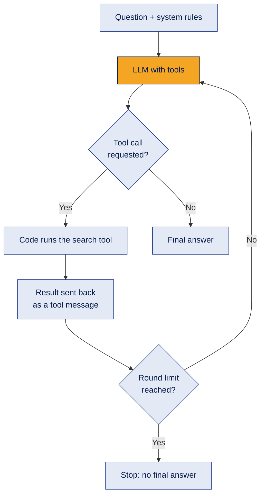

The key pieces in LangChain:
```python
@tool
def search_college_faq(query: str) -> str:
    """Search the college FAQ."""          # the docstring tells the LLM when to use it
    ...

llm_with_tools = llm.bind_tools([search_college_faq])
response = llm_with_tools.invoke(messages)
if response.tool_calls:                    # the LLM asked for the tool
    ...run it, then append ToolMessage(content=result, tool_call_id=call["id"])
else:
    final_answer = response.content        # no tool call means it is done
```

| | Controller (code decides) | Tool calling (LLM decides) |
|---|---|---|
| Who chooses the next step | Your code, from a structured check | The LLM, through tool calls |
| Predictability | High, easy to test | Lower, the model may skip or repeat searches |
| Code needed | More | Less |
| Flexibility | You design every branch | Handles new situations on its own |
| Main risk | Rigid if you miss a case | The model may answer from its own memory instead of searching |
| Good for | Strict, high-risk workflows | Flexible assistants with several tools |

**Example**
Off-topic test: "Who won the cricket world cup in 2011?" sent to a college FAQ bot. With tool calling, if the system prompt does not forbid it, the model may simply answer from memory. A good prompt says: "If the question is not about the college, say you only answer college questions." Testing off-topic questions is part of building an agent.

**Where it's used**
Tool calling is how most agent frameworks work inside (LangChain agents, LangGraph tool nodes). Controllers are common where rules must be strict.

**Common mistake**
- No round limit, so a confused model keeps calling tools.
- Forgetting that **every** tool call needs a reply message with the matching `tool_call_id`, even when the tool fails or does not exist. Otherwise the next API call errors.
- Weak tool descriptions. The LLM decides when to use a tool by reading its name and description.

**Interview questions**
1. **Q:** What are two ways to build agentic RAG? **A:** A code controller that decides from structured checks, or tool calling where the LLM decides when to search.
2. **Q:** What does `bind_tools` do? **A:** Tells the model which tools exist (name, description, inputs) so it can request them.
3. **Q:** How does the loop know the agent is finished? **A:** The model replies without any tool call; that reply is the final answer.
4. **Q:** Why does a tool's docstring matter? **A:** The model reads it to decide when and how to use the tool.
5. **Q:** When would you prefer a controller over tool calling? **A:** When the workflow must be predictable, auditable and easy to test, for example in finance or HR policy.

**In one line**
Same goal, different driver: code drives the controller, the LLM drives tool calling.

---

## 7. The agent harness

**What it is**
Everything **around** the LLM that turns it into a dependable agent. If the LLM is the engine, the harness is the rest of the car: steering, brakes, dashboard and seatbelts.

**How it works**
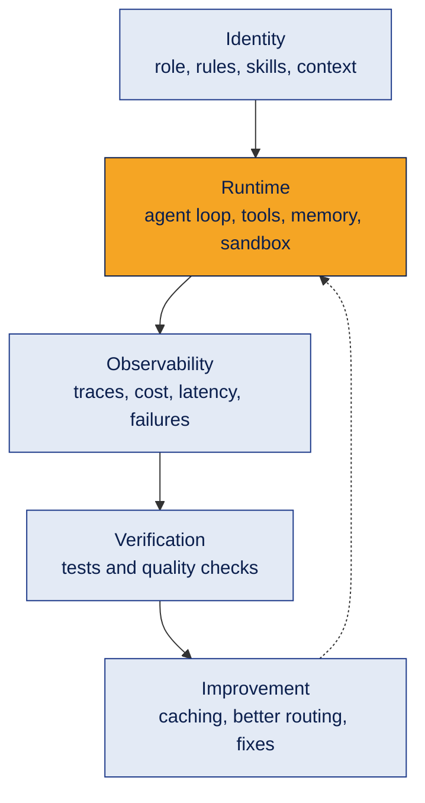

**Example**
A market research agent with three tools (company data, competitor data, news). The harness decides which tool calls are allowed, keeps the context small, logs every call and cost, and checks the final report before the user sees it.

**Where it's used**
Coding assistants, research agents, enterprise agents: any agent that must run reliably, not just in a demo.

**Common mistake**
Spending all the effort on the prompt and none on the harness. Most production failures come from missing limits, logs and checks.

**Interview questions**
1. **Q:** What is an agent harness? **A:** The system around the LLM: tools, memory, the loop, permissions, logging and verification.
2. **Q:** Why is a sandbox useful? **A:** It limits what an agent's code or tools can touch if something goes wrong.
3. **Q:** What should observability capture? **A:** Each step, tool call, token usage, cost, latency and errors.
4. **Q:** What is context management? **A:** Choosing what information goes into the model's limited context window at each step.
5. **Q:** Why add verification before the final answer? **A:** To catch wrong or unsupported output before it reaches the user.

**In one line**
A good agent is a good LLM inside a good harness.

---

## 8. Single-agent systems

**What it is**
**One agent owns the whole task from start to finish:** it understands the request, uses tools, decides and responds.

**How it works**
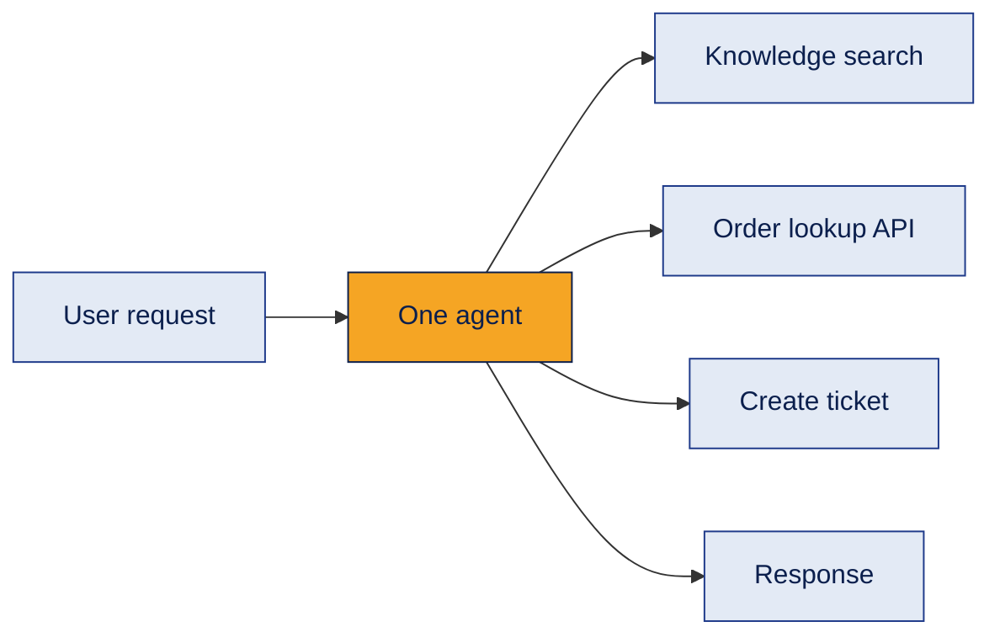

**Example**
A support agent reads "my order hasn't arrived", looks up the order, checks the delivery policy, replies with the status, and opens a ticket if it is late.

**Where it's used**
Customer support, FAQ assistants, personal productivity agents, most first versions of any agent.

**Common mistake**
Jumping to multi-agent too early. A single agent is simpler to build, cheaper to run and easier to debug.

**Interview questions**
1. **Q:** What is a single-agent system? **A:** One agent that handles the full workflow with its own reasoning and tools.
2. **Q:** When is a single agent the right choice? **A:** When the task is clear, the steps are connected and one agent can do it reliably.
3. **Q:** What are its main advantages? **A:** Simpler design, lower cost, easier debugging, central control.
4. **Q:** What is its main weakness? **A:** It can struggle when a task needs many different skills or too much context at once.
5. **Q:** Can a single agent use many tools? **A:** Yes. Using many tools does not make it multi-agent.

**In one line**
Start with one agent; add more only when it clearly struggles.

---

## 9. Autonomous agents (AutoGPT style) and bounded autonomy

**What it is**
An agent that receives a **big goal**, breaks it into tasks, works through them, and creates new tasks as it learns. AutoGPT (2023) made this idea famous.

**How it works**
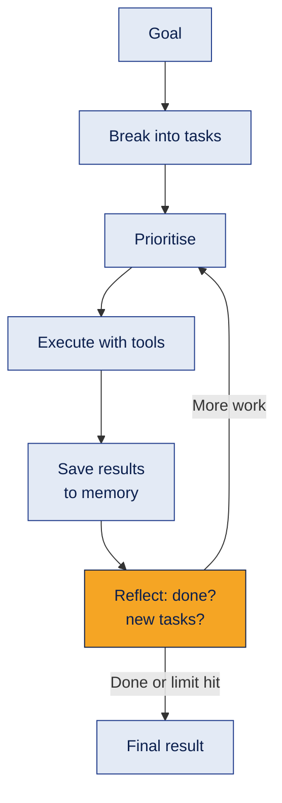

| Benefits | Risks |
|---|---|
| Breaks big goals into steps | Plans can be wrong |
| Adapts as it learns | Early mistakes spread to later steps |
| Uses tools and memory | Many LLM calls: high cost and slow |
| Handles open-ended work | Can loop without end |
| | Tool misuse and security issues |

**Example**
Goal: "Compare three project management tools for a 10 person startup." The agent plans tasks (list features, find pricing, compare), works through them, notices pricing is missing for one tool, adds a task, then writes the comparison.

**Where it's used**
Research assistants, coding agents, long-running background tasks, always with limits.

**Common mistake**
Giving full autonomy. Use **bounded autonomy**: maximum steps and time, tool permissions, input and output checks, logging, clear success criteria, and human approval for important actions.

**Interview questions**
1. **Q:** What is task decomposition? **A:** Breaking a large goal into smaller, manageable tasks.
2. **Q:** Is AutoGPT a type of agentic RAG? **A:** Not exactly. It is a broader goal-driven agent; retrieval is only one tool it may use.
3. **Q:** Why did early autonomous agents struggle? **A:** Weak planning, error propagation, high cost and no reliable stopping condition.
4. **Q:** What is bounded autonomy? **A:** Letting an agent act on its own within strict limits on steps, tools, time and approvals.
5. **Q:** Which actions should need human approval? **A:** Anything costly or hard to undo: payments, deleting data, sending messages to customers.

**In one line**
Autonomy is useful only when it has limits and a clear finish line.

---

## 10. Multi-agent systems

**What it is**
Several specialist agents share one goal. A **supervisor** splits the work, specialists do their parts, and the results are combined.

**How it works**
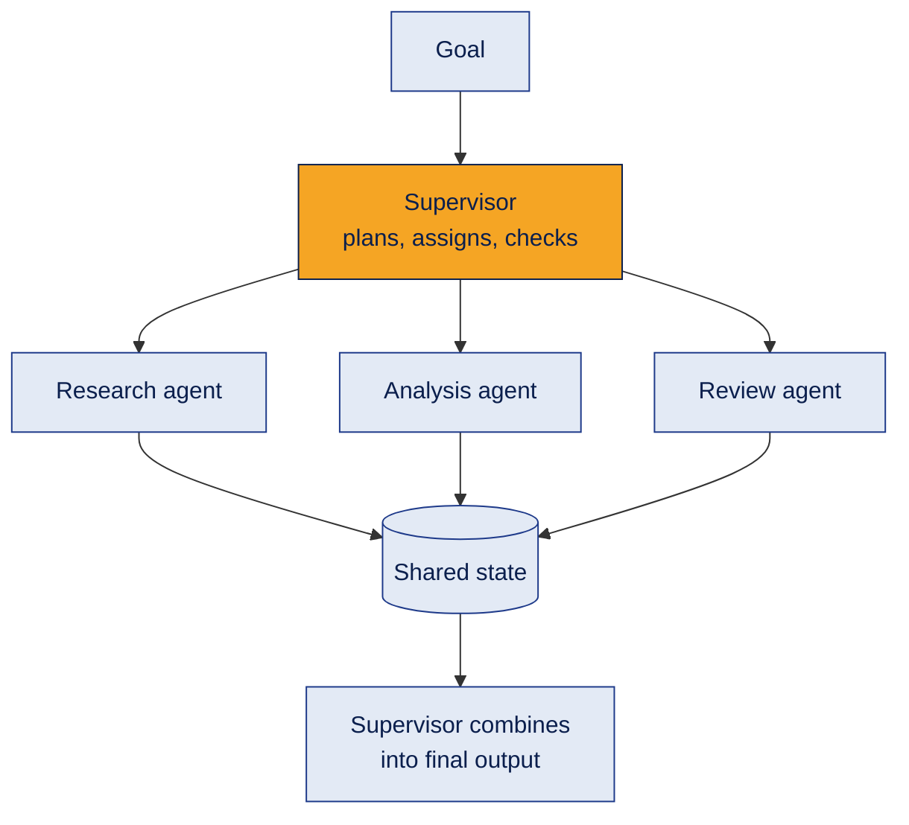

| Component | Job |
|---|---|
| Supervisor | Plans, assigns tasks, tracks progress, resolves conflicts, combines results |
| Specialist agents | Each owns one responsibility |
| Communication | Messages or shared state between agents |
| Orchestration | The order: one after another, in parallel, or a graph with loops |
| Synthesis | Merges outputs into one answer |

**Example**
A bookstore wants WhatsApp ordering. A Market Researcher describes the customers, a Tech Planner designs the system, a Risk Reviewer flags payment and privacy risks, and the Supervisor sends the plan back if a risk has no safeguard. (See [Demo 2](demos/supervisor_team.py).)

**Where it's used**
Research reports, product planning, software teams of agents, document processing pipelines.

**Common mistake**
Thinking more agents means a better answer. Each agent adds calls, cost, delay and new ways to fail.

**Interview questions**
1. **Q:** What is a multi-agent system? **A:** Multiple specialised agents coordinating toward a shared goal.
2. **Q:** What does the supervisor do? **A:** Splits the goal into tasks, assigns them, checks results and combines the final output.
3. **Q:** How do agents share information? **A:** Through messages or a shared state that each agent can read and update.
4. **Q:** What are the orchestration styles? **A:** Sequential, parallel, or graph-based with conditions and loops.
5. **Q:** If three agents use the same LLM, are they different agents? **A:** They are role-specialised calls coordinated by code; whether you call them separate agents depends on the architecture.

**In one line**
Split the work by role, coordinate it with a supervisor, then combine.

---

## 11. Single agent or multi-agent?

**What it is**
A design decision. Choose the **simplest** design that solves the problem reliably.

**How it works**
| | Single agent | Multi-agent |
|---|---|---|
| Ownership | One agent does everything | Work is shared by roles |
| Specialisation | One generalist | Several specialists |
| Parallel work | Not by default | Possible if the framework supports it |
| Debugging | Easier | Harder (more moving parts) |
| Cost | Lower | Higher (more LLM calls) |
| Failure | Central agent fails, task stops | Can be isolated, depending on design |

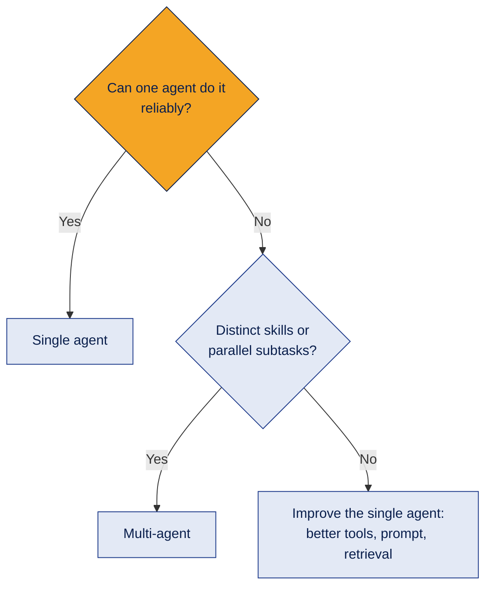

**Example**
"Answer questions about our return policy" → single agent. "Research five competitors in parallel and write a verified report" → multi-agent can help.

**Where it's used**
Architecture reviews and interviews ("why did you choose this design?").

**Common mistake**
Not comparing. Before keeping a multi-agent design, test it against a single-agent baseline on the same questions.

**Interview questions**
1. **Q:** When would you choose multi-agent over single agent? **A:** When the task needs distinct specialisations, independent checking or parallel subtasks that justify the extra cost.
2. **Q:** Why might a multi-agent system cost more? **A:** Every agent makes its own LLM calls, plus coordination calls.
3. **Q:** Why is multi-agent harder to debug? **A:** Errors can come from any agent or from the hand-offs between them.
4. **Q:** How do you prove a multi-agent design is better? **A:** Run both designs on the same test set and compare quality, cost and latency.
5. **Q:** What is a good default? **A:** Start with a single agent and split only where it clearly fails.

**In one line**
More agents is a cost; use them only when they buy real quality.

---

## 12. Lead agent and subagents (research pattern)

**What it is**
A **lead agent** plans a research question, sends subtopics to **subagents** that work in parallel, then combines their findings into one cited report. Also called the orchestrator and worker pattern.

**How it works**
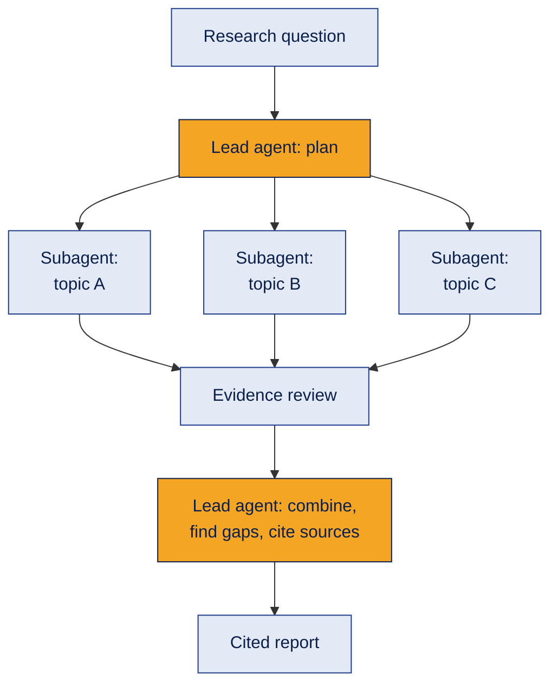

**Example**
"Should our startup build on AWS, Azure or Google Cloud?" Subagents research pricing, AI services and free startup credits in parallel. An evidence reviewer flags unsupported claims. The lead agent writes the comparison with sources and marks what is uncertain.

Anthropic has [publicly described](https://www.anthropic.com/engineering/multi-agent-research-system) using this pattern for its research feature. Its write-up reports that the pattern helps on broad research questions, and also that multi-agent runs used about 15 times more tokens than a normal chat.

**Where it's used**
Deep research tools, market and competitor analysis, literature reviews.

**Common mistake**
Using it for tasks that are not easy to split. If every subtask depends on the others, parallel agents add cost without much benefit.

**Interview questions**
1. **Q:** What does the lead agent do? **A:** Plans the research, assigns subtopics, tracks gaps and writes the final synthesis.
2. **Q:** Why run subagents in parallel? **A:** Independent subtopics finish faster, and each subagent keeps a smaller, focused context.
3. **Q:** Why add an evidence reviewer? **A:** To check sources, spot conflicting claims and flag unsupported conclusions.
4. **Q:** What is the main trade-off of this pattern? **A:** Better coverage on broad questions, but much higher token cost.
5. **Q:** When is it a poor fit? **A:** When subtasks depend heavily on each other or the task is small.

**In one line**
Plan centrally, research in parallel, verify, then combine with citations.

---

## 13. Research frameworks: CAMEL, AgentVerse, MetaGPT

**What it is**
Three well-known research projects that explore **how agents should collaborate**. Each focuses on a different style.

**How it works**
| Framework | Main idea | Picture it as |
|---|---|---|
| CAMEL | Agents play assigned roles and talk to each other to finish a task | Two colleagues role-playing a meeting |
| AgentVerse | An environment for running and studying groups of agents | A lab where you watch agents interact |
| MetaGPT | Agents follow a team workflow with standard documents | A software company: PM → engineer → QA |

**Example**
MetaGPT style: a "Product Manager" agent writes requirements, an "Engineer" agent writes a design from them, and a "QA" agent writes test cases. Each hands a document to the next.

**Where it's used**
Research and prototyping. For production apps, teams more often use frameworks such as LangGraph or CrewAI ([topic 07](../07-agent-frameworks/README.md)).

**Common mistake**
Choosing a framework by how many agents it supports. Choose by the **coordination problem**: free conversation, a studied environment, or a fixed workflow.

**Interview questions**
1. **Q:** What is CAMEL's core idea? **A:** Role-based agents communicating with each other to complete a task.
2. **Q:** What is MetaGPT's core idea? **A:** Agents organised like a team, following a structured workflow and passing documents.
3. **Q:** What is AgentVerse used for? **A:** Setting up and studying how multiple agents interact in an environment.
4. **Q:** Why might structured workflows beat free conversation? **A:** Clear roles and documents reduce off-topic chat and make results easier to check.
5. **Q:** Does adding agents make a system reliable? **A:** No. Reliability comes from role design, validation, state management and error handling.

**In one line**
Different frameworks, different coordination styles: pick by the problem, not the agent count.

---

## 14. Designing agent contracts

**What it is**
Before writing code, define a **contract** for every agent: what it receives, what it must return, and how its output is checked.

**How it works**
| For each agent, define | Example: Risk Reviewer |
|---|---|
| Role | Find risks in the plan |
| Instructions | Cover privacy, payments, wrong orders, cost |
| Tools | None (reads the plan only) |
| Input | Business problem + current plan |
| Output schema | `summary`, `key_points`, `assumptions` |
| Validation | Every risk has a safeguard |
| Failure handling | Retry once, then mark as an open issue |

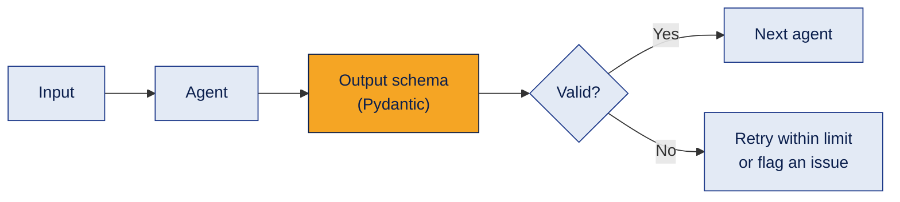

**Example**
In Demo 2 every specialist must return a `SpecialistReport` (summary, key points, assumptions) and the supervisor must return a `SupervisorReview` (approved, issues). The code reads `approved` directly, with no guessing from free text.

**Where it's used**
Any multi-agent system that must be tested, debugged or maintained by a team.

**Common mistake**
Passing free-form text between agents. Small wording changes then break the next step. Structured outputs make hand-offs reliable.

**Interview questions**
1. **Q:** What is an agent contract? **A:** A clear definition of an agent's role, inputs, output format, validation and failure handling.
2. **Q:** Why use structured output (like Pydantic models) between agents? **A:** So the next step can rely on fields instead of parsing free text.
3. **Q:** What should happen when an agent's output fails validation? **A:** Retry within a limit, then flag it as an open issue instead of passing bad data on.
4. **Q:** Why is multi-agent design called a software problem? **A:** Success depends on contracts, state, retries and logging as much as on prompts.
5. **Q:** What should a supervisor do with conflicting recommendations? **A:** Compare them against the goal and evidence, pick or merge, and record the reason.

**In one line**
Agent collaboration is software engineering: clear contracts, limits and checks.

---

## 15. Practice: design a multi-agent product team

**What it is**
A design exercise to practise everything above **before** writing code.

**How it works**

Scenario: a fitness app for students has low weekly usage. The team wants ideas to bring users back **without** manipulative tricks.

| Agent | Responsibility | Output |
|---|---|---|
| Product Manager | Define the problem, users and success metrics | Short requirements document |
| UX Designer | Propose features and the user journey | Feature list + journey |
| Engineer | Turn features into a technical plan | Components, APIs, data, risks |
| QA and Risk Reviewer | Test cases, edge cases, unhealthy engagement risks | Test plan + safeguards |
| Supervisor | Assign work, resolve conflicts, check completeness | Final proposal |

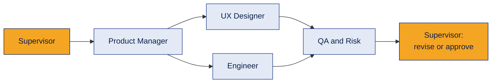
UX Designer and Engineer can work **in parallel** once requirements exist.

**Your tasks**
1. Write the input and output for each agent.
2. Decide which agents can run in parallel.
3. List what must be shared between agents (the shared state).
4. Decide how the supervisor handles disagreements.
5. Decide how QA checks the final proposal.
6. Name at least three ways the system could fail.

**Example answers for task 6**
- Every agent repeats the same wrong assumption, because nobody checks facts.
- The engineer plans features the designer never proposed (lost context between agents).
- The revision loop never ends, because there is no limit.

**Where it's used**
System design interviews and planning real agent projects.

**Common mistake**
Starting with code. Clear roles, contracts and limits on paper save hours of debugging.

**Interview questions**
1. **Q:** Why not use one powerful LLM call for the whole task? **A:** Separate roles give focused outputs and independent checks, but you must prove this beats a single call.
2. **Q:** Which agents can run in parallel here? **A:** UX Designer and Engineer, after the requirements are ready.
3. **Q:** What belongs in shared state? **A:** Requirements, decisions, agent outputs and open issues.
4. **Q:** How should the supervisor resolve conflicts? **A:** Compare options against the goal and evidence, decide, and record why.
5. **Q:** Name one safeguard against endless revisions. **A:** A maximum number of revision rounds, after which open issues are reported.

**In one line**
Design roles, hand-offs, limits and failure points first; code second.

---

## 16. Good engineering habits for agent code

**What it is**
Small habits that make agent code safe, debuggable and ready to grow.

**How it works**
| Habit | Why | How |
|---|---|---|
| Keep keys out of code | Leaked keys get misused and cost money | `.env` file + `.gitignore`, or `getpass` in notebooks |
| Use logging, not only print | See what happened, in order, with severity | Python `logging` module |
| Validate inputs | Fail early with a clear message | Reject empty questions, missing files |
| Structured outputs | Code can trust the fields | Pydantic models with `with_structured_output` |
| Limits everywhere | Stop endless loops and runaway cost | Max attempts, max rounds, max revisions, timeouts |
| Keep a trace | Explain and debug every decision | Store each step's query, tool call and decision |
| Read warnings | Libraries change fast | Act on deprecation warnings before they become errors |

**Python logging levels**

| Level | Use it for | Example |
|---|---|---|
| DEBUG | Detailed diagnostics | "Retrieved 5 chunks for query X" |
| INFO | Normal events | "Model client ready" |
| WARNING | Something unexpected | "API response slow" |
| ERROR | An operation failed | "Vector search failed" |
| CRITICAL | The app cannot continue | "No API key, stopping" |

```python
import logging
logging.basicConfig(level=logging.INFO, format="%(asctime)s | %(levelname)s | %(message)s")
logger = logging.getLogger("agentic_rag")
logger.info("Retrieval attempt %d of %d", 1, 3)
```

**Example**
A deprecation warning such as "`langchain-community` is being sunset" is not an error today, but it tells you to plan a move to the newer package before it breaks.

**Where it's used**
Every project you put on GitHub or ship to users.

**Common mistake**
Hardcoding an API key "just for testing" and then pushing it to GitHub. If that happens, revoke the key first, then remove it from the code.

**Interview questions**
1. **Q:** Where should API keys live? **A:** In environment variables or a `.env` file that is never committed.
2. **Q:** Why prefer logging over print? **A:** Levels, timestamps and consistent format, and it can be sent to files or monitoring tools.
3. **Q:** Why validate inputs in agent code? **A:** To fail early with clear errors instead of wasting LLM calls on bad input.
4. **Q:** What limits should an agent have? **A:** Maximum steps or rounds, retries, revisions, time and cost.
5. **Q:** What do you do if you see a deprecation warning? **A:** Read it, check the docs for the replacement, and plan the update.

**In one line**
Safe keys, clear logs, checked inputs, structured outputs and hard limits.

---

## 17. Demos

Three runnable demos are in the [`demos`](demos/README.md) folder.

| Demo | What it shows |
|---|---|
| [`agentic_rag_loop.py`](demos/agentic_rag_loop.py) | College FAQ assistant: search → evidence check (structured output) → refine → retry limit → grounded answer or honest "not found", compared with one-search RAG |
| [`supervisor_team.py`](demos/supervisor_team.py) | Bookstore WhatsApp ordering: researcher → planner → risk reviewer → supervisor review with one bounded revision → final proposal, with LLM call count |
| [`tool_calling_agent.py`](demos/tool_calling_agent.py) | Same college FAQ, but the LLM decides when to search (tool calling), with a round limit and an off-topic test |

The core of Demo 1, the decision loop (simplified from the full file):

```python
while state["attempts"] < max_attempts:          # retry limit
    state["attempts"] += 1
    state["queries"].append(query)
    state["evidence"] += search(store, query)    # act
    check = check_evidence(llm, question, state["evidence"])   # observe (structured output)
    if check.decision == "SUFFICIENT":           # decide
        break
    if not check.next_query or check.next_query in state["queries"]:
        break                                    # no new idea: stop early
    query = check.next_query                     # refine and try again
```

**API key:** read from a `.env` file, never written in the code or uploaded to GitHub.

[← Back to all topics](../README.md)
