# 08 · A2A: Agent to Agent Protocol

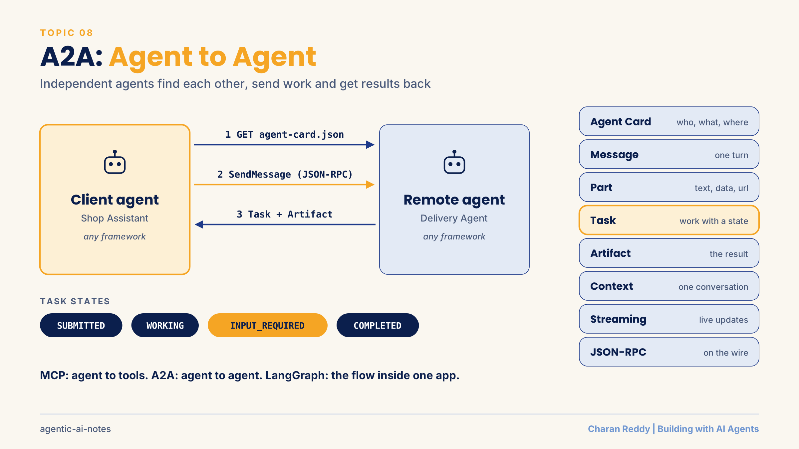

A2A (Agent2Agent) is an open protocol that lets **independent AI agents discover each other, send work, track it and get results back**, even when different teams built them with different frameworks or languages.

> **Status:** 📘 Concepts learned · runnable demo (hand written JSON and official SDK, A2A v1.0): [a2a-protocol-demo](https://github.com/charanbabareddy-dot/a2a-protocol-demo)
>
> Sections marked **🔭 Beyond the basics** go further than a first introduction. They are here so the page stays useful when I build real systems.

[← Back to Multi-Agent Systems](README.md) · [← All topics](../README.md)

## Contents
1. [Why agents need to talk to each other](#1-why-agents-need-to-talk-to-each-other)
2. [What A2A is: a protocol, not a framework](#2-what-a2a-is-a-protocol-not-a-framework)
3. [Architecture: user, client agent, remote agents](#3-architecture-user-client-agent-remote-agents)
4. [A2A call vs a normal function call](#4-a2a-call-vs-a-normal-function-call)
5. [A2A vs MCP vs LangGraph](#5-a2a-vs-mcp-vs-langgraph)
6. [Agent Card and discovery](#6-agent-card-and-discovery)
7. [Message, Part, Task, Artifact, Context](#7-message-part-task-artifact-context)
8. [Task lifecycle (task states)](#8-task-lifecycle-task-states)
9. [Sync, async, streaming and push notifications](#9-sync-async-streaming-and-push-notifications)
10. [JSON-RPC: the messages on the wire](#10-json-rpc-the-messages-on-the-wire)
11. [Building an A2A agent with the SDK](#11-building-an-a2a-agent-with-the-sdk)
12. [Task-aware agents with TaskUpdater](#12-task-aware-agents-with-taskupdater)
13. [Two agents working together](#13-two-agents-working-together)
14. [Many agents: a client agent that routes work](#14-many-agents-a-client-agent-that-routes-work)
15. [🔭 Security and trust](#15--security-and-trust)
16. [🔭 Production checklist and versions](#16--production-checklist-and-versions)
17. [Common errors and cheat sheet](#17-common-errors-and-cheat-sheet)

**Examples used:** a delivery estimate agent, an online seller's price checker and report writer, and a travel planner with hotel and weather agents.

---

## 1. Why agents need to talk to each other

**What it is**
Real systems use many **specialised agents**: one researches, one analyses, one writes, one reviews. Inside one framework they talk easily. The problem starts when agents are built **separately**.

**How it works**
Each agent may differ in:

| Difference | Example |
|---|---|
| Framework | LangGraph, CrewAI, custom code |
| Language | Python, JavaScript, Java |
| API format | Different request and response shapes |
| Where it runs | Laptop, cloud service, another company's server |

Without a standard, every pair of agents needs its own custom connector:

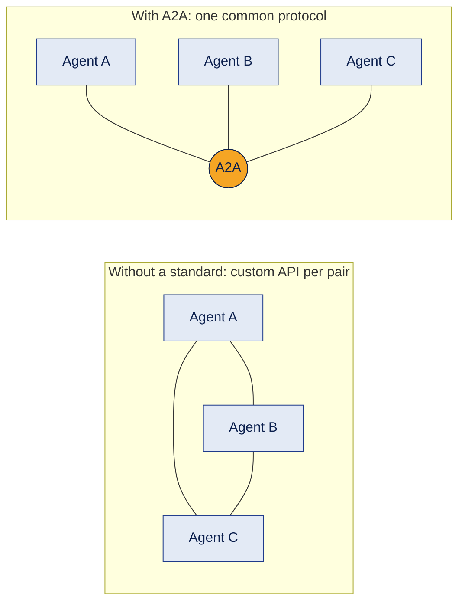

With 3 agents that is 3 custom connectors. With 10 agents it is 45. With a shared protocol, each agent learns **one** way to talk.

**Example**
An online seller has a price checker agent (built by team A in LangGraph) and a report writer agent (built by team B in CrewAI). Without a standard, team B must learn team A's custom API.

**Where it's used**
Companies connecting agents across teams, partners and vendors.

**Common mistake**
Thinking every multi-agent system needs A2A. If all agents live in one app and one framework, the framework is enough.

**Interview questions**
1. **Q:** What is the interoperability problem? **A:** Agents built with different frameworks, languages and APIs cannot easily talk to each other.
2. **Q:** Why do custom connectors not scale? **A:** Every new agent needs a new connector to every other agent.
3. **Q:** Name four ways agents can differ. **A:** Framework, language, API format and where they run.
4. **Q:** When is A2A not needed? **A:** When all agents run inside one app and one framework.
5. **Q:** What does a shared protocol give you? **A:** Each agent learns one way to communicate instead of many.

**In one line**
Agents built separately need a common language, and A2A is that language.

---

## 2. What A2A is: a protocol, not a framework

**What it is**
A **framework** (LangGraph, CrewAI) is how you **build** an agent. A **protocol** (A2A) is how agents **talk**. A2A was started by Google and is now an open project under the Linux Foundation.

**How it works**
Think of HTTP: websites built with completely different tools still talk because they all speak HTTP. A2A does the same for agents.

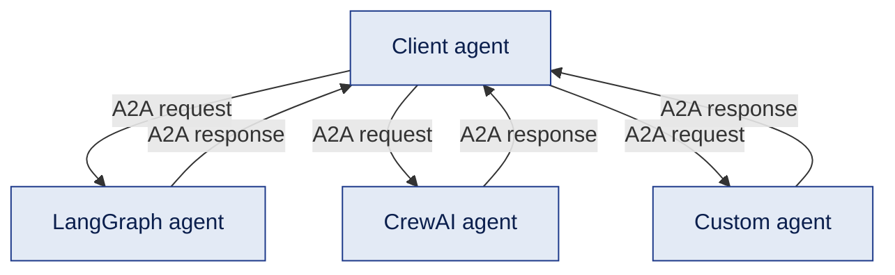

Key features:
1. **Standard messages:** everyone uses the same structure.
2. **Cross framework:** each agent keeps its own framework inside.
3. **Less integration work:** no custom adapter per pair.
4. **Task delegation:** one agent can hand work to another.
5. **Autonomy:** the remote agent keeps its own tools, state and logic. It is a service, not a function.
6. **Security hooks:** the protocol can describe authentication. Real security depends on how you deploy it.
7. **Streaming:** progress updates while work runs.

**Example**
The report writer does not care that the price checker uses LangGraph. It only sends an A2A message and reads the A2A reply.

**Where it's used**
Agent marketplaces, enterprise agent platforms, and connecting your agents to partners' agents.

**Common mistake**
Thinking A2A makes agents "compatible in every way" or guarantees success. It standardises **communication**. The remote agent can still fail or give a poor answer.

**Interview questions**
1. **Q:** Framework vs protocol? **A:** A framework builds an agent; a protocol defines how agents communicate.
2. **Q:** Give an analogy for A2A. **A:** HTTP for websites: different builders, one shared language.
3. **Q:** Does A2A replace LangGraph or CrewAI? **A:** No. You build with them and talk through A2A.
4. **Q:** Who governs A2A? **A:** It is an open project under the Linux Foundation, originally from Google.
5. **Q:** Does A2A guarantee the task succeeds? **A:** No, it only standardises how the request and result travel.

**In one line**
Build with any framework, talk with A2A.

---

## 3. Architecture: user, client agent, remote agents

**What it is**
Three roles:
1. **User:** asks for something.
2. **Client agent:** understands the request and picks a remote agent that can do it.
3. **Remote agent:** an independent agent that offers a skill and does the work.

**How it works**
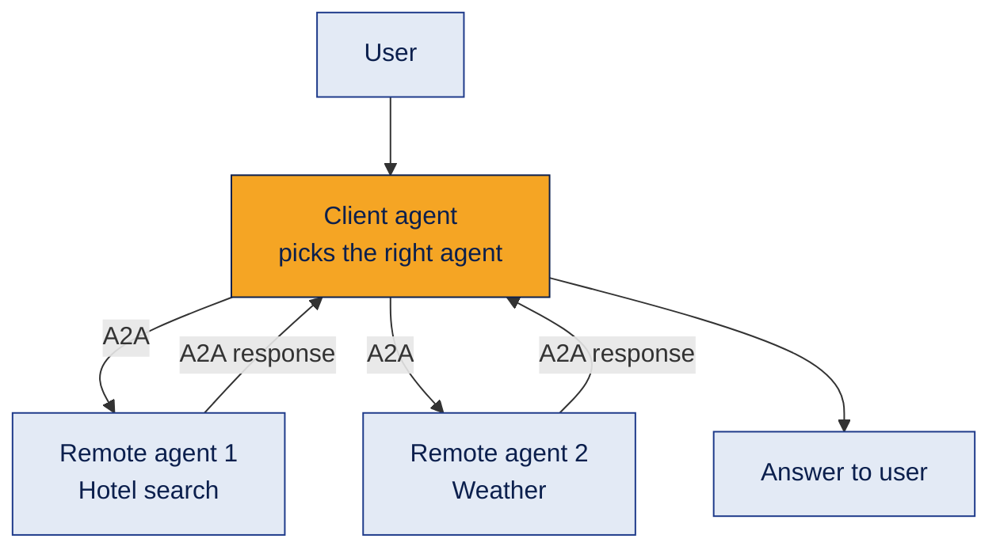

The client agent does **not** need to know how the remote agent works inside. It only needs to know three things: **what** it can do, **where** it lives, and **how** to talk to it. All three come from the Agent Card (section 6).

**Example**
A travel planner (client) asks a hotel agent for rooms in Goa and a weather agent for the forecast, then combines both answers.

**Where it's used**
Assistants that delegate to specialist agents, and customer support systems that hand off to billing or shipping agents.

**Common mistake**
Letting the client depend on the remote agent's internal details. Remote agents are **opaque**: treat them like a black box with a public contract.

**Interview questions**
1. **Q:** Name the three roles. **A:** User, client agent and remote agent.
2. **Q:** What does the client agent do? **A:** Understands the request, picks a remote agent and sends it the work.
3. **Q:** What must the client know about a remote agent? **A:** What it can do, where it is and how to talk to it.
4. **Q:** What does "opaque agent" mean? **A:** Its internals are hidden; only its public contract is visible.
5. **Q:** Must remote agents use the same framework as the client? **A:** No.

**In one line**
The client knows what, where and how, never the inside.

---

## 4. A2A call vs a normal function call

**What it is**
A function call uses a **programming interface** inside one program. An A2A call uses a **standard protocol** to reach an **independent agent**.

**How it works**

| | Function call `agent_b.run(task)` | A2A call |
|---|---|---|
| Lives in | The same application | A separate service |
| Caller must know | The exact function and its arguments | The Agent Card and the protocol |
| Built by | Usually the same team | Can be another team or company |
| Can change freely inside | No, a change can break the caller | Yes, as long as the contract stays the same |

**Example**
Inside your own app, calling `estimate_delivery("500081")` is a function call. Asking a courier company's agent over A2A is an A2A call.

**Where it's used**
Use function calls inside your system. Use A2A at the **boundary** between independent agents.

**Common mistake**
Thinking A2A must always be remote or slow. The key difference is the **protocol and the agent boundary**, not the distance. Two A2A agents can run on the same laptop, like in my demo.

**Interview questions**
1. **Q:** Main difference? **A:** A function call uses a code interface; A2A uses a standard protocol to an independent agent.
2. **Q:** Can A2A agents run on one machine? **A:** Yes. The boundary matters, not the location.
3. **Q:** Why is A2A safer to change? **A:** The remote agent can change its internals as long as its public contract stays the same.
4. **Q:** When would you choose a function call? **A:** When the code is inside your own application.
5. **Q:** What replaces the "function signature" in A2A? **A:** The Agent Card and the protocol's message format.

**In one line**
Functions inside your app, A2A across agent boundaries.

---

## 5. A2A vs MCP vs LangGraph

**What it is**
Three tools that people often confuse:
- **MCP:** connects an agent to **tools and data**.
- **A2A:** connects an agent to **other agents**.
- **LangGraph (or CrewAI):** **orchestrates** steps and agents **inside one app**.

**How it works**
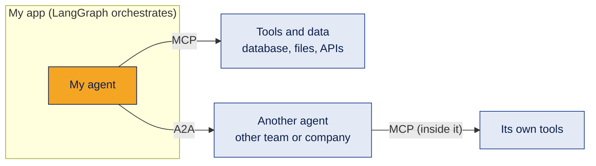

| | MCP | A2A |
|---|---|---|
| Connects | Agent ↔ tools and resources | Agent ↔ agent |
| Purpose | Use a capability | Collaborate and delegate |
| Discovery | List of tools and resources | Agent Card with skills |
| Typical call | Run a tool, read a resource | Send a message, create a task |
| Result | Tool output or data | Message, task result, artifact |

Easy way to remember: MCP says "give me access to a capability". A2A says "work with another agent".

**Example**
A shop agent built with LangGraph reads stock from a database through MCP, and asks a courier company's delivery agent for an estimate through A2A.

**Where it's used**
Together, in the same system. MCP is covered in topic 10.

**Common mistake**
Thinking A2A replaces MCP, or the other way round. They solve different problems and work well together.

**Interview questions**
1. **Q:** MCP vs A2A in one line? **A:** MCP connects agents to tools; A2A connects agents to agents.
2. **Q:** Where does LangGraph fit? **A:** It orchestrates work inside one application.
3. **Q:** Can a remote A2A agent use MCP? **A:** Yes, inside itself, for its own tools.
4. **Q:** What does each use for discovery? **A:** MCP lists tools and resources; A2A uses Agent Cards.
5. **Q:** Can one system use all three? **A:** Yes, and that is common.

**In one line**
MCP for tools, A2A for agents, LangGraph for the flow inside.

---

## 6. Agent Card and discovery

**What it is**
An **Agent Card** is a JSON document where an agent introduces itself: name, what it can do, where to reach it, and how to talk to it. Think of it as a **business card plus a capability profile**.

**How it works**
The card is published at a well known address:

```text
GET https://<agent-base-url>/.well-known/agent-card.json
```

Main fields in A2A v1.0:

| Field | Meaning |
|---|---|
| `name`, `description`, `version` | Identity |
| `supportedInterfaces` | List of `{url, protocolBinding, protocolVersion}`: where and how to connect |
| `capabilities` | Features like `streaming`, `pushNotifications`, `extendedAgentCard` |
| `skills` | What it can do: `id`, `name`, `description`, `tags`, `examples` |
| `defaultInputModes`, `defaultOutputModes` | Content types, like `text/plain` or `application/json` |
| `securitySchemes`, `securityRequirements` | How a client must authenticate |
| `provider`, `documentationUrl`, `iconUrl` | Optional extra information |

```json
{
  "name": "Delivery Agent",
  "description": "Estimates delivery days for an Indian pincode.",
  "version": "1.0.0",
  "supportedInterfaces": [
    { "url": "http://127.0.0.1:8765", "protocolBinding": "JSONRPC", "protocolVersion": "1.0" }
  ],
  "capabilities": { "streaming": false },
  "skills": [
    { "id": "estimate_delivery", "name": "Estimate delivery",
      "description": "Give a 6 digit pincode and get the expected delivery days.",
      "tags": ["delivery"], "examples": ["How many days to deliver to 500081?"] }
  ]
}
```

A typical interaction:

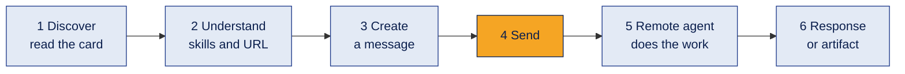

**Example**
My Shop Assistant reads the Delivery Agent's card, finds the skill "Estimate delivery", picks the JSON-RPC URL from `supportedInterfaces`, then sends its question.

**Where it's used**
Every A2A interaction starts here. Agent registries and catalogues collect many cards so clients can search them.

**Common mistake**
Treating discovery as a promise. The card says what an agent **advertises**. Discovery and successful work are two separate steps.

**Interview questions**
1. **Q:** What is an Agent Card? **A:** A JSON document describing an agent's identity, skills, endpoint and supported features.
2. **Q:** Where is it published? **A:** At `/.well-known/agent-card.json` on the agent's base URL.
3. **Q:** Which field tells you where to connect in v1.0? **A:** `supportedInterfaces`, which lists URL, binding and protocol version.
4. **Q:** What is a skill? **A:** One task the agent advertises, with an id, description, tags and examples.
5. **Q:** Does a card guarantee success? **A:** No, it only describes what the agent offers.

**In one line**
The Agent Card tells you who, what, where and how, before you send anything.

---

## 7. Message, Part, Task, Artifact, Context

**What it is**
The five data pieces of A2A:

| Piece | Meaning | Example |
|---|---|---|
| **Message** | One turn of communication, from `ROLE_USER` or `ROLE_AGENT` | "When will my books arrive?" |
| **Part** | A piece of content inside a message or artifact: `text`, `data` (JSON), `url` (a file link) or `raw` (bytes) | `{"text": "500081"}` |
| **Task** | A unit of work with an id and a **state** | "Estimate delivery", now `COMPLETED` |
| **Artifact** | The output of a task, made of parts | `{"data": {"pincode": "500081", "days": 2}}` |
| **Context** | A `contextId` that groups related tasks and messages into one conversation | Same chat, several tasks |

**How it works**
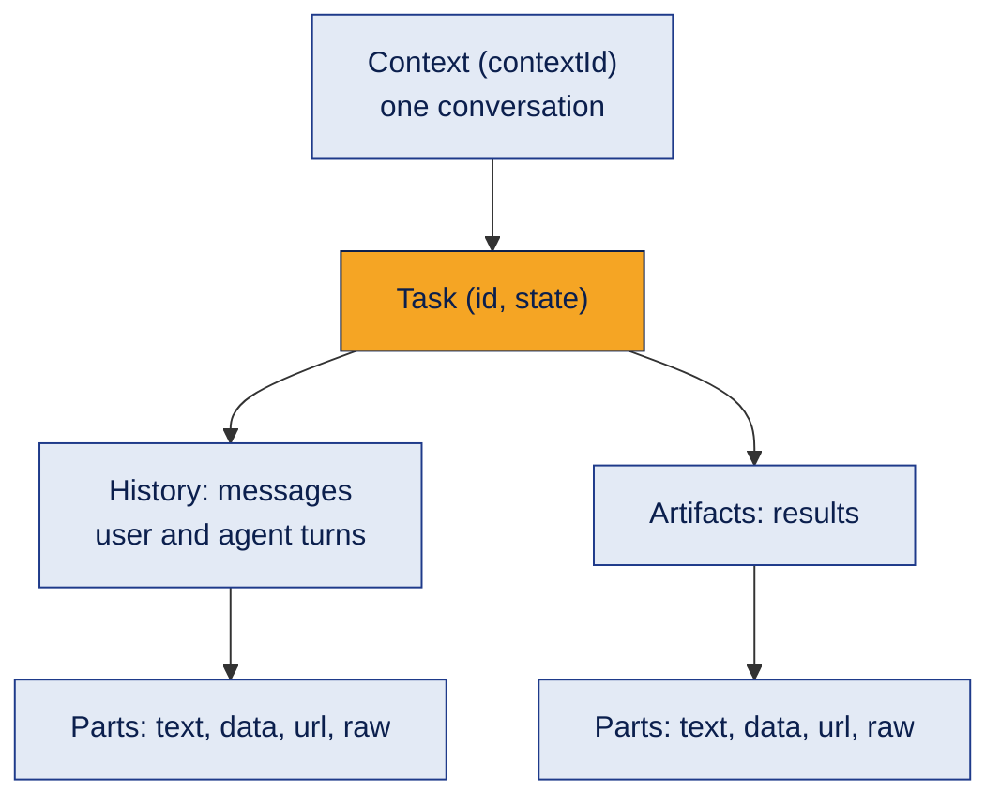

| Message | Task |
|---|---|
| A piece of communication | A unit of work |
| Often a quick request and reply | Can run for a long time |
| No lifecycle | Has a lifecycle (states) |
| "Hello" | "Research this topic" |

A remote agent can answer a request **with just a message** (quick replies, like an echo agent) or **with a task** (work that is tracked).

**Example**
In my demo, the first question creates a task. The agent's reply ("please share a pincode") is a message inside the task. When the task completes, the result arrives as an artifact with a `data` part.

**Where it's used**
Everywhere in A2A. Artifacts carry reports, files, images or JSON results.

**Common mistake**
Putting the final result only inside a chat message. Use an **artifact** for the actual output, so other agents can read it in a structured way.

**Interview questions**
1. **Q:** Message vs task? **A:** A message is one turn of talk; a task is tracked work with a state.
2. **Q:** What is a part? **A:** One piece of content: text, JSON data, a file URL or raw bytes.
3. **Q:** What is an artifact? **A:** The output a task produces.
4. **Q:** What does contextId do? **A:** Groups related tasks and messages into one conversation.
5. **Q:** Can an agent reply without a task? **A:** Yes, with a direct message for quick interactions.

**In one line**
Messages talk, tasks track, artifacts deliver, context connects.

---

## 8. Task lifecycle (task states)

**What it is**
Every task has a **state** that shows where it is in its life.

**How it works**
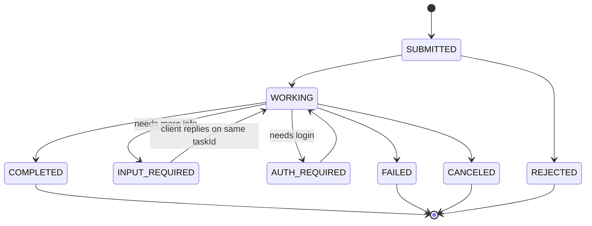

| State (wire name has prefix `TASK_STATE_`) | Meaning | Final? |
|---|---|---|
| `SUBMITTED` | Received, not started | No |
| `WORKING` | In progress | No |
| `INPUT_REQUIRED` | Waiting for more information from the client | No |
| `AUTH_REQUIRED` | Waiting for authentication | No |
| `COMPLETED` | Done successfully | **Yes** |
| `FAILED` | Ended with an error | **Yes** |
| `CANCELED` | Stopped on request | **Yes** |
| `REJECTED` | The agent refused the task | **Yes** |

**Example**
"When will my books arrive?" → `INPUT_REQUIRED` ("please share a pincode") → client replies "500081" **on the same taskId** → `COMPLETED` with an artifact.

**Where it's used**
Long jobs (reports, research), approvals, and any task that needs a follow up question.

**Common mistake**
Sending the follow up as a **new** task. The agent then loses the earlier conversation. Always reuse the `taskId` (and `contextId`).

**Interview questions**
1. **Q:** Name the four final states. **A:** Completed, failed, canceled and rejected.
2. **Q:** What does input required mean? **A:** The agent paused and needs more information from the client.
3. **Q:** How do you continue a paused task? **A:** Send a new message with the same taskId.
4. **Q:** Rejected vs failed? **A:** Rejected means the agent refused to start; failed means it tried and hit an error.
5. **Q:** Can a completed task change again? **A:** No, final states do not change.

**In one line**
Every task has a state, and four of them are the end of the road.

---

## 9. Sync, async, streaming and push notifications

**What it is**
Four ways to wait for a result:

| Pattern | How it feels | Good for |
|---|---|---|
| **Synchronous** | Send and wait for the answer | Short jobs, like converting 10 USD to INR |
| **Asynchronous** | Send, get a task id, check later with `GetTask` | Long jobs, like analysing a 500 page document |
| **Streaming** | Send, then receive live updates as they happen | Showing progress: 10%, 30%, 70%, done |
| **🔭 Push notifications** | The agent calls **your** webhook when the task changes | Very long jobs, when you cannot keep a connection open |

**How it works**
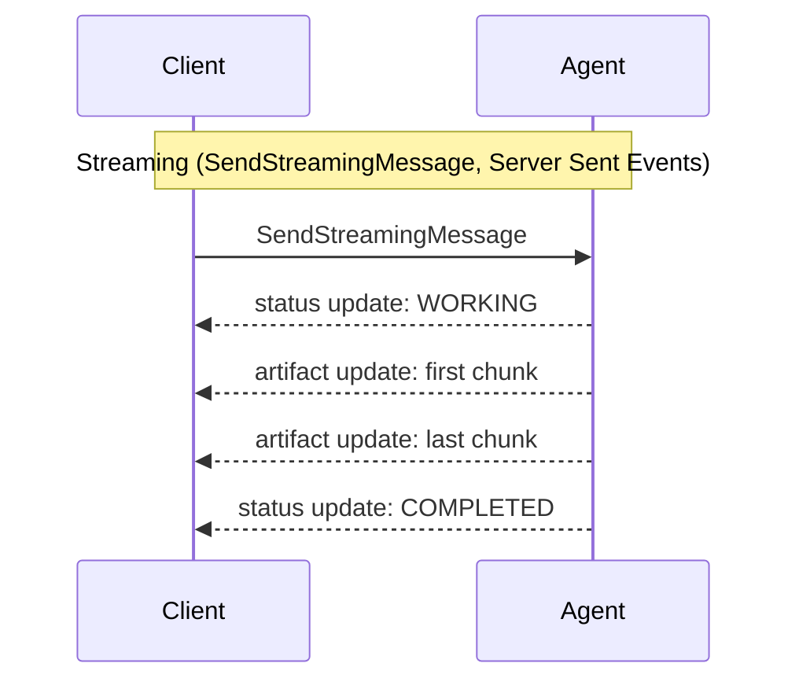

- **Async in v1.0:** `SendMessage` with the option `returnImmediately` returns the task straight away. Later, the client polls with `GetTask` (or lists tasks with `ListTasks`).
- **Streaming** needs `capabilities.streaming: true` on the card. Updates arrive as `TaskStatusUpdateEvent` and `TaskArtifactUpdateEvent`. If the connection drops, `SubscribeToTask` reconnects to a running task.
- **🔭 Push notifications** need `capabilities.pushNotifications: true`. The client registers a webhook URL (`CreateTaskPushNotificationConfig`), and the agent sends updates there.

**Example**
A price checker scanning 2,000 products streams "250 done, 500 done..." to the report writer, instead of making it wait in silence.

**Where it's used**
Chat UIs (streaming), batch jobs (async), and overnight workflows (push notifications).

**Common mistake**
Calling a streaming method on an agent whose card says `streaming: false`. Always check `capabilities` first.

**Interview questions**
1. **Q:** Sync vs async? **A:** Sync waits for the result; async returns a task id and you check later.
2. **Q:** How does A2A stream? **A:** With Server Sent Events, sending status and artifact updates.
3. **Q:** How do you know an agent supports streaming? **A:** `capabilities.streaming` is true in its Agent Card.
4. **Q:** What are push notifications? **A:** The agent calls the client's webhook when the task changes.
5. **Q:** When would you use push over streaming? **A:** For very long tasks where keeping a connection open is not practical.

**In one line**
Wait, check later, watch live, or get a call back.

---

## 10. JSON-RPC: the messages on the wire

**What it is**
The SDK hides it, but underneath, A2A requests are structured messages. The most common binding is **JSON-RPC 2.0 over HTTP**. A2A v1.0 also supports **gRPC** and **HTTP+JSON (REST)** bindings, listed in the card's `supportedInterfaces`.

**How it works**
Both sides must agree on four things: **which operation**, **what data**, **how the request is identified**, and **how the reply looks**. JSON-RPC gives exactly that: `method`, `params`, `id`, and `result` or `error`.

```json
{
  "jsonrpc": "2.0",
  "id": "1",
  "method": "SendMessage",
  "params": {
    "message": {
      "messageId": "f1c2...",
      "role": "ROLE_USER",
      "parts": [{ "text": "When will my books arrive?" }]
    }
  }
}
```
The HTTP request also carries the header `A2A-Version: 1.0`.

JSON-RPC methods in v1.0:

| Method | What it does |
|---|---|
| `SendMessage` | Send a message, get back a task or a message |
| `SendStreamingMessage` | Same, but stream updates |
| `GetTask` | Read a task's current state |
| `ListTasks` | List tasks |
| `CancelTask` | Ask the agent to stop a task |
| `SubscribeToTask` | Reconnect to the stream of a running task |
| `GetExtendedAgentCard` | Get a fuller card after authentication |
| `Create / Get / List / DeleteTaskPushNotificationConfig` | Manage webhooks for push notifications |

Error codes you will meet:

| Code | Meaning |
|---|---|
| -32700, -32601, -32602 | Standard JSON-RPC: parse error, method not found, invalid params |
| -32001 | Task not found |
| -32009 | Version not supported |

**Example**
My hand written demo builds exactly this JSON with plain Python, and the official SDK client can talk to it. That proves the format matches.

**Where it's used**
Debugging, writing an agent in a language without an SDK, and understanding what the SDK does for you.

**Common mistake**
Mixing versions. In **v0.3** the method was `message/send`, roles were `"user"`, and parts had a `kind` field. A **v1.0** server rejects those. Also, a request without the `A2A-Version` header is treated as v0.3.

**Interview questions**
1. **Q:** What does JSON-RPC define? **A:** The method, params, request id, and a result or error.
2. **Q:** Name the method to send a message in v1.0. **A:** `SendMessage`.
3. **Q:** Which header sets the protocol version? **A:** `A2A-Version`.
4. **Q:** Name the three bindings in v1.0. **A:** JSON-RPC, gRPC and HTTP+JSON (REST).
5. **Q:** What does error -32001 mean? **A:** Task not found.

**In one line**
Under the SDK, A2A is plain JSON-RPC: a method, params and an id.

---

## 11. Building an A2A agent with the SDK

**What it is**
The official Python SDK (`a2a-sdk`) handles JSON-RPC, routing and task storage. You write the business logic and a small bridge.

**How it works**
Every SDK agent has the same **6 building blocks**:

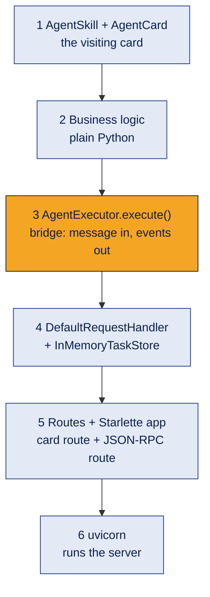

The smallest possible agent, a greeter that replies with a direct message:

```python
from a2a.server.agent_execution import AgentExecutor, RequestContext
from a2a.server.events import EventQueue
from a2a.types import Message, Part, Role

class GreeterExecutor(AgentExecutor):
    async def execute(self, context: RequestContext, event_queue: EventQueue) -> None:
        name = context.get_user_input()                      # 1. read the incoming text
        reply = Message(role=Role.ROLE_AGENT,                # 2. build the reply
                        parts=[Part(text=f"Namaste, {name}!")])
        await event_queue.enqueue_event(reply)               # 3. send it back through A2A

    async def cancel(self, context, event_queue) -> None:
        raise NotImplementedError("Cancel is not supported")
```

Exposing it (blocks 4 to 6):

```python
handler = DefaultRequestHandler(agent_executor=GreeterExecutor(),
                                task_store=InMemoryTaskStore(), agent_card=agent_card)
app = Starlette(routes=[*create_agent_card_routes(agent_card),   # GET /.well-known/agent-card.json
                        *create_jsonrpc_routes(handler, "/")])    # POST / (JSON-RPC)
uvicorn.run(app, host="127.0.0.1", port=9999)
```

The client side:

```python
client = await ClientFactory().create_from_url("http://127.0.0.1:9999")   # reads the card
msg = Message(message_id=str(uuid.uuid4()), role=Role.ROLE_USER, parts=[Part(text="Charan")])
async for response in client.send_message(SendMessageRequest(message=msg)):
    if response.HasField("message"):
        print(response.message.parts[0].text)          # Namaste, Charan!
```

**Example**
The full delivery agent built this way is in the demo repo: [`sdk/delivery_agent_sdk.py`](https://github.com/charanbabareddy-dot/a2a-protocol-demo/blob/main/sdk/delivery_agent_sdk.py).

**Where it's used**
Any Python agent you want to expose over A2A. The executor can wrap a LangGraph graph, a CrewAI crew or plain code.

**Common mistake**
Putting business logic inside the executor. Keep the logic in its own function or class, and keep the executor as a thin bridge. Then you can test the logic without a server.

**Interview questions**
1. **Q:** What does the AgentExecutor do? **A:** It reads the incoming message, runs the agent logic and sends events back through the event queue.
2. **Q:** What does DefaultRequestHandler do? **A:** It handles A2A requests and connects them to the executor and the task store.
3. **Q:** Which two routes does an A2A server need? **A:** The Agent Card route and the JSON-RPC route.
4. **Q:** How does the client find the endpoint? **A:** `ClientFactory.create_from_url()` reads the Agent Card first.
5. **Q:** Why does `send_message` use `async for`? **A:** The response can be a stream of events, not just one reply.

**In one line**
Card, logic, executor, handler, routes, server: six blocks, every time.

---

## 12. Task-aware agents with TaskUpdater

**What it is**
A greeter can reply with one message. Real work needs a **task** with states and artifacts. The SDK's `TaskUpdater` gives simple methods to move a task through its lifecycle.

**How it works**

| TaskUpdater method | Effect |
|---|---|
| `start_work()` | State → `WORKING` |
| `requires_input(message=...)` | State → `INPUT_REQUIRED`, task stays open |
| `add_artifact(parts, name=...)` | Attaches a result |
| `complete(message=...)` | State → `COMPLETED` |
| `failed(...)`, `reject(...)`, `cancel(...)` | Other final states |

```python
async def execute(self, context, event_queue):
    task = context.current_task
    if task is None:                                       # first message: create the task
        task = new_task_from_user_message(context.message)
        await event_queue.enqueue_event(task)
    updater = TaskUpdater(event_queue, task.id, task.context_id)

    pincode = find_pincode(context.get_user_input())
    if not pincode:
        await updater.requires_input(message=updater.new_agent_message(
            [Part(text="Please share a 6 digit pincode.")]))
        return                                             # wait for the client's reply

    result = estimate_delivery(pincode)
    await updater.add_artifact([new_data_part(result)], name="delivery_estimate")
    await updater.complete()
```

**Example**
This is exactly the delivery agent in the demo repo: missing pincode → `INPUT_REQUIRED`, then the reply on the same task → artifact plus `COMPLETED`.

**Where it's used**
Every agent whose work takes time, needs follow up questions, or returns structured results.

**Common mistake**
Creating a new task on every message. Check `context.current_task` first: if the client sent a `taskId`, continue that task.

**Interview questions**
1. **Q:** Why use TaskUpdater? **A:** It moves a task through its states and attaches artifacts with simple calls.
2. **Q:** How do you ask the client for more information? **A:** `requires_input()` with a message.
3. **Q:** How is the result returned? **A:** As an artifact, with `add_artifact()`.
4. **Q:** How does the executor know it's a follow up? **A:** `context.current_task` is already set.
5. **Q:** Which part type suits structured results? **A:** A `data` part (JSON).

**In one line**
TaskUpdater turns a reply into tracked work: working, ask, attach, complete.

---

## 13. Two agents working together

**What it is**
The real point of A2A: one agent **delegates part of its work** to another independent agent.

**How it works**
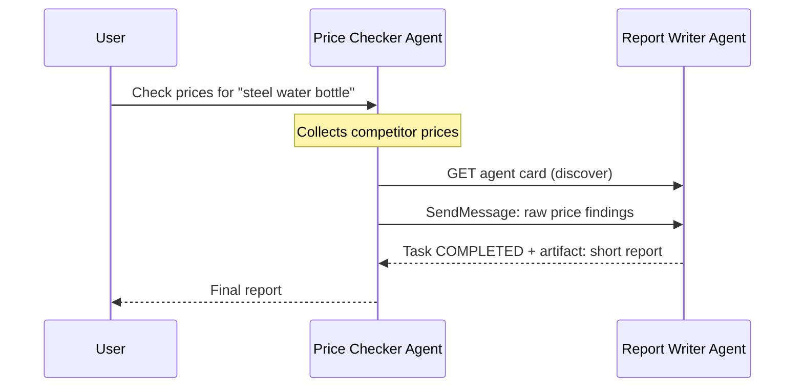

Each agent is its own A2A server with its own card and port. The first agent acts as a **client** of the second.

Steps:
1. The user asks the price checker.
2. The price checker collects findings (in a real system: web search, a database, or MCP tools).
3. It discovers the report writer through its Agent Card.
4. It sends the findings as an A2A message.
5. The report writer returns a summary as an artifact.
6. The price checker returns the final answer to the user.

**Example**
An online seller asks for a daily price report. The price checker (team A) gathers 30 competitor prices. The report writer (team B) turns them into five clear bullet points with the cheapest and the average price.

**Where it's used**
Research then summary, data collection then analysis, drafting then review.

**Common mistake**
Assuming the second agent's output is always right or safe. Check the task state and validate the artifact before using it. Also, start with simple Python logic in each agent so you can test the A2A flow before adding LLMs and live search.

**Interview questions**
1. **Q:** How does one A2A agent call another? **A:** It acts as a client: reads the other agent's card and sends a message.
2. **Q:** Does each agent need its own server? **A:** Yes, with its own card and endpoint.
3. **Q:** How is the result passed back? **A:** As a task artifact.
4. **Q:** Why test with simple logic first? **A:** To prove the communication works before adding LLM and search complexity.
5. **Q:** What should the first agent check? **A:** The task state and the content of the artifact.

**In one line**
Agent A gathers, agent B shapes, A2A carries the work between them.

---

## 14. Many agents: a client agent that routes work

**What it is**
With several remote agents, a **client agent** reads all their cards and **routes** each request to the agent whose skills match.

**How it works**
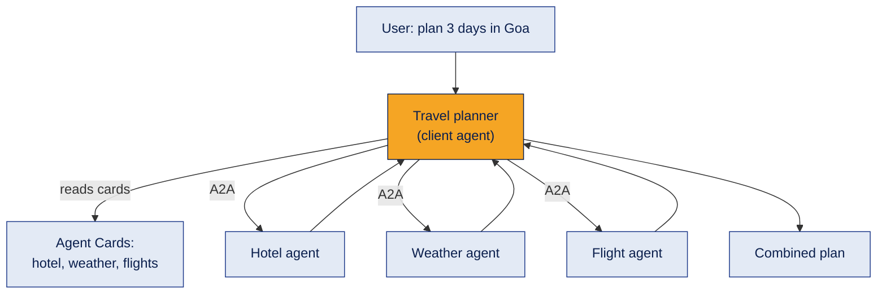

The routing decision can be simple rules (match skill tags) or an LLM that reads the skill descriptions and picks one. Independent calls can run in parallel.

**Example**
"Plan 3 days in Goa": the planner sends one task to the hotel agent and one to the weather agent at the same time, then merges the answers.

**Where it's used**
Personal assistants, support desks that hand off to specialist agents, enterprise agent platforms.

**Common mistake**
Letting the LLM route to agents that were never checked. Keep an **allow list** of trusted agents and set a timeout for each call, so one slow agent does not block everything.

**Interview questions**
1. **Q:** How does the client pick an agent? **A:** By matching the request to skills in the Agent Cards, using rules or an LLM.
2. **Q:** Can calls to different agents run in parallel? **A:** Yes, if they do not depend on each other.
3. **Q:** Why keep an allow list? **A:** So the client only talks to agents you trust.
4. **Q:** Why set timeouts? **A:** One slow agent should not block the whole answer.
5. **Q:** How is this different from a LangGraph supervisor? **A:** The specialists are independent services reached over A2A, not nodes inside one app.

**In one line**
Read the cards, pick the right specialist, combine the answers.

---

## 15. 🔭 Security and trust

**What it is**
A2A carries work between agents that you may not control. Security is not automatic: the protocol **describes** it, and your deployment must **enforce** it.

**How it works**

| Area | What to do |
|---|---|
| Authentication | The card lists `securitySchemes`: API key, HTTP auth (Bearer), OAuth 2.0, OpenID Connect or mutual TLS. Clients send credentials in HTTP headers, not inside messages |
| Authorization | Decide which client may use which skill. `AUTH_REQUIRED` pauses a task until auth is done |
| Extended card | Public card for everyone. A fuller card via `GetExtendedAgentCard`, only after login |
| Transport | Use HTTPS in production |
| Untrusted output | Treat every message and artifact from another agent as **untrusted input**. It could contain prompt injection |
| Card trust | Cards can be signed (`signatures`). Only call agents from a trusted list |
| Limits | Timeouts, rate limits, and size limits on messages and files |

**Example**
The report writer only accepts requests with a valid API key from the price checker, and it never runs instructions found inside the price data.

**Where it's used**
Any A2A agent reachable outside your laptop.

**Common mistake**
Feeding another agent's artifact straight into your LLM as trusted instructions. Wrap it as data, and validate its structure first.

**Interview questions**
1. **Q:** Where does an agent declare its auth requirements? **A:** In `securitySchemes` and `securityRequirements` on the Agent Card.
2. **Q:** Name three supported auth types. **A:** API key, OAuth 2.0 and mutual TLS (also HTTP auth and OpenID Connect).
3. **Q:** What is the extended agent card? **A:** A fuller card shown only to authenticated clients.
4. **Q:** Why treat remote output as untrusted? **A:** It may contain prompt injection or wrong data.
5. **Q:** Does A2A make an agent secure by itself? **A:** No, security depends on the deployment.

**In one line**
A2A can describe security, but you must enforce it and never trust remote output blindly.

---

## 16. 🔭 Production checklist and versions

**What it is**
What changes between a learning demo and a real A2A agent.

**How it works**

| Demo | Production |
|---|---|
| `InMemoryTaskStore`: tasks lost on restart | A database task store (the SDK has `DatabaseTaskStore`) |
| `127.0.0.1`, no auth | HTTPS, auth, rate limits |
| `print()` | Structured logs and tracing (topic 12) |
| One process | Several instances behind a load balancer |
| No tests | Contract tests: does the agent still match its card? |

**Versions.** A2A changes fast:
- **v0.3:** methods like `message/send`, roles `"user"` and `"agent"`, parts with a `kind` field, card with a top level `url`.
- **v1.0:** methods like `SendMessage`, roles `ROLE_USER` and `ROLE_AGENT`, states like `TASK_STATE_COMPLETED`, `supportedInterfaces` in the card, and the `A2A-Version` header.

The Python SDK 1.x includes some compatibility code for v0.3, but a default v1.0 server rejects a v0.3 style request with error -32009 (I tested this).

**Example**
My demo uses an in-memory store and no auth, which is fine for learning. A real delivery agent would store tasks in a database and require an API key.

**Where it's used**
Before deploying any agent other teams depend on.

**Common mistake**
Copying an older tutorial and getting "Method not found" or "Version not supported". Check which version the SDK and the other agent use.

**Interview questions**
1. **Q:** Why replace InMemoryTaskStore in production? **A:** Tasks would be lost when the server restarts.
2. **Q:** Name two v0.3 vs v1.0 differences. **A:** `message/send` became `SendMessage`; roles became `ROLE_USER` and `ROLE_AGENT`.
3. **Q:** What is a contract test? **A:** A test that checks the agent still behaves as its card promises.
4. **Q:** How do you see what an agent did? **A:** Logs and tracing.
5. **Q:** What causes error -32009? **A:** The client and server use different protocol versions.

**In one line**
Persist tasks, secure the endpoint, log everything, and match versions.

---

## 17. Common errors and cheat sheet

**Common errors**

| Error | Likely cause | Fix |
|---|---|---|
| `Method not found` | Old v0.3 method name like `message/send` | Use `SendMessage` |
| `Version not supported` (-32009) | Missing or wrong `A2A-Version` header | Send `A2A-Version: 1.0`, or use the SDK client |
| `Task not found` (-32001) | Wrong task id, or the server restarted with an in-memory store | Use the right id; use a database store |
| Agent "forgets" the earlier question | Follow up sent without `taskId` | Reuse `taskId` and `contextId` |
| Connection refused | Server not running, or wrong port | Start the server; check the URL in the card |
| Numbers come back as `2.0` | Data parts are JSON, the SDK returns floats | Convert with `int()` |
| `Address already in use` | Port taken by an old server | Stop it, or change the port |

**Cheat sheet**

```text
Discover   GET  /.well-known/agent-card.json
Send       POST /  {"method": "SendMessage", "params": {"message": {...}}}   header A2A-Version: 1.0
Continue   same call, with "taskId" and "contextId" inside the message
Check      {"method": "GetTask", "params": {"id": "<task id>"}}
Stream     SendStreamingMessage (needs capabilities.streaming = true)

Message  = one turn (ROLE_USER / ROLE_AGENT), made of parts
Part     = text | data | url | raw
Task     = tracked work with a state
Artifact = the result
Context  = groups tasks into one conversation

LLM → reasoning   MCP → agent to tool   A2A → agent to agent
```

**Demo**

The [a2a-protocol-demo](https://github.com/charanbabareddy-dot/a2a-protocol-demo) repo has the same Shop Assistant and Delivery Agent built twice: once with plain Python (so you can see the JSON) and once with the official SDK. The two versions work with each other in every combination.

[← Back to Multi-Agent Systems](README.md) · [← All topics](../README.md)
