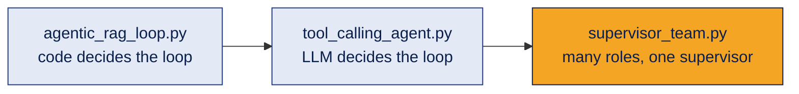

# Demos · Multi-Agent Systems (Part I)

Three small, runnable demos for the concepts in [topic 08](../README.md).

| File | What it shows | Concepts |
|---|---|---|
| [`agentic_rag_loop.py`](agentic_rag_loop.py) | A college FAQ assistant that checks its own evidence, refines its search and stops at a retry limit | Agentic RAG, decision loop, evidence check, state, honest "not found" |
| [`supervisor_team.py`](supervisor_team.py) | A supervisor and three specialist agents plan WhatsApp ordering for a small bookstore | Roles, output contracts, supervisor review, bounded revision, call counting |
| [`tool_calling_agent.py`](tool_calling_agent.py) | The same college FAQ, but the LLM decides when to search by calling a tool | Tool calling, `bind_tools`, tool messages, round limit, off-topic test |

`college_faq.py` holds the made-up FAQ shared by Demo 1 and Demo 3.



## How to run

1. Install Python 3.10 or newer.
2. Open a terminal in this `demos` folder and install the libraries:
   ```bash
   pip install -r requirements.txt
   ```
3. Copy `.env.example` to a new file named `.env` and put your own OpenAI API key in it.
4. Run a demo:
   ```bash
   python agentic_rag_loop.py
   python supervisor_team.py
   python tool_calling_agent.py
   ```

**Safety:** your key lives only in `.env`. The repo's `.gitignore` stops `.env` from being uploaded. If a key is ever exposed, revoke it and create a new one first.

**Cost:** each run makes a small number of API calls (Demo 2 prints the exact count). Check your provider's current pricing.

## What to look for

**Demo 1**
- The trace prints every attempt: the query used, how many new chunks it found, and the decision.
- For the placement salary question, the information is not in the FAQ. The agent should stop and say it could not find it, instead of inventing a number.
- At the end, compare with the one-search traditional RAG answer.

**Demo 2**
- The log shows whether the supervisor approved the plan or sent it back.
- The plan can be sent back only once (`MAX_REVISIONS = 1`), so the run always ends.
- The LLM call count shows the cost of adding agents: between 5 and 8 calls for one task.

**Demo 3**
- Each round prints the tool call the model asked for and the query it chose.
- The two part question may need one search or two: the model decides.
- The placement question should end with "not in the FAQ", and the cricket question with a polite refusal instead of an answer from memory.
- Compare with Demo 1: there, your code decided when to search again.

## Good to know
- Outputs change from run to run because LLMs are probabilistic. Your results may differ from anyone else's.
- The control flow in all three demos was tested with a fake model, so the loop, retry limit, early stop and revision limit are checked. The live LLM answers depend on the model you use.
- The FAQ and bookstore are made-up examples for learning.
- These are learning demos, not production code. A real system would add evaluation, tracing, permissions and error handling (later topics).

## Try this yourself
1. Change `MAX_ATTEMPTS` to 1 in Demo 1. What happens to the two part question?
2. Add a new FAQ entry about placements and run the salary question again.
3. In Demo 2, set `MAX_REVISIONS = 0`. How many calls does it make now?
4. Add a fourth specialist, for example a "Pricing Analyst", and pass its report to the supervisor.
5. In Demo 3, delete rule 5 from the system prompt and ask the cricket question again. What changes?

[← Back to topic 08](../README.md)
